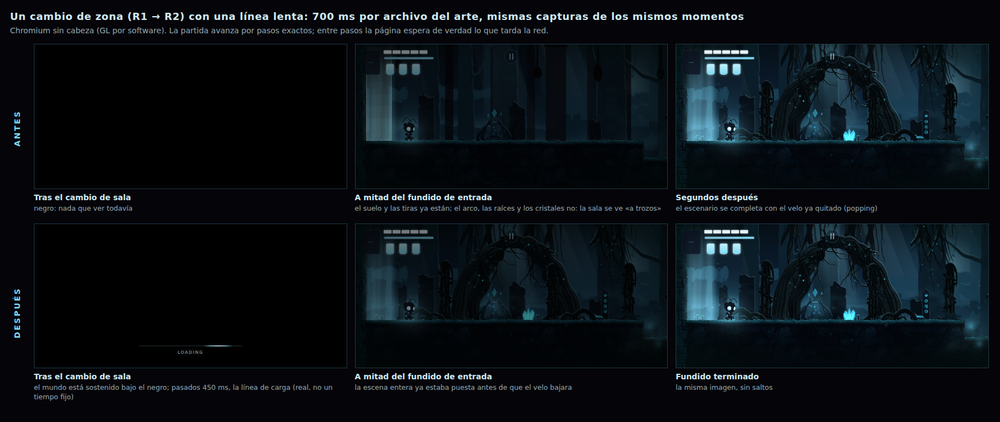

# Prompt 13 — Las transiciones entre zonas: el escenario nuevo se enseña entero o no se enseña

> **Lo que pasó.** El usuario pidió «un sistema profesional de transición y carga de zonas»: al pasar de un sector a otro el escenario aparecía **a trozos** (primero el suelo y algunos objetos, después los detalles), lo que hacía que el juego pareciera incompleto. Pidió **averiguar la causa real antes de tocar código**, que la transición estuviera **atada al estado real de preparación del escenario** (no un negro de duración fija), carga anticipada si era posible, un indicador de carga **solo si la espera se nota** (y una barra con porcentaje **solo si se puede medir de verdad**), que un fallo de carga no dejara al jugador en negro, y que nada de lo que ya funcionaba se rompiera. Y: **«no modifiques ni reemplaces el arte original del protagonista ni las animaciones»**.
> **Causa** (medida, no supuesta): el fundido de una transición dura **0.53 s fijos** (12 + 6 + 14 *ticks*) y **no sabe nada** de si el arte de la sala siguiente está en memoria; la sala nueva se construía como *blockout* y se **vestía después**, de forma asíncrona y **en dos etapas** (primero el suelo, las plataformas y las tiras de fondo; las capas de la escena solo cuando su JSON llegaba). Con una línea que tarda 400 ms por archivo, la sala nueva se veía **sin vestir 1.2 s** (≈ 0.8 s con el velo ya casi a cero); con 1.5 s por archivo, **4.4 s** de *blockout* ([§1](#1--qué-provocaba-el-popping-medido)).
> **Qué se hizo:** la simulación **no se toca** (el cambio de sala sigue siendo un solo paso bajo el negro, con los mismos 32 *ticks*): lo que cambia es que **el mundo se sostiene** —no se le pide el siguiente *tick*— desde el cambio hasta que el arte de la sala está en memoria, su vista se ha puesto en el escenario **entera, de una vez**, y se ha dibujado un par de fotogramas **sin que nadie mire**; después el fundido sale de una imagen que ya está. El arte de la sala siguiente se pide **al tocar la salida** y, si el héroe **camina hacia una salida abierta**, **antes**, en silencio, sin cambiar lo que la sala actual retiene. Si la espera se nota (**> 450 ms**) aparece, bajo el negro, **una línea fina de luz cian con el porcentaje real de bytes recibidos** (o una luz que espera, si el servidor no dice cuánto pesa). Si el arte falla o no llega en **10 s**, el juego sigue como pueda: **nadie se queda en negro** ([§2](#2--qué-se-hizo-y-por-qué-así)).
> **Lo que no se tocó:** `GameSession`, `RoomTransition`, `DeathFlow`, el combate, la física, las colisiones, las habilidades, las botellas, los *checkpoints*, los controles táctiles, **el arte y las animaciones del protagonista** (`hero-sheet.png`, `hero-portrait.jpg`, `art/player/**`, `public/art/player/**`: byte a byte los mismos) y los escenarios. **Una partida es idéntica con una línea lenta y con una rápida** (posición, vida, magia, banderas, enemigos y *ticks*: lo comprueba el E2E).
> **Lo que no se puede afirmar:** que **se vea bien en un dispositivo real** (todo se midió en Chromium sin cabeza con GL por software, que va a ≈ 10 fotogramas por segundo: los números absolutos dependen de la máquina; lo que se comprueba es la **relación**), y qué tal se porta **la subida de las texturas a la GPU** de un teléfono de gama baja ([§7](#7--límites-reales)).

---

## 1 · Qué provocaba el popping (medido)

**Cómo se hace hoy un cambio de zona** (leído en el código antes de tocarlo): `GameSession.checkExits` → `RoomTransition` (`fadeOut 12 · swap · hold 6 · fadeIn 14` *ticks*, temporizadores de la simulación) → el *swap* descarga la sala vieja y construye la nueva **en un solo paso** y emite `room:loaded` → `Game2D`: `roomDirty` → `buildRoomView()` (el *blockout* de la sala) → `dressRoom()` **asíncrono** (espera `art.enterZone`, luego `RoomArtView.build`, luego `cover` y el vestido de las entidades). Desde `transition:started` ya se llamaba a `art.enterZone(destino)`: era una **mitigación**, pero **sin ninguna garantía** de que terminara antes del *swap*.

**Las causas** (cada una, comprobada):

| # | Causa | Qué se veía |
|---|---|---|
| 1 | **Los tiempos del fundido son fijos** (0.53 s) y **no están atados a la preparación**: nada espera al arte | con una línea lenta o la primera visita a una sala, el velo sube **sobre el *blockout*** |
| 2 | La sala nueva **se construye como *blockout* y se viste después** (de forma asíncrona, tras el *swap*) | rectángulos planos y una cápsula, un instante o varios segundos |
| 3 | `RoomArtView.build` ponía **primero** lo que viene de los datos de la sala (suelo, plataformas, puertas, tiras de fondo) y **solo después de un `await`** las capas de la escena; y el *blockout* **no se cubría hasta el final** | «el suelo y algunos objetos primero, los detalles después» (y, entre medias, el suelo del *blockout* **y** el del arte a la vez) |
| 4 | Las vistas de las entidades nacían como formas procedurales y se vestían **después** de la sala; la del jefe es un *chunk* aparte | enemigos que «cambian de piel» a la vista |
| 5 | La carga era una **cascada de peticiones en serie** (manifiesto del paquete → página de atlas → archivo de la escena) y la GPU recibe las texturas **en el primer dibujo** | espera más larga de la necesaria, y un tirón en el primer fotograma |

**Medición** (Chromium sin cabeza con GL por software ≈ 10 fotogramas/s, servidor de desarrollo; un grabador por fotograma de animación apuntaba la fase de la transición, la opacidad del velo, si la sala estaba vestida y cuántos hijos tenía cada capa que el arte viste; la primera visita a R2 desde R1, con el arte retrasado):

| Línea (por archivo del arte) | Sala nueva **vestida** tras el *swap* | Fotogramas con la sala nueva **a la vista** (velo < 0.98) y **sin vestir del todo** |
|---|---|---|
| rápida (local) | durante el negro (0 ms después) | **0** |
| **400 ms** | **1 194 ms** (el velo ya está en ≈ 0.1 a los 350 ms) | **9** |
| **1 500 ms** | **4 424 ms** | **50** |

Y entre medias, la capa «a trozos» que se ve: con 400 ms, a ≈ 1.46 s la escena de R2 tenía `terrain 4 · far 2 · mid 2 · near 2 · foreground 1 · luz 5` frente a `6 · 2 · 4 · 4 · 2 · 6` de la sala entera (el suelo y las tiras ya estaban, las capas de la escena no), y el *blockout* seguía dibujado debajo.

## 2 · Qué se hizo y por qué así

**La decisión de fondo: el mundo se sostiene, no el reloj.** Sostener la transición en la simulación (alargar el negro con otro temporizador) habría hecho que **cuándo ocurre el siguiente *tick*** dependiera de la red: no es determinista. En su lugar, **`Game2D` deja de pedirle `tick()` a la sesión** mientras la sala nueva no se puede enseñar entera (el mismo mecanismo que el telón de arranque y la pausa). La sesión no sabe que existe: los *ticks* que vienen después son los mismos **cuando vengan**. Por eso `RoomTransition`, `GameSession` y `DeathFlow` **no cambian**, y los E2E de repetición y los de determinismo siguen valiendo.

```
toca la salida ─▶ transition:started ─▶ prepareArrival(destino)  [arte, escenas, vistas del jefe]    (el viejo se funde: 12 ticks)
                                              │
               ... fin del fundido de salida: el swap (la sim ya está en la sala nueva, bajo el negro)
                                              ▼
 room:loaded ─▶ arrive(): ¿hay un negro que tape el cambio? (transición o derrota) ── sí ─▶ EL MUNDO SE SOSTIENE
                                              │
       cada fotograma: ¿el arte del destino está (o falló, o pasaron 10 s)?  no ─▶ espera (la luz aparece a los 450 ms)
                                              │ sí
                          buildRoomView(): blockout + vestido ENTERO en la misma llamada  (RoomArtView.buildNow)
                                              │
                      2 fotogramas dibujados con la sala nueva, bajo el negro (la GPU recibe las texturas fuera de vista)
                                              ▼
                  el mundo sigue: hold 6 ticks · fundido de entrada 14 ticks (de una imagen que ya está)
```

- **El vestido de la sala es de una vez** (`RoomArtView.compose`, síncrono; `buildNow` cuando todo está en memoria): el suelo, las plataformas, las puertas, las tiras, las capas de la escena y los *handles* de las entidades entran en el escenario **en el mismo paso**, y el *blockout* suelta lo que el arte cubre **en la misma llamada**. Ya no hay un momento con la mitad. Es la causa 3 corregida de raíz (no tapada con un negro), y vale también cuando la sala se carga por otra vía.
- **«Listo» es el estado real de la biblioteca**, no un tiempo: los paquetes de la zona **enteros** en memoria (`heldPacks` ya no ofrece un paquete cuyos conjuntos siguen en camino, ni uno traído por adelantado), las escenas **leídas** (`ArtLibrary.sceneNow` / `readScenes`) y, si la sala tiene jefe, el código que lo dibuja.
- **Carga anticipada** (`ArtLibrary.prefetch`, `releaseAhead`; `presentation/arrival.roomAhead`): si el héroe **camina hacia una salida abierta** (≤ 42 m, a más de 0.75 m/s hacia ella; una salida que exige una bandera que no tiene no cuenta) el arte de lo que hay detrás se trae **en silencio**: sus paquetes **no pasan a ser «los retenidos»** (una lista aparte, `ahead`), así que **la sala actual no cambia en nada**; al llegar, `enterZone` **los toma sin pedir un archivo**; si el héroe se aleja (> 64 m) se **devuelven**. Un paquete ya retenido o que arranca con el juego **no se vuelve a pedir**; el límite es el presupuesto de memoria residente (96 MiB), y **no se hace con Ahorro de datos ni en un dispositivo que dice tener ≤ 2 GB**: allí se espera en el negro, como antes.
- **El fundido no empieza «al acercarse».** Oscurecer la pantalla porque el héroe se aproxima a una salida (que puede dar media vuelta) estorbaría al juego; lo que se hace al acercarse es **cargar en silencio**. El fundido empieza **al tocar la salida**, como siempre, y si el arte **aún** no está, el negro **espera**.
- **Los fallos no atrapan.** La biblioteca **nunca falla** (devuelve `null` y lo anota): un paquete que no se pudo traer es «terminó» y la sala se construye como puede (con el *blockout* donde falta arte); un paquete **sin ningún conjunto** ya no se queda «retenido» (el siguiente intento lo vuelve a pedir: **un fallo de la carga anticipada no puede dejar una zona sin su paquete**); una **escena** que no se pudo traer **no se recuerda** como «no hay escena» (antes sí: un fallo de red la dejaba sin escena toda la sesión). Y a los **10 s** (`?arrival=<ms>` en los tests) el mundo sigue de todos modos.
- **Lo mismo para la derrota** que devuelve al héroe a **otra sala** (el negro de la derrota tapa el cambio): se sostiene igual, y el indicador de carga se ve **por encima** del texto de derrota.
- **Dos fotogramas a oscuras** (`ARRIVAL.warmFrames`): el primer dibujo es donde la GPU recibe las texturas; se hace antes de que el velo baje, para que el tirón no coincida con la revelación.

**El indicador** (`ui/overlays/ArrivalIndicator` + `arrivalIndicatorModel` puro): **nada** durante los primeros **450 ms** de espera —«no agregues una pantalla de carga cuando el cambio es instantáneo»: con la carga anticipada, el caso normal no la ve nunca—; después, sobre el negro, **una línea de 2 px de luz cian con brillo y, debajo, el porcentaje en minúsculas espaciadas**, abajo al centro dentro del área segura, por encima del texto de derrota (`z-index 41`), sin capturar toques. **El porcentaje es el real**: `artIO.readBody` lee la respuesta como una corriente y cuenta los **bytes que llegan** frente a `Content-Length` (si el servidor no dice cuánto pesa o la respuesta va comprimida, **no hay número**: una luz recorre la línea y solo dice «cargando»); la línea **nunca retrocede** y **nunca dice 100 %** mientras espera (lo último es armar la sala). Con `prefers-reduced-motion` la luz **no se mueve**. Las palabras vienen del traductor (`arrival.loading`: «Cargando» / «Loading»); `role="progressbar"` con `aria-valuenow`.

## 3 · Los números, en un solo sitio

`ARRIVAL` (`presentation/arrival.ts`): **espera máxima 10 000 ms** (como el telón de arranque), **gracia 450 ms** antes de enseñar nada, **2 fotogramas** a oscuras. `PREFETCH`: **42 m** para empezar, **64 m** para devolverlo, **0.75 m/s** para contar como «caminar hacia». Un héroe que acaba de **cruzar** una salida y está pegado a ella **no** trae de vuelta lo que dejó hasta que se gira hacia ella.

## 4 · Pruebas

**Unitarias (+59: 2617 → 2676 en 169 archivos):** `arrival.test` (la máquina de estados con reloj explícito: una preparación por sala, una respuesta antigua no vale, el mundo se sostiene desde el cambio, «listo» = el arte, fallo = sigue, 10 s = sigue, 2 fotogramas, cancelar suelta todo; y la regla de «caminar hacia» con histéresis), `arrivalIndicator.test` (la gracia, el progreso que no retrocede ni dice 100, la luz quieta con movimiento reducido, el DOM, el idioma), `artLibrary.test` (+19: `sceneNow`/`readScenes`, una escena que falla se vuelve a pedir, **la carga anticipada no contamina `heldPacks`, `enterZone` la toma sin pedir nada, devolverla, techo de memoria, un fallo no deja la zona sin su paquete**, el progreso de bytes), `artIO.test` (la lectura por corriente: bytes reales, sin tamaño, comprimido, nunca más del anunciado — **encontró un error real**: bloquear el cuerpo antes de decidir si leerlo por corriente), `options.test` (`?arrival=`). Las 2617 anteriores, **intactas**.

**E2E `arrival`** (nuevo, 8 secciones, dentro de un navegador, cada página con **su propia red**: retraso por archivo, rechazo, silencio, ancho de banda limitado con CDP):

| | Qué comprueba |
|---|---|
| **A** | línea lenta (600 ms por archivo), **en tiempo real**: del escenario nuevo **no se ve ni un fotograma incompleto** (cada fotograma lleva la opacidad del velo y la firma de las capas); el mundo **no avanza un solo *tick*** mientras espera; el negro dura lo que tarda la carga (**≈ 2.0 s**, mundo sostenido **≈ 1.8 s**); el indicador sale, **bajo el negro**, y se va; el fundido de salida y el de entrada son **una rampa limpia cada uno, sin parpadeo**; el velo **no empieza a bajar antes** de soltar el mundo; la imagen es negra salvo la línea |
| **B** | **la misma partida con la línea lenta y con la rápida**, *tick* a *tick* (posición, vida, magia, banderas, enemigos, 90 *ticks*): **idénticas**; la transición dura 32 *ticks* en las dos |
| **C** | caminar hacia la salida trae el arte **antes** (los 4 archivos de R3 se pidieron **3.5 s antes** de tocar la salida, ninguno dos veces): la llegada espera **≈ 0.12 s** y **no enseña indicador**, con 400 ms por archivo; al darse la vuelta se **devuelve** y lo de R2 se queda |
| **D** | arte **rechazado** (el mundo sigue a los 0.1 s, sala como pueda, héroe libre) y arte que **nunca contesta** (`?arrival=1500`: se rinde a los **1.6 s**, héroe libre) |
| **E** | **seis cambios de zona seguidos** en línea lenta: todos terminan, **0 fotogramas incompletos**, la escena es la de la sala cargada directamente (ni sobras ni duplicados), **ningún temporizador pendiente**, **29.4 MiB** residentes (< 40) |
| **F** | **260 KB/s** reales: **≈ 40 muestras** del porcentaje, de 0.02 a 0.99, solo crece; la etiqueta dice `98 %` |
| **G** | el indicador cabe en un móvil con *notch* (`?safe=44,47,21,47`) y en escritorio: dentro de la pantalla y del área segura, centrado, bajo, y el negro sigue negro alrededor |
| **H** | una **derrota** que devuelve a R1 desde R3, en línea lenta: el mundo se sostiene (≈ 1.4 s), la línea se ve **por encima** del texto de derrota y R1 vuelve entera |

**Regresión.** Las 49 escenas de E2E anteriores, **sin tocar**, pasan; `tsc`, `assets:check`, la compilación y el presupuesto del arranque (**199.0 KB gz de JS** del primer fotograma, de 200 de presupuesto: **+3.2 KB** por la máquina de estados, el indicador, la lectura por corriente y la lógica de carga anticipada; los *chunks* cosméticos 42.0 KB gz). Detalle de los resultados: [§6](#6--resultados).

## 5 · Archivos

| Qué | Archivos |
|---|---|
| **La llegada** (nuevo, puro) | `src/presentation/arrival.ts` (`ArrivalGate`, `ARRIVAL`, `PREFETCH`, `roomAhead`) |
| **El indicador** (nuevo) | `src/ui/overlays/ArrivalIndicator.ts`, `arrivalIndicatorModel.ts`; `src/i18n/locales/{es,en}.json` (`arrival.loading`) |
| **El vestido de una vez** | `src/render/RoomArtView.ts` (`build` → `compose`, `buildNow`; se quita `prepare`) |
| **La biblioteca** | `src/assets/artLibrary.ts` (`sceneNow`, `readScenes`, `prefetch`, `releaseAhead`, `progress`, `heldPacks` solo paquetes **enteros** y **de la zona**, escenas que fallan no se recuerdan, un paquete sin conjuntos no se retiene), `src/assets/artIO.ts` (`readBody`: bytes reales) |
| **El cableado** | `src/app/Game2D.ts` (`arrive`, `prepareArrival`, `arrivalAdmits`, `watchWayOut`, `buildRoomView`/`applyCover`, el mundo sostenido en `tick()` y en el bucle), `src/app/options.ts` (`?arrival=`), `src/app/testHooks.ts` (`arrival`, y `step` **espera** al mundo sostenido) |
| **Pruebas** | `tests/unit/presentation/arrival.test.ts`, `tests/unit/ui/arrivalIndicator.test.ts`, `tests/unit/assets/artIO.test.ts`, `tests/unit/assets/artLibrary.test.ts` (+), `tests/unit/app/options.test.ts` (+), `tests/helpers/artWorld.ts` (escenas e informes de bytes), `tools/e2e/scenarios/arrival.ts`, `tools/e2e/scenario.ts`, `tools/e2e/run.ts` |
| **Documentación** | este archivo · `docs/ARCHITECTURE-2D.md` §7.3 · `docs/ART-PIPELINE-2D.md` M.17 · `README.md` · `docs/ROADMAP.md` · `docs/img/prompt13/` |

## 6 · Resultados



*Las mismas capturas de los mismos momentos de un cambio de zona (R1 → R2) con 700 ms por archivo del arte. Arriba, la versión anterior: a mitad del fundido de entrada la sala ya se ve (suelo y tiras) pero sin el arco, las raíces ni los cristales, que llegan después. Abajo, ahora: la escena entera ya estaba puesta antes de que el velo bajara, y mientras se esperaba, bajo el negro, la línea de carga.*

| Comprobación | Resultado |
|---|---|
| `tsc --noEmit` | limpio |
| Pruebas unitarias y de integración | **2676 pasan** (169 archivos; 2617 antes: **+59**, ninguna de las anteriores modificada) |
| `assets:check` | limpio |
| Compilación + `bench:bundle` | **199.0 KB gz** de JS del primer fotograma (presupuesto 200); *chunks* cosméticos 42.0 KB gz |
| E2E **producción** (`--prod`), las 50 escenas | **50 pasan, 0 fallan** (con `arrival`, nueva, y las 49 anteriores sin tocar) |
| E2E **desarrollo**, las 50 escenas | **49 pasan** en la pasada completa; `arrival` falló **una vez** por una comprobación **de la propia escena** (comparaba *ticks* absolutos entre dos páginas que corren en tiempo real antes de pausarse; ahora cuenta desde el inicio de la marcha y exige exactamente 90), y **pasa** (las 8 secciones) al repetirla con la corrección |
| Medición del *popping* | **antes** (§1, medido): con 400 ms por archivo, **9** fotogramas con la sala incompleta a la vista; con 1.5 s, **50**. **Ahora** (`arrival` A, a 600 ms por archivo y en tiempo real, y E, seis cambios seguidos): **0** fotogramas incompletos de la sala nueva en todos los casos |

La pasada completa de desarrollo con **las 50 a la vez** se repite en la regresión final del encargo siguiente (Prompt 14): este informe no la da por hecha.

## 7 · Límites reales

- **No está visto en un dispositivo real.** Todo se midió en Chromium sin cabeza con GL por software (≈ 10 fotogramas/s). Lo que se comprueba es lo que no depende de la máquina —**qué se ve en cada fotograma frente a lo que está en memoria**—, no cuánto cuesta la subida de las texturas a la GPU de un teléfono de gama baja (con 2 fotogramas a oscuras debería quedar tapada, pero no está medido allí).
- **Si el arte no llega en 10 s**, la sala se enseña **como *blockout*** y se viste cuando llegue (si llega): en **ese** caso degradado el *popping* sigue siendo posible. Es la salida honesta antes que dejar al jugador en negro; el telón de arranque tiene la misma regla.
- **El porcentaje necesita `Content-Length`** y una respuesta sin comprimir (lo que sirven los alojamientos estáticos para PNG). Sin eso la línea no tiene número: una luz espera. No se inventa un porcentaje.
- **La carga anticipada no se hace** con Ahorro de datos ni en un dispositivo con ≤ 2 GB: allí, el cambio de zona espera en el negro lo que tarde (con el indicador). Es un criterio prudente, no medido.
- **El fundido no empieza «al acercarse»** (ver §2): se carga en silencio y se funde al tocar la salida. Si el usuario quiere oscurecer al aproximarse, es un cambio de diseño, no técnico.
- **No hay audio** en el juego (hay señales, no motor): la llegada no toca nada de sonido, y no hay nada que se pueda duplicar al cambiar de zona.
- **Mientras el mundo se sostiene, la tecla de pausa no responde** (hasta ≈ 10 s en el peor caso; lo normal es cero). *(Corregido en el Prompt 14: la página mira esa pulsación aunque no corra ningún tick; ver [PROMPT14-LOG §3.1](PROMPT14-LOG.md#31--detener-la-simulación-de-verdad).)*
