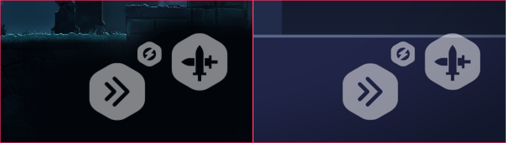
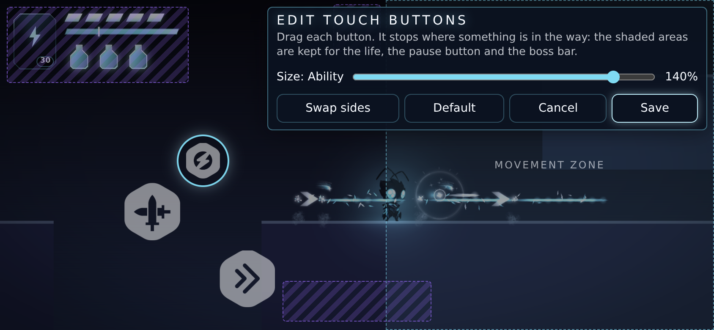
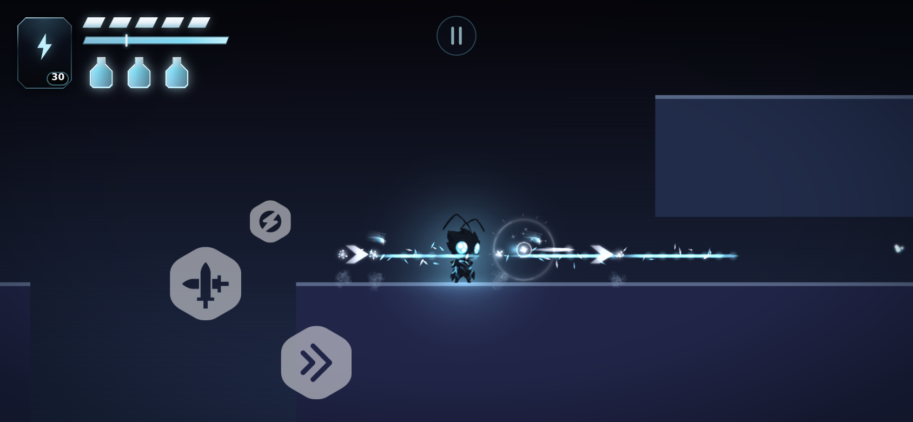

# Prompt 15 — Los botones táctiles de combate: los PNG del artista, la disposición de la referencia y un editor para ponerlos donde cada mano los quiere

> **Lo que pasó.** El usuario pidió implementar los tres botones táctiles de combate —**Dash**, **ataque cuerpo a cuerpo** y **ataque a distancia / magia**— con **los PNG originales** que entregó (nada de redibujarlos, de iconos «parecidos», de filtros ni de cambios destructivos: solo escala proporcional, con los originales intactos), cada uno **conectado a su acción real** del juego (con sus condiciones, duración, enfriamiento, coste y habilidades desbloqueadas; ni mecánicas duplicadas ni imágenes sin efecto), con la **disposición de la imagen de referencia** (orden, distancias y jerarquía relativos, adaptada a todas las proporciones de pantalla) y una sección de **personalización** en Pausa → Configuración → Controles: mover cada botón, cambiar su tamaño, recolocar los tres, ver una vista previa mientras se configura, guardar, restaurar la disposición por defecto y que todo **persista** entre sesiones, con un **modo de edición** que arrastra los botones **sin disparar** el dash, el ataque ni la magia. Reglas duras: **inspeccionar primero y reutilizar lo que hay**, no tocar los PNG, y —textual— *«no des por terminada la tarea si los PNG originales no se están utilizando directamente o si la personalización solo está dibujada, pero no funciona»*.
> **Diagnóstico** ([§1](#1--diagnóstico-lo-que-había-y-lo-que-faltaba)): ya existían la capa táctil en DOM, `TouchSource` con **un dueño único por dedo**, las acciones `attack`/`dash`/`ability` del mismo `InputManager` que el teclado, ajustes persistentes con migraciones y un menú de pausa en un *chunk* aparte. **Faltaban** las imágenes del artista (los botones eran discos de CSS con un trazo de SVG), la disposición de la referencia (había cuatro botones de otro tamaño y otra jerarquía), un botón de Dash que **solo exista si el héroe tiene el dash**, un lugar propio para cada botón (había «lado» y dos desplazamientos del bloque entero) y todo el editor.
> **Qué se hizo:** los tres PNG entran **byte a byte** y se muestran con un `` escalado en proporción ([§2](#2--los-png-originales-entran-sin-tocar)); cada botón llama a la acción real y la cadena entera —dedo → `TouchSource` → acción → héroe— es la del teclado ([§3](#3--cada-botón-llama-a-su-acción-real)); la disposición sale de la referencia, medida, y un solucionador exacto del «lugar libre más cercano» la adapta a cualquier ventana ([§4](#4--la-disposición-de-la-referencia-y-un-modelo-que-la-adapta)); los ajustes pasan a la versión 4, con un lugar y un tamaño por botón y una migración desde la 3 ([§5](#5--ajustes-versión-4-y-su-migración)); un **editor** que arrastra los botones con dedos reales sin que ninguno llegue al juego, una vista previa en Configuración, restaurar y persistencia ([§6](#6--el-editor-y-la-sección-botones-táctiles)); y la convivencia con la pausa y con el escritorio ([§7](#7--convivencia-con-la-pausa-las-zonas-y-el-escritorio)).
> **Lo que no se tocó:** la simulación (ninguna regla del héroe cambió: el dash, el ataque y la magia son los de siempre y los botones solo los piden), el teclado, el ratón y el mando, el arte del protagonista y los escenarios, y **los tres PNG**: sus bytes son los entregados (`0be2c04f…`, `15f3a2a7…`, `dbb1f02a…`; [`src/ui/touch/buttons/README.md`](../src/ui/touch/buttons/README.md)).
> **Lo que no se puede afirmar:** que se **vea y se maneje bien en un dispositivo real** (todo se midió en Chromium sin cabeza con GL por software, con toques de DevTools); que la **comodidad** de la disposición de la referencia con un pulgar de verdad sea la buena (es *la de la referencia*, no una calibrada); ni que los PNG se vean **igual de nítidos** en toda densidad de pantalla (se escalan en proporción desde 2560 × 1440: a un tamaño pequeño el navegador los reduce, y la calidad de ese reescalado es la suya).

---

## 1 · Diagnóstico: lo que había y lo que faltaba

Leído en el código antes de modificar nada (se entregó un diagnóstico breve antes de implementar):

| Sistema | Lo que había | Lo que faltaba / el riesgo |
|---|---|---|
| **Capa táctil** | `ui/touch/TouchControls` (DOM): una zona de movimiento invisible y cuatro controles; `TouchSource` da **un dueño por dedo** y llama a `InputManager` | los botones eran discos de CSS con un trazo SVG (`ui/icons.ts`: `attack`, `dash`); ninguna imagen del artista |
| **Acciones** | `attack`, `dash`, `ability` son acciones del `InputManager`, **las mismas** que las del teclado y el mando; el héroe las lee con *buffers* y reglas propias | el botón de Dash se dibujaba **aunque el héroe no tuviera el dash**; el de Magia dependía de la carta (bien) pero no decía cuándo no se podía lanzar |
| **Disposición** | `computeTouchLayout`: un diseño provisional (Ataque 88, Dash 68, Habilidad 68, chip) y un «bloque» que se mueve entero: lado + dos desplazamientos (`TouchSettings.side/offsetX/offsetY`) | la jerarquía y las distancias **no eran las de la referencia**; no se podía poner **un** botón donde se quisiera; ningún modo de edición |
| **Ajustes** | `SettingsData` v3 con migraciones, `SettingsStore` (nunca lanza, reparación al leer y al escribir), menú de pausa con pantallas | el modelo no tenía lugar ni tamaño **por botón**; la sección táctil era tres controles deslizantes y dos botones de lado |
| **Geometría compartida** | el HUD, el botón de pausa y la barra del jefe (`pauseBox`, `HUD_FOOTPRINT`, `bossBarLayout`) ya se mantenían fuera del camino de los botones | cada uno vivía en su archivo: un lugar elegido por el jugador tiene que respetarlos **todos** |
| **Los PNG** | tres archivos de 2560 × 1440: una placa hexagonal blanca, medio transparente, con el glifo recortado, sobre un lienzo 16:9 casi vacío | **la placa ocupa el mismo rectángulo en los tres** (717, 131, 1182 × 1222 px): el botón es la placa, no el lienzo |
| **Pruebas** | 3021 unitarias, 55 escenas E2E (con toques CDP de varios dedos), 10 clases de ventana × 4 márgenes en `mobileGeometry` | cobertura de lo nuevo por escribir; las escenas `touch`, `mobile` y `settings` leían los ids y la geometría de los controles |

**Riesgos técnicos** identificados: (1) el **presupuesto del arranque en frío** (JS ≤ 200 KB gz; estaba en 197.7 KB y un solucionador de geometría es mucho código: [§8](#8--el-presupuesto-del-arranque-en-frío)); (2) **no repetir** la mecánica: un botón que «hace su propio dash» sería un segundo dash → todo pasa por la acción, no por una copia; (3) un **arrastre** de edición que llegue al juego (pulsar Ataque al recolocarlo) → la capa real se aparta del todo mientras el editor tiene la pantalla; (4) un botón **fuera de pantalla o tapado** por una elección del jugador o por un cambio de ventana (girar, un teléfono con muesca) → el lugar se guarda como **fracción del área segura** y se vuelve a resolver contra la ventana de cada momento; (5) el comportamiento de Chromium con los toques (un `click` que no llega tras un arrastre: [§6.4](#64-lo-que-el-navegador-no-hace-y-cómo-se-resolvió)).

## 2 · Los PNG originales entran sin tocar

- **Los archivos.** `src/ui/touch/buttons/touch-attack.png`, `touch-dash.png` y `touch-magic.png`: **byte a byte los entregados** (SHA-256 y tamaño en [`art/README.md`](../src/ui/touch/buttons/README.md) y en `tests/helpers/touchArt.ts`; comparados con los archivos subidos: idénticos). No hay ninguna copia redibujada, ni una versión «parecida» en SVG, ni una hoja con los tres. El icono `attack`/`dash` del SVG **se quitó** de `ui/icons.ts` (ya no tiene ningún uso).
- **Cómo se muestran** (`ui/touch/art.ts`): un `` del **archivo entero** dentro de una caja que recorta a la placa —el rectángulo `ART_PLATE` (717, 131, 1182 × 1222) es el mismo en los tres, y está comprobado contra los píxeles—; el tamaño es `visual / 1222`, así que **lo único que se hace a la imagen es escalarla en proporción** (16:9 se conserva a la milésima). Nada de `canvas`, `filter`, `mix-blend-mode`, máscaras ni recolores: una prueba lee el código y falla si aparece cualquiera de ellos.
- **Los estados.** *Pulsado*: la caja se hace un 7 % más pequeña (`scale(0.93)`), no se toca el archivo. *No disponible* (el dash recargando, la magia sin magia): la caja al 45 % de opacidad. La opacidad que el jugador elige en Ajustes se aplica a toda la capa. Nada de esto altera un píxel del PNG: es lo que CSS hace con **cualquier** elemento.
- **La carga.** Las imágenes se piden **la primera vez que la capa táctil se muestra**: un escritorio con ratón y teclado no las descarga (la escena `touchEditor` lo comprueba). En producción las sirve el *build* de Vite con *hash* en el nombre.
- **Cómo se comprueba.** `touchArt.test.ts` (12 pruebas: bytes y SHA-256, 2560 × 1440, la placa medida **en los píxeles**, escala proporcional a cualquier tamaño, y que el código no pone filtros ni dibuja otra cosa) y la escena E2E `touchEditor`, sección A: **en el navegador** la página carga exactamente tres PNG, los bytes que recibe tienen el mismo SHA-256, los píxeles que decodifica son los del archivo (muestreados en una rejilla contra el mismo archivo decodificado en Node), y los estilos computados de la imagen y de su caja no llevan filtro, mezcla, transformación ni recolor.

## 3 · Cada botón llama a su acción real

Los botones **no implementan** nada: son otra fuente de entrada. Un dedo sobre el botón → `TouchSource.down(...)` → la acción del `InputManager` (`attack` / `dash` / `ability`), que es **exactamente** la que activan la tecla o el botón del mando → el héroe la lee con las reglas de siempre. Por eso una condición, una duración, un enfriamiento o un coste que cambie mañana vale a la vez para el teclado, el mando y el toque.

| Botón (PNG) | Identificador | Acción | Lo que hace en el juego (reglas reales, no del botón) | Existe cuando | Se ve apagado (45 %) cuando |
|---|---|---|---|---|---|
| **Ataque cuerpo a cuerpo** (`touch-attack.png`) | `touch-attack` | `attack` | `PlayerCombat`: la cadena de golpes (suelo, aire, agachado), su *buffer*, su caja de golpe, su daño y su parada de impacto — los de la tecla | siempre | nunca |
| **Dash** (`touch-dash.png`) | `touch-dash` | `dash` | `PlayerController.canDash()`: exige la habilidad `dash` desbloqueada, que no haya enfriamiento (0.42 s) y, en el aire, los dashes aéreos que quedan (1, +1 con `air_dash`); dura 0.17 s a 21 m/s con 0.13 s de invulnerabilidad | **solo si el héroe tiene el dash** (`abilities.has('dash')`): antes se dibujaba siempre | mientras se recarga (`dashCooldown01 > 0`) |
| **Magia / ataque a distancia** (`touch-magic.png`) | `touch-ability` | `ability` | `SkillRuntime` lanza la carta equipada: el Spirit Bolt cuesta **30 de magia**, 0.3 s entre lanzamientos, proyectil de 2 de daño; sin magia suficiente **no se lanza** | solo con una carta equipada (la regla de siempre: no hay controles sobrantes) | no hay magia para el coste o la carta se recarga (`card.state !== 'ready'`) |
| *Chip de botella* (contextual, ya existía) | `touch-chip` | `bottle` | usa la siguiente botella lista | solo si hay una lista y sirve ahora; **cuelga del botón de Ataque** | — |

- **Un botón «apagado» sigue siendo tocable**: la decisión de si la acción ocurre es del juego (el héroe, el coste y el enfriamiento); el botón solo lo **muestra**. Lo comprueba una prueba: un dedo sobre el botón apagado sigue levantando `abilityHeld`.
- **Una sola vía.** El snapshot `PlayerStatus` ganó `dash: { unlocked, cooldown01 }` (lo que ya sabía el controlador) y `Game2D` lo copia al botón cada fotograma, igual que ya hacía con la carta y las botellas. No hay ningún temporizador, contador ni condición en la capa táctil.
- **La prueba de que es la acción real** (E2E `touchEditor`, sección C, con toques de DevTools): el ataque del botón emite `player:attacked`; el dash emite `player:dashed`, descansa el enfriamiento y el botón lo dice; la magia emite `skill:cast`, gasta 30 de magia, descansa 0.3 s y **no se lanza sin magia**; con el dash sin desbloquear el botón **no está**; y **cuatro dedos a la vez** (movimiento + los tres botones) los pulsan todos y el héroe corre.

## 4 · La disposición de la referencia y un modelo que la adapta

**Medida, no dibujada a ojo.** Sobre la captura de referencia (844 × 390) se midieron los centros y la altura de cada placa; esas medidas pasaron a *dp desde la esquina inferior derecha segura* (`BUTTON_DESIGN` en `input/gestures/TouchConfig.ts`, a la escala `uiScale` de esa pantalla, 819/844):

| Botón | Centro (dx, dy) dp | Diámetro de la placa | En la referencia (px) |
|---|---|---|---|
| Ataque | (−65, −100) | 70 | centro (781, 293), 68 de alto |
| Dash | (−166, −63) | 70 | centro (683, 329), 68 de alto |
| Magia | (−126, −109) | 31 | centro (721.5, 284), 30 de alto |
| Chip de botella | cuelga a 16 dp **sobre** Ataque | 52 | — |

La jerarquía es la de la imagen: **Ataque y Dash grandes, la Magia pequeña** entre los dos y por encima, los tres a la derecha, separados. La escena E2E sección B lee las cajas del DOM en la pantalla de referencia y exige que cada centro esté a **menos de 1.2 px** de la medida y cada placa a menos de 1.2 px de su altura. La imagen [`referencia-y-juego.png`](img/prompt15/referencia-y-juego.png) pone la referencia (izquierda) y el juego (derecha) lado a lado, y [`disposicion-de-la-referencia-844x390.png`](img/prompt15/disposicion-de-la-referencia-844x390.png) es la pantalla entera del juego (844 × 390 a 2×) con la disposición por defecto:

**Cualquier proporción.** Las medidas se escalan con `uiScale = clamp(min(ancho, alto × 2.1) / 844, 0.9, 1.6)` desde la esquina inferior derecha del **área segura** (muesca, isla dinámica, indicador de inicio): de 4:3 a 21:9 el bloque conserva sus proporciones y sus distancias relativas y nunca toca un margen del sistema.

**El modelo** (`ui/touch/layout.ts`, una función **pura** de la ventana y los ajustes — se prueba sin navegador):

- El lugar de un botón es **una fracción del área segura** (x, y de 0 a 1) más **una escala propia** (70 – 150 %) sobre la de todos (80 – 140 %). Un botón que el jugador no ha movido está donde el diseño lo pone **y sigue a la esquina de la pantalla**.
- Cada botón se coloca en el **lugar libre más cercano** a donde se pidió: dentro del área segura (la placa guarda `edgeMargin` × escala de los bordes laterales, donde viven los gestos del sistema), fuera del HUD, del botón de pausa y de la sala que siempre tiene la barra del jefe, y a distancia de los botones ya colocados. «Más cercano» es **exacto**: la región libre está limitada por rectas y arcos, y el punto más cercano de una región a un punto es él mismo, el pie de una perpendicular o una esquina, así que el solucionador **prueba todos esos puntos** y no busca ninguno (`nearestFree`).
- Si la ventana no puede con todo lo pedido, **el tamaño cede primero** (es una preferencia; dónde pueden estar es una promesa): baja hasta lo mayor que cabe, con un suelo de 0.72 en el que cada zona táctil sigue midiendo ≥ 44 px; y solo entonces ceden las demás cosas, **de una en una y en este orden**: la sala de la barra del jefe, el botón de pausa, el HUD, la separación entre botones. El último escalón deja solo el área segura, y siempre hay lugar en ella.
- La **zona táctil** de un botón es su placa más un margen (8 dp, nunca menos de un dedo: 44 px), repartido en partes iguales cuando dos placas están cerca, y **nunca se solapa** con la de otro.
- La **zona de movimiento** se pone en el lado contrario al centroide de los botones (30 – 46 % del ancho útil) y cede ante ellos.
- Es **idempotente**: un lugar que esta función dio, vuelto a dar, es donde el botón se queda (la edición guarda lo que ve).

## 5 · Ajustes: versión 4 y su migración

`SettingsData` v4: `touch: { scale, opacity, buttons: { attack?, dash?, ability?: { x, y, scale } } }`. Sustituye a `side`, `offsetX` y `offsetY` (el bloque entero) por un lugar y un tamaño por botón; los botones que no están en `buttons` están donde el diseño los pone.

- **Reparar**: solo los tres botones conocidos, cada uno con una posición finita dentro de 0 – 1 (un botón con una posición que no es un número **no está colocado**, no se inventa), un tamaño dentro de los límites (uno fuera de ellos es el de diseño), a cuatro decimales (lo guardado es lo que vuelve) y en un orden fijo (los mismos ajustes son el mismo texto). Se repara al leer **y** al escribir.
- **Migración 3 → 4** (`SETTINGS_MIGRATIONS[3]`): quien no tocó nada (derecha, sin desplazamiento) conserva el diseño; quien sí lo hizo recibe sus tres botones **del mismo lado y tan adentro y arriba como los tenía**, calculados sobre la pantalla de referencia (844 × 390) con los lugares del diseño. Hay un archivo dorado (`tests/unit/save/golden/settings.v4.json`) y las migraciones desde 1 y 2 siguen funcionando: la escena E2E `mobile` carga archivos v2 y v3 **en la página real**.
- `SettingsStore.update` mezcla `touch` superficialmente, de modo que `buttons` se **reemplaza entero**; «restaurar» es `buttons: {}`.

## 6 · El editor y la sección «Botones táctiles»

### 6.1 · Dónde está

Pausa → **Controles** → sección «Botones táctiles» (solo donde hay capa táctil): una **vista previa** (una pantalla en miniatura con los tres PNG a escala, el HUD y el botón de pausa tenues y la zona de movimiento: lo que el editor cambiará y lo que «restablecer» devuelve), los controles de **tamaño** y **opacidad** de siempre, **Editar disposición** y **Restablecer disposición**.

### 6.2 · El modo de edición

`ui/touch/TouchEditor`. Al abrirlo, **la capa táctil real se aparta del todo** (`setSuspended`: no se ve, suelta todo lo que sostenía y su `pointerdown` no llega a `TouchSource` aunque alguien lo dispare) y el editor dibuja **sus propias copias** de los tres botones con los mismos PNG y el mismo código (`art.ts`). **Nada de lo que se hace dentro llega al juego**: un dedo sobre un botón lo **mueve**; no ataca, no hace dash, no lanza.

- **Arrastrar**: un dedo toma un botón, que se queda con el punto por el que se cogió bajo el dedo; hasta 4 px es un toque que solo **elige** el botón. El botón **se detiene** contra lo que no puede ocupar (el borde del área segura, el HUD, el botón de pausa, la sala de la barra del jefe, los otros botones); esas zonas se ven rayadas. El botón que está en la mano se coloca **el último**, de modo que es él el que cede, no los demás.
- **Tamaño**: un deslizador por botón (70 – 150 %), hasta donde la ventana lo permite (baja de a 0.05 hasta el primer tamaño que cabe).
- **Teclado**: las flechas mueven el botón elegido (8 px; con Mayús, 32); Escape lo cierra sin guardar.
- **Cambiar de mano**: «Invertir lados» espeja los tres botones de golpe.
- **Restablecer**: vuelve al diseño de la referencia.
- **Guardar / Cancelar**: nada se guarda hasta **Guardar**; **Cancelar**, Escape y cerrar el menú descartan. Se guarda el lugar de **cada botón que se tocó** (los demás siguen siguiendo al diseño).
- **Vista previa mientras se configura**: el editor *es* la vista previa: el lugar y el tamaño de cada botón se ven al instante, con las mismas reglas del juego, y lo que se ve es lo que se guarda.

Y el juego, tras pulsar «Guardar», con los botones donde el jugador los dejó (aquí para la mano izquierda):

### 6.3 · Guardado y persistencia

«Guardar» llama al mismo `setTouch` que cualquier otro ajuste: `Game2D` lo aplica **al instante** a la capa real y `SettingsStore` lo guarda (con respaldo, comprobación de lectura y reparación). Persiste entre **recargas**, **cambios de zona** y **otra partida** (los ajustes son del jugador, no de la partida): la escena E2E sección F lo comprueba con la página real.

### 6.4 · Lo que el navegador no hace, y cómo se resolvió

Chromium **no fabrica un `click`** para un toque que llega justo después de un arrastre sobre una superficie `touch-action: none` ni para un toque que es **uno de dos dedos** (reproducido en una página mínima). «Guardar» justo después de arrastrar un botón no se oía; lo mismo le pasaba al botón de pausa con un pulgar sobre Ataque. Se resolvió con `app/press.ts` (`onPress`): para el toque actúa al **levantar el dedo** (con una ventana de 600 ms que descarta el `click` que sí llegue) y para el ratón y el teclado, con el `click`. Lo usan los botones del editor y el botón de pausa.

## 7 · Convivencia con la pausa, las zonas y el escritorio

- **Abrir la pausa o los ajustes con un dedo sobre un botón no pulsa nada**: la capa suelta lo que sostenía, un toque sobre el menú no llega a los botones y, al volver al juego, no se dispara nada (E2E, sección D).
- **Una pausa por encima del editor**: la tecla de pausa y «volver» **cierran primero el editor** (`PauseMenu.interrupt`), y luego el menú.
- **Cambiar de zona o cargar una partida** no pierde la disposición ni los botones: siguen funcionando donde el jugador los puso (sección F).
- **Un teléfono con muesca** (sección G): un botón llevado a cualquier esquina se detiene **dentro del área segura**; lo guardado es una fracción de ella; tras recargar y en **otra ventana** (se gira el teléfono, la barra del navegador viene y va) los lugares se vuelven a resolver contra lo que esa ventana tiene —nunca fuera de ella, nunca uno sobre otro— y de vuelta en la primera están donde estaban.
- **El escritorio sigue igual** (sección H): sin pantalla táctil no hay sección ni imágenes descargadas, y el teclado juega como siempre. Los controles de teclado, ratón y mando no se tocaron.

## 8 · El presupuesto del arranque en frío

El código nuevo está en el primer fotograma de un teléfono (la capa táctil se construye con el juego), así que **el solucionador de la disposición entra en el arranque en frío**: subió de 197.7 a **200.9 KB gz** y hubo que bajarlo. Lo que se hizo (sin quitar ninguna función del encargo; se quitaron cosas sin uso y una aserción de prueba sobre un atributo que solo servía a esa prueba):

| Paso | Efecto |
|---|---|
| `onPress` se mudó a `app/press.ts` (diferido) y se quitaron los iconos `attack`/`dash` del SVG (sin uso) | 200.9 → 200.6 KB |
| El resto, medido con el banco **en bytes exactos** (el banco da un decimal): las cifras de la barra del jefe que la disposición necesita viven en `layout.ts` (como ya vivían las del HUD; las pruebas las mantienen juntas) en vez de tirar de `bossBarLayout.ts` entera al arranque; `nearestFree` sin la lista intermedia de puntos y con los círculos como tuplas; `discOf`, `placeButton`, la zona y `touchFrame` más compactos; el registro de un botón colocado sin el nivel extra de anidamiento; la migración desde la v3 reutiliza `BUTTON_DESIGN` y el `clamp` compartido; sin campos sin uso (`TouchFrame.width/height/insets/cfg`, `Control.id/target`); sin `userSelect` repetido en los PNG (ya lo pone la capa y, en la vista previa, la hoja de estilo); sin el atributo `data-ready` | 200.6 → **199.98 KB** |
| **Resultado** | **204 780 B gz** de 204 800 (el presupuesto): **margen de 20 B** |

**El margen se agotó.** El próximo cambio que añada código al primer fotograma tiene que **mover algo a un *chunk* diferido** o subir el techo con una medición delante. La palanca más clara es partir el solucionador: el diseño sin tocar de una ventana normal no lo necesita (solo los lugares elegidos por el jugador y las ventanas muy pequeñas), y cargarlo con la capa táctil como un *chunk* propio ahorraría más de 1 KB gz — se descartó aquí porque haría **asíncrono** `computeTouchLayout` (las pruebas, la edición y el primer fotograma de un teléfono tendrían que esperarlo). Se descartaron también subir el techo y cargar la capa solo en los dispositivos táctiles (taparía el exceso en vez de quitarlo: la medida se hace en un escritorio).

## 9 · Pruebas

| Capa | Qué comprueba | Dónde |
|---|---|---|
| Geometría pura | el solucionador contra **576 colocaciones al azar con semilla** (8 ventanas × 4 márgenes × 3 tamaños × 6 colocaciones) más la rejilla de `mobileGeometry`: dentro del área segura, fuera de HUD / pausa / barra del jefe, sin solapes, zonas ≥ 44 px, **idempotente**, monótono en el tamaño; **la búsqueda exacta contra una búsqueda por fuerza bruta del plano** (220 ventanas al azar con círculos y rectángulos: lo que da `nearestFree` es libre y nada libre está más cerca); y **el orden en que ceden las cosas** (la barra del jefe, el botón de pausa, el HUD, la separación entre botones, el área segura: un caso por escalón, con lugares pedidos encima de cada cosa) | `touchLayout.test`, `mobileGeometry.test` (10 clases de ventana × 4 márgenes) |
| Ajustes | v4: reparar (tipos, rangos, orden, decimales), migraciones 1 → 4 con archivos dorados, `buttons` reemplazado entero | `settingsData.test`, `settingsStore.test`, `golden/settings.v4.json` |
| La capa | los PNG, los estados, el dash que no existe, la magia que se apaga, el dedo que se suelta al cambiar de tamaño o de lugar, `setSuspended`, `display:flex` conservado | `touchControls.test`, `touchArt.test`, `touchDomSoak.test` (cinco dedos, botones que aparecen y desaparecen, el jugador que cambia tamaño y lugares y el editor que abre y cierra, **sin romper ningún invariante**) |
| El editor | arrastrar, detenerse contra los límites, cancelar un toque, el deslizador, las flechas, invertir, restablecer, guardar / cancelar / Escape, **nada llega a `TouchSource`**; un **arrastre aleatorio largo** nunca deja un botón solapado, fuera de pantalla o sobre algo | `touchEditor.test` |
| El menú | la sección, la vista previa que sigue al deslizador, editar y restablecer **llaman al juego** | `settingsMenu.test`, `pauseMenuWiring.test` (sobre el juego real), `pauseButton.test`, `dom.test`, `press.test` |
| **E2E real (Chromium, toques de DevTools)** | `touchEditor` (nueva, 8 secciones A – H: los PNG, la referencia, cada acción real, la pausa, el editor entero con dedos, la persistencia, una muesca y otra ventana, el escritorio); `touch`, `mobile` y `settings` adaptadas a los ids y la geometría nuevos (sin quitar ninguna aserción sin una equivalente) | `tools/e2e/scenarios/*` |

**¿Tienen dientes las pruebas?** Se comprobó rompiendo el código a propósito (48 **mutantes**: una aserción de cada pieza a la vez, en una copia del repositorio) y mirando si alguna prueba se ponía en rojo: la pulsación (6), el editor (11), la capa (4), el solucionador y la zona (23) y la reparación y migración de los ajustes (5). **46 murieron.** Cuatro sobrevivieron al principio —quitar los cruces entre dos círculos, los de un círculo con una recta horizontal, el orden de cesión y la rama del punto exactamente encima de un vecino— y **tres de ellos señalaban un hueco real**: ninguna prueba comprobaba que el lugar dado fuera *el más cercano* ni en qué orden ceden las cosas. Se escribieron la búsqueda por fuerza bruta y las pruebas del orden, y esas tres mutaciones **mueren ahora**. Quedan **dos** que no: la rama del punto exactamente encima del centro de un vecino (los otros candidatos de ese círculo dan la misma distancia) y que el último escalón conserve la separación entre botones (no cambia nada hasta una ventana de menos de 150 px); se dejan dichas.

## 10 · Límites reales y lo pendiente

- **Nada se vio ni se tocó en un dispositivo real.** Los números son de Chromium sin cabeza con GL por software (≈ 3 – 10 fotogramas/s) y toques de DevTools. La **comodidad** de la disposición de la referencia con un pulgar, la nitidez de los PNG reducidos en una pantalla de 2 – 3× y el rendimiento de la capa en un teléfono de gama baja **no están medidos**.
- **Un botón apagado sigue siendo tocable** (a propósito: la regla es del juego). Quien prefiera que no responda tendría que decidirlo por el juego, no por el botón.
- **Un arrastre es de un dedo a la vez** en el editor (una mano por botón); el juego sí admite varios dedos.
- **No hay botón de salto, de interacción ni de botella permanentes** (siguen siendo un gesto, un icono contextual y un chip): la referencia no los tenía.
- **No hay más de tres botones personalizables**: el chip de la botella cuelga del de Ataque (si el jugador lo mueve, el chip lo sigue).
- **La miniatura de Configuración dibuja el HUD a su tamaño normal** aunque el jugador lo haya agrandado en Accesibilidad (los botones **sí** lo respetan: es solo la caja tenue de la miniatura; corregirlo cuesta bytes en el primer fotograma y ya no los hay).
- **El mando no navega por el editor** (como no navega por el menú de pausa: ver el Prompt 14).
- **Presupuesto**: ver [§8](#8--el-presupuesto-del-arranque-en-frío): 20 B de margen.

## 11 · Resultados

Medido sobre el código que se entrega (nada de `src/` cambió entre las pasadas finales).

| Comprobación | Resultado |
|---|---|
| `npx tsc --noEmit` | sin errores |
| `npx vitest run` | **191 archivos, 3109 pruebas, todas pasan** (partía de 187 archivos y 3021 pruebas: **+88**; ninguna se quitó ni se debilitó: las que cambiaron lo hicieron porque el modelo cambió —los botones y los ajustes v4— y siguen comprobando lo mismo, ampliadas) |
| `npm run build` (= `tsc` + `assets:check` + `vite build`) | ✓ |
| `npm run bench:bundle` | arranque en frío de R1: **204 780 B gz = 199.98 KB en 41 *scripts*** (presupuesto 200 = 204 800 B; 197.7 antes del encargo). Diferido: lo que ya lo estaba (`overlays` 10.7 KB gz, `menu`, `saveActions`) y `press` (0.4 KB) |
| E2E, producción (`npm run test:e2e -- --prod`) | **56 de 56 escenas pasan** (≈ 20.5 min), sobre la compilación del mismo código |
| E2E, desarrollo (`npm run test:e2e`) | **56 de 56 escenas pasan** (≈ 22 min), sobre el mismo código |

**Defectos que la propia verificación encontró y que se corrigieron** (cada uno tiene ahora una prueba o una aserción que lo comprueba):

| Defecto | Dónde se vio | Arreglo |
|---|---|---|
| Las placas salían **2.7 px descentradas** en la página real: al mostrar un botón se perdía el `display: flex` que centra la imagen en su zona táctil | la escena de la referencia (medida contra la captura) | los botones restauran `flex`; prueba unitaria |
| Un evento sintético sobre un elemento con `visibility: hidden` **seguía ejecutando sus manejadores**: la capa «apartada» podía recibir un dedo | el sondeo aleatorio `touchDomSoak` | un guardia en `pointerdown` y soltar todo al apartarla; mutación `C1` |
| Chromium **no hace `click`** de un toque que sigue a un arrastre ni de un toque con dos dedos: «Guardar» y el botón de pausa perdían la primera pulsación | E2E con dedos reales; reproducido en una página mínima | `onPress` (§6.4); 6 mutaciones |
| Las pruebas de geometría **no comprobaban que el lugar fuera el más cercano** ni el orden en que ceden las cosas | las **mutaciones** (tres sobrevivían, §9) | búsqueda por fuerza bruta y pruebas del orden |
| La escena **`boot` fallaba solo en desarrollo**: simula «el arte no llega» rechazando todo lo que cuelga de `**/art/**`, y los PNG de los botones estaban en `src/ui/touch/art/` (en desarrollo, una petición del navegador): **el juego no arrancaba** | E2E de desarrollo completo | la carpeta se llama `buttons` (y lo dice su README) |
| `language` y `accessibility` **esperaban la forma antigua** de los ajustes táctiles (lado y desplazamientos) y la versión 3 | E2E de desarrollo completo | adaptadas a la v4 (la segunda guarda ahora botones colocados) |
| Un E2E leía la **opacidad a mitad de una transición** (un fotograma lento con GL por software) y otro tomaba un ataque en vuelo por uno nuevo | repetición de la escena | se lee la opacidad que se le dijo al botón y se **cuentan eventos** |
| El arranque en frío **se pasaba del presupuesto** (200.9 KB) | `npm run bench:bundle` | [§8](#8--el-presupuesto-del-arranque-en-frío) |

**Lo que sigue sin verificarse**: todo lo que depende de un dispositivo real (la comodidad de la disposición de la referencia con un pulgar, la nitidez de los PNG reducidos, el selector de gestos del sistema en los bordes, el `click` que Safari o Firefox móvil hacen o no hacen tras un arrastre, el rendimiento en un teléfono de gama baja).
