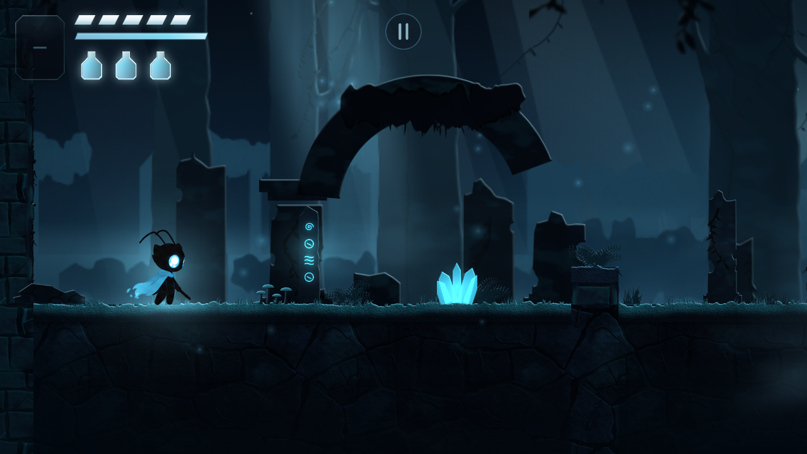
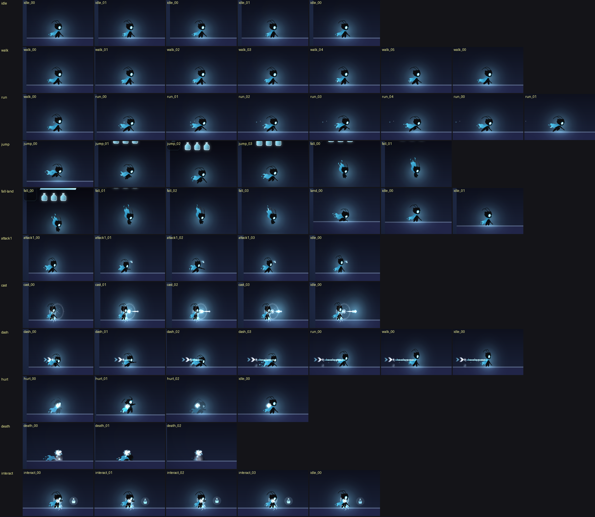

# Prompt 16 — El protagonista nuevo: la hoja de personaje del usuario reemplaza el diseño anterior, sin redibujar un píxel y sin tocar una regla del juego

> **Lo que pasó.** El usuario entregó una **hoja de personaje nueva** (1536 × 1024, 12 paneles —IDLE / DESCANSO, CAMINANDO, CORRIENDO, SALTANDO, CAÍDA, ATAQUE CUERPO A CUERPO, DISPARO / MAGIA, DASH, INTERACCIÓN, DAÑO / GOLPE, MUERTE, VISTA DETRÁS— y 50 poses) y pidió **reemplazar por completo el diseño del protagonista**:
> la imagen es la referencia visual **principal y autoritativa**; no se redibuja, no se reconstruye, no se inventan detalles ni se mezcla con el diseño anterior; los fotogramas de cada animación tienen que ser **consistentes**; los recursos anteriores no se borran sin comprobar sus dependencias y sin una forma segura de volver; y **los sistemas** (movimiento, combate, colisiones, interacciones, HUD) **se conservan**.
> **Diagnóstico** ([§1](#1--diagnóstico-lo-que-había-la-hoja-y-sus-inconsistencias)): el juego tenía 90 fotogramas en 18 clips (la hoja del Prompt 8 movida por un rig y 10 clips de dibujos entregados), un pipeline hecho para **ese** diseño (un solo «ojo grande» como medida de escala, el centro de masa de todo lo sólido como ancla) y pruebas y escenas E2E que lo describían. La hoja nueva tiene **44 poses útiles para 12 clips y ninguna para 5 de los 15 estados que el juego pide**; sus paneles están dibujados **a escalas distintas** (la cabeza mide 56.2 px en el idle y 39.9 px en el daño: ×1.41), traen **efectos pintados dentro** (arcos, estelas, un rayo, gotas) y el personaje es casi negro con una capa de fuego pálido que el pipeline anterior recortaba mal.
> **Qué se hizo:** la hoja entra **bit a bit** con un archivo de datos que dice dónde está cada pose ([§2](#2--la-hoja-entra-bit-a-bit)); el fondo blanco se quita **sin tocar la figura** ([§3](#3--quitar-el-fondo-sin-tocar-la-figura)); **una escala por clip, medida por la cabeza**, los pies en la línea del suelo y el cuerpo en el pivote, en un lienzo lo bastante ancho para que **ningún dibujo se desplace para caber** ([§4](#4--una-escala-por-clip-y-el-cuerpo-en-el-pivote)); los efectos pintados se quitan con polígonos revisados ([§5](#5--los-efectos-pintados-dentro-de-las-poses)); **lo que la hoja no tiene se declara y no se inventa** ([§6](#6--lo-que-la-hoja-no-tiene)); el diseño anterior queda **guardado entero y verificado**, con la forma de volver ([§7](#7--el-diseño-anterior-guardado-y-la-forma-de-volver)).
> **Lo que no se tocó:** **`src/` entero: 0 líneas.** El movimiento, el combate, las cajas de colisión, las interacciones, el HUD, la cámara, los efectos, la entrada táctil, el guardado y las transiciones son los de siempre; el motor ya sabía dibujar un protagonista con arte por estados y con el *placeholder* donde no lo hay, y eso es lo que pasa ([§8](#8--lo-que-se-conserva-y-cómo-se-comprobó)).
> **Lo que no se puede afirmar:** que se vea y se sienta bien **en un dispositivo real** (todo se midió en Chromium sin cabeza con GL por software); que el **tajo** (el efecto del motor) case con la hoja **corta** del dibujo —el efecto no sale de las anclas del arte—; y que los **cinco estados sin dibujo** (el agachado y el gateo, el golpe en el aire, el golpe agachado, beber) **tengan la apariencia que el usuario quiere**: hoy los dibuja la cápsula del *placeholder* ([§6](#6--lo-que-la-hoja-no-tiene), [§10](#10--límites-reales-y-lo-pendiente)).

---

## 1 · Diagnóstico: lo que había, la hoja y sus inconsistencias

Leído en el repositorio **antes de reemplazar nada** (se entregó un diagnóstico antes de tocar un archivo):

| Sistema | Lo que había | Decisión |
|---|---|---|
| **Los fotogramas** (`art/player/hero/`) | 90 PNG de 280 × 230 en 18 clips: la hoja de poses del Prompt 8 **movida por un rig** (`assets:animate`) y 10 clips de dibujos entregados por la recepción (Prompts 11 y 12) | **retirados del juego y archivados enteros** (`art/player/archive/design-v1/`, y la etiqueta `protagonista-v1`): [§7](#7--el-diseño-anterior-guardado-y-la-forma-de-volver) |
| **El manifiesto** (`player.pack.json`) | 18 clips, las anclas de la espada de 4 golpes, `missingClips: 'placeholder'` | reescrito: **12 clips**, anclas de la espada (`attack1`) y de la mano y la salida del proyectil (`cast`); **`missingClips: 'placeholder'` se conserva** |
| **El pipeline de arte** | un generador por rig (`assets:animate`), la recepción (`assets:intake`: recorta, escala **por el ojo grande**, coloca por **el centro de masa de todo lo sólido**, juzga con umbrales del diseño viejo) y el kit de encargos | el generador **se retira** (queda, probado, contra el archivo); la recepción **se adapta a la hoja nueva** ([§3](#3--quitar-el-fondo-sin-tocar-la-figura), [§4](#4--una-escala-por-clip-y-el-cuerpo-en-el-pivote)) y el kit pide **lo que falta** con la hoja nueva como referencia |
| **El motor** (`src/`) | el animador, el cargador del manifiesto y del atlas, `visualSource` (`auto` / `placeholder` / `art` por estado, *stand-ins* declarados), el conmutador `?visual=` | **intacto**: ya hacía lo que hace falta |
| **La simulación** | `PlayerController` (cápsula de 0.7 × 1.7 m, 1.0 m agachado), el combate (cajas de golpe y de daño por fase), la cámara, el HUD, los efectos, la entrada táctil, el guardado, las transiciones de zona | **intacta** ([§8](#8--lo-que-se-conserva-y-cómo-se-comprobó)) |
| **Pruebas y escenas E2E** que describían el diseño anterior | `artRepo`, `heroPlayback`, `figure`, `intake`, `animate`, `heroAnimation`, y las escenas `player-anim` y `player-art` | **adaptadas** a lo que hay hoy (sin debilitar ninguna: [§9](#9--pruebas)) |

**La hoja** (`art/player/source/character-sheet.png`, 1536 × 1024; sus rectángulos y qué pose es qué clip están en `character-sheet.json`):

| Panel | Poses | Clip del juego | Fotogramas |
|---|---|---|---|
| IDLE / DESCANSO | 6 | `idle` (poses 5 y 6: la respiración) | 2 — las poses 1 a 4 son el **giro** del personaje (de frente, de tres cuartos, de espaldas): el juego nunca lo ve así; no se usan, con su motivo en el archivo de datos |
| CAMINANDO | 6 | `walk` | 6 |
| CORRIENDO | 5 | `run` | 5 |
| SALTANDO | 4 | `jump` | 4 |
| CAÍDA | 5 | `fall` (poses 1 a 4) y `land` (la 5.ª: la caída en cuclillas) | 4 + 1 |
| ATAQUE CUERPO A CUERPO | 4 | `attack1` | 4 |
| DISPARO / MAGIA | 4 | `cast` | 4 |
| DASH | 4 | `dash` | 4 |
| INTERACCIÓN | 4 | `interact` | 4 |
| DAÑO / GOLPE | 3 | `hurt` | 3 |
| MUERTE | 3 | `death` | 3 |
| VISTA DETRÁS | 2 | ninguno: ningún estado del juego dibuja al héroe de espaldas | — |

**50 poses: 44 usadas (12 clips) y 6 no usadas, cada una con su motivo.** Una prueba exige que **toda pose esté contada** (usada por un clip o dicha como no usada).

**Inconsistencias entre la hoja y lo que el juego necesita**, y qué se hizo con cada una:

1. **Cada panel está dibujado a otra escala.** La cabeza mide 56.2 px en el idle, 54.7 en CAMINANDO, 51.5 en CORRIENDO, 52.2 en SALTANDO, 52.5 en el golpe, 45.4 en el disparo, 44.8 en el dash, 40.7 en INTERACCIÓN y **39.9 en el daño**: hasta **×1.41** de diferencia. Puestos tal cual en el juego, el personaje cambiaría de tamaño en cada acción. → **una escala por clip**, medida por la cabeza ([§4](#4--una-escala-por-clip-y-el-cuerpo-en-el-pivote)): la mediana de la cabeza de cada clip queda entre **54.8 y 56.7 px** (la del idle, 56.25: **3.3 % de diferencia como mucho**).
2. **La hoja es más pequeña que los fotogramas** (salvo el idle, que ya está a su tamaño): 11 de 12 clips se **agrandan** ×1.02 a ×1.41. No se disimula: el informe de cada clip lo avisa («la imagen entregada es más pequeña que los fotogramas») y queda dicho en [§10](#10--límites-reales-y-lo-pendiente).
3. **Efectos pintados dentro de las poses**: el arco del tajo, las estelas del dash, el rayo del disparo, el haz de la interacción, las gotas de la muerte. El motor pone los suyos. → [§5](#5--los-efectos-pintados-dentro-de-las-poses).
4. **El personaje es casi negro y la capa es fuego azul pálido que se funde con el blanco del fondo.** El recorte del diseño anterior (colores «seguros» crecidos unos píxeles) **perdía las puntas de la capa y todas las brasas sueltas**, y el centro de masa «de todo lo sólido» se iba hacia la capa. → recorte nuevo ([§3](#3--quitar-el-fondo-sin-tocar-la-figura)) y cuerpo = **los píxeles oscuros** ([§4](#4--una-escala-por-clip-y-el-cuerpo-en-el-pivote)).
5. **El ojo no es una medida de escala**: de frente mide 23 px, de perfil 18 a 21, y en la muerte se apaga. → la cabeza.
6. **La hoja no tiene 5 de los 15 estados** que el juego pide. → [§6](#6--lo-que-la-hoja-no-tiene).
7. **El idle son dos poses de respiración**, no ocho. Se usan las dos tal cual: no se inventan más moviéndolas.

## 2 · La hoja entra bit a bit

- **El archivo** `art/player/source/character-sheet.png` es **el entregado, byte a byte** (SHA-256 `1150f61d…b6bbd`, 1536 × 1024); una prueba lo comprueba contra el hash y contra los datos.
- **Los datos** (`character-sheet.json`): para cada panel, **un rectángulo por pose** (ajustado a la figura y a lo que va con ella), qué poses de qué panel son cada clip y **por qué cada pose no usada no se usa**. Las decisiones que son de una persona están en un archivo que se puede leer; el código solo lo sigue.
- **Cómo sale cada clip**: `npm run assets:intake -- from-sheet <clip>` escribe en la bandeja el **recorte exacto** de la hoja (ni un píxel remuestreado o cambiado) y los rectángulos de sus poses; `npm run assets:intake -- sheet` comprueba que la hoja es la de los datos, que todo rectángulo está dentro y que toda pose está contada. Pruebas (`characterSheet.test.ts`, 12): el hash, las 50 poses, que ningún rectángulo toque a otro **ni corte una figura** (nada de tinta justo fuera), que el recorte de cada clip **sea un recorte** y que el archivo de cada entrega **sea ese recorte**; y cada manera de estar mal (otro archivo con el mismo nombre —incluso un PNG corrupto—, una pose fuera de la hoja, una pose que nadie cuenta) se dice, no se lanza.

## 3 · Quitar el fondo sin tocar la figura

`tools/assets/matte.ts` — el recorte del fondo blanco, hecho **para esta hoja** y con una sola pregunta: *¿cuánto se aleja este píxel del blanco sobre el que se dibujó?*

- **Tinta** = todo píxel a un 12 % o más del blanco. Nada se descarta por su color, su tamaño ni su distancia al resto: **las puntas pálidas de la capa y las brasas sueltas son figura**.
- **Lo que la tinta encierra es figura** (el brillo blanco de un ojo), salvo un hueco que el contorno cierra y es casi todo blanco (el bucle de una antena).
- **A dos píxeles dentro del contorno, los píxeles de la hoja se conservan exactos** (alfa 255, el color de la hoja). Solo el borde suave —de dos píxeles dentro a tres fuera— se resuelve: cada píxel es una mezcla del color de la figura que tiene al lado y del blanco; la mezcla es el alfa, el color se des-mezcla. **El sprite no lleva halo claro, y puesto sobre el blanco reproduce la hoja.**
- **Prueba de que solo es un cambio de fondo**: sobre las **50 poses** y **276 019 píxeles de tinta**, **ninguno** difiere en más de 6 niveles de la hoja al volver a ponerlo sobre blanco (la peor diferencia en cualquier punto de las cajas es de 24 niveles: un velo del fondo por debajo del 12 % que no es figura). Con el recorte del diseño anterior la proporción era del 1.6 al 4 % de los píxeles por encima de 12 niveles.
- **Nada se pinta, recolorea ni mueve**: lo que no es el personaje (un arco, una estela) lo decide una persona ([§5](#5--los-efectos-pintados-dentro-de-las-poses)), no esta función. Pruebas (`matte.test.ts`, 6): una hoja hecha para ello —cuerpo negro de borde suave, capa translúcida cuya punta se funde con el blanco, ojo con reflejos, bucle de antena, una brasa suelta, ruido de fondo— y lo que se afirma es la regla.

## 4 · Una escala por clip y el cuerpo en el pivote

- **La escala sale de la cabeza** (`figure.ts`: `headDiameter`, el círculo más grande que cabe en la figura): no cambia cuando la cara gira, cuando se agacha el cuerpo ni cuando se apaga el ojo. **Un solo factor por clip** (nada de un factor por fotograma: las poses de un clip conservan los tamaños relativos que su autor les dio), hacia **la cabeza del idle** (el clip de referencia: ×1, una copia exacta de los píxeles movida un número entero de píxeles). La muerte, con el cuerpo tumbado, se mide por su primera pose.

| Clip | Factor | Cabeza en la hoja → en el juego (mediana) | Fotogramas |
|---|---|---|---|
| `idle` | ×1.000 | 56.2 → 56.3 px | 2 |
| `walk` | ×1.028 | 54.7 → 56.6 | 6 |
| `run` | ×1.092 | 51.5 → 56.5 | 5 |
| `jump` | ×1.078 | 52.2 → 56.1 | 4 |
| `fall` | ×1.024 | 55.0 → 56.7 | 4 |
| `land` | ×1.032 | 54.5 → 54.8 | 1 |
| `attack1` | ×1.071 | 52.5 → 56.4 | 4 |
| `cast` | ×1.238 | 45.4 → 56.0 | 4 |
| `dash` | ×1.255 | 44.8 → 55.5 | 4 |
| `interact` | ×1.380 | 40.7 → 55.7 | 4 |
| `hurt` | ×1.410 | 39.9 → 56.0 | 3 |
| `death` | ×1.354 | 41.5 (primera pose) → 56.3 (primera pose) | 3 |

- **Colocación.** El cuerpo es **lo oscuro** (los píxeles casi negros y lo que encierran: los ojos, las líneas de la armadura), no «todo lo sólido»: la capa de fuego es grande y arrastraría el centro hacia sí. Su **centro de masa** va en **la columna del pivote** y **la suela del pie** en la **fila del suelo** (192): una hoja de espada que baje por debajo de los pies no los levanta del suelo. Un clip en el aire pone el cuerpo a 1.0 m sobre el pivote.
- **El lienzo mide 320 × 230 y el pivote está en (160, 192)** (65 px de arte por metro). Con el lienzo anterior (280 × 230, pivote en 120) la **estela de fuego del dash y de la muerte no cabía con el cuerpo en el pivote**: la solución barata era **desplazar el dibujo hacia delante** (hasta 36 px = 0.55 m en el dash) **y eso rompía la alineación**: el cuerpo del dibujo iba hasta medio metro por delante de la cápsula y **volvía de golpe** al acabar el dash. Se ensanchó el lienzo 40 px por la izquierda (los 44 fotogramas son **los mismos píxeles, movidos**: se comprobó píxel a píxel, [§9](#9--pruebas)) y **el cuerpo está en el pivote en todos los fotogramas de todos los clips**: el centro de masa a **0.4 px o menos** de la columna 160 en 43 de 44 (la última pose de la muerte, tumbada, a 1.3), los pies a **±2 px** de la fila 192 en todos los clips que están en el suelo, y un **margen de al menos 8 px** (el contrato pide 4) por todos lados.
- **Continuidad.** Ningún salto del cuerpo entre fotogramas vecinos pasa de 0.55 m (el límite de la recepción); la cabeza de un clip no se aparta de su mediana más del 10.7 % (el máximo, `dash_01`).

## 5 · Los efectos pintados dentro de las poses

Seis clips traen efectos dibujados **dentro** de la hoja (el motor pone los suyos y se vería doble); son **15 716 píxeles** en 11 poses (el 4.1 % de lo que habría en los 44 fotogramas con ellos: 371 557 píxeles de figura quedan). Se quitan con **polígonos que una persona revisó mirando cada pose** (`erase.json`: el motivo y los vértices, en píxeles del lienzo): solo se vuelven transparentes los píxeles de dentro, **nada más cambia**, y la herramienta **se niega** a borrar un píxel del cuerpo oscuro ni un punto de la hoja de la espada (hay una lista corta y explícita de motas oscuras que sí pueden ir con un efecto). El dibujo entregado sigue archivado sin tocar: quitar `erase.json` y volver a entregar lo devuelve entero.

| Clip | Lo que se quita | Píxeles |
|---|---|---|
| `attack1` (pose 2) | el arco del tajo (una media luna cian con otra fina dentro) | 2 972 |
| `cast` (poses 2 y 3) | el proyectil de energía pintado delante del brazo extendido (un anillo con una estela de chispas) | 3 472 |
| `dash` (pose 2) | el arco pintado bajo y delante de la figura, con su cola de rayas | 4 377 |
| `interact` (poses 1 a 3) | el destello en forma de rombo pintado delante de la mano | 3 111 |
| `hurt` (poses 1 y 3) | las gotas que salen volando de la cabeza (el efecto del golpe) | 856 |
| `death` (poses 2 y 3) | las gotas que suben sobre la figura tumbada | 928 |

Las **brasas** que se desprenden de la capa **se quedan**: son del personaje. Una prueba (`deliveries.test.ts`) vuelve a preparar cada entrega **sin** el `erase.json` y exige que **lo único que difiera** de los fotogramas del juego sean píxeles dentro de los polígonos, y que ahora sean transparentes.

## 6 · Lo que la hoja no tiene

La hoja no tiene dibujo para **el segundo golpe, el golpe en el aire, el agachado (quieto y andando), el golpe agachado y beber**. **No se han inventado ni sacado de otro clip**: ni un fotograma de otra acción movido, doblado o recortado para que se parezca.

| Estado | Qué lo dibuja hoy |
|---|---|
| `attack2` (el segundo golpe) | el **primer golpe**, tal cual: es el *stand-in* que el motor ya tenía declarado (`visualSource.ts`: «el segundo golpe repite el primero»), el mismo dibujo, sin mover nada |
| `attackAir`, `crouch`, `crouchWalk` (el gateo), `attackCrouch`, `drink` | **el *placeholder*** (la cápsula): el propio motor dice «aquí no hay arte» y **se ve**; `npm run assets:missing` los cuenta como **no entregados** (**10 de 15** clips con dibujo propio) |

- **Dónde se ve**: [`lo-que-dibuja-el-marcador.png`](img/prompt16/lo-que-dibuja-el-marcador.png) — el héroe se vuelve una cápsula gris con una línea blanca en esos estados, entre fotogramas del arte. **Es lo que pide la regla** («identificá ese faltante en lugar de ocultarlo») **y se nota**: la decisión es del usuario ([§10](#10--límites-reales-y-lo-pendiente)).
- **Cómo se piden**: el kit (`art/player/requests/`) tiene **un encargo y un tablero de referencia por cada clip que falta** (el *prompt* listo para pegar, la lista exacta de fotogramas, los tiempos, lo que fija el juego) **con la hoja nueva** como referencia, y `npm run assets:intake -- <clip>` los recibe y comprueba. Las advertencias de `assets:check` y de `assets:verify` dicen cuántos y cuáles faltan.

## 7 · El diseño anterior, guardado y la forma de volver

- **Nada se perdió.** `art/player/archive/design-v1/` es el diseño anterior **entero** con la misma disposición que `art/player/`: sus 90 fotogramas, su manifiesto, la hoja de poses, el rig, los 45 archivos de sus entregas y sus encargos. Antes de retirarlo se comprobó **byte a byte** contra Git (los 90 fotogramas, el manifiesto, el rig, las poses, la hoja, el retrato y la lista de entregas) y se creó **la etiqueta `protagonista-v1`** en el último commit con ese diseño en el juego (`48684b9`).
- **No es referencia de nada.** El empaquetador lee `art/<paquete>/<paquete>.pack.json` a un nivel: nada de `archive/` llega al juego. Una prueba exige que **ninguno de los 44 fotogramas de hoy sea una copia de uno de esos 90**.
- **Volver es posible y está probado.** Con Git: `git rm -r -q art/player public/art/player && git checkout protagonista-v1 -- art/player public/art/player` (el `rm` antes, porque `checkout` solo añade: un fotograma de hoy que el anterior no tenía se quedaría); o copiar `hero/` y el manifiesto del archivo donde el juego los lee y volver a empaquetar (los pasos están en `art/player/archive/design-v1/README.md`). Una prueba **hace exactamente eso en una carpeta temporal** (sin tocar la de verdad): el diseño archivado se empaqueta sin un error, verifica y da 90 fotogramas en 18 clips.
- **El generador por rig** (`assets:animate`) pertenece a ese diseño: su valor por defecto es la **especificación del archivo** y todo lo que lee y escribe está junto a ella, así que **no puede tocar los fotogramas del juego**; sus pruebas trabajan contra el archivo.

## 8 · Lo que se conserva y cómo se comprobó

- **`src/` no tiene ni una línea cambiada** (`git diff HEAD -- src` vacío): ni el motor del arte, ni la simulación, ni el combate, ni la cámara, ni el HUD, ni los efectos, ni la entrada. El arranque en frío de JavaScript es **el mismo código**: `npm run bench:bundle` da hoy 41 *scripts* y 200.0 KB gz, lo que el cierre del Prompt 15 midió (204 780 B = 199.98 KB en 41 *scripts*; presupuesto 200 KB).
- **Las colisiones y el combate son datos del juego, no del dibujo.** Un E2E ya existente (`player-anim`, sección F) juega **el mismo guion de teclas con el arte real, con el *placeholder* y solo con el arte** y compara la simulación **tick a tick**: es idéntica; `player-art` (sección D) y `player-r1` hacen lo mismo con arte de prueba y comparan además **las tres cajas** (cuerpo, *hurtbox* y *hitbox*): iguales con y sin arte. Pasan con el arte nuevo.
- **El motor elige por estado**: con el arte nuevo `auto` dibuja con el arte los estados que tienen clip (y el segundo golpe con el primero) y con el *placeholder* los otros cinco; `?visual=placeholder` vuelve a la cápsula **al instante** y `?visual=art` enseña solo el arte; el camino de vuelta a media pose funciona.
- **Las pruebas de sistemas** (movimiento, combate, colisiones, interacciones, HUD, guardado, transiciones) **no se han modificado** y pasan: [§9](#9--pruebas) y [§11](#11--resultados).

### 8.1 En el juego real: el tamaño, la alineación, la continuidad y las colisiones

Mirado en el juego (Chromium sin cabeza, GL por software; las imágenes son **capturas del navegador** a 844 × 390 y 2×, hechas con un guion de trabajo que no se versiona):

- **El tamaño frente al escenario** — [`tamano-en-r1-1280x720.png`](img/prompt16/tamano-en-r1-1280x720.png): el héroe junto a la runa, el cristal y las ruinas de R1. Mide **2.29 m con las antenas** y su cabeza **0.86 m**. **La escala del juego no cambió**: el diseño anterior medía 2.23 m en el idle (cabeza 0.91 m) con los mismos 65 px por metro.
- **La alineación y la continuidad** — [`animaciones-en-el-juego.png`](img/prompt16/animaciones-en-el-juego.png): una fila por animación y un cuadro por fotograma que estuvo en pantalla (con los efectos del motor encima: el tajo, la estela del dash, el disparo, el golpe). El cuerpo está **en el pivote en todos los fotogramas** (el centro de masa a 0.4 px o menos de la columna 160 en 43 de 44), así que la figura **no salta** al pasar de un fotograma al siguiente, ni de un clip a otro (la carrera que sigue al dash, el aterrizaje que sigue a la caída), y es **el mismo personaje** en todos: la cabeza de cada clip mide entre 54.8 y 56.7 px.
- **Las colisiones** son las de siempre: la cápsula (0.7 × 1.7 m; 1.0 m agachado) y las cajas de golpe y de daño **no dependen del dibujo**. Lo comprueba el E2E: la simulación es **idéntica tick a tick** con el arte real y con el *placeholder*, la imagen **se apoya en el suelo** (su punto más bajo a menos de 0.06 m de los pies) y **está sobre el cuerpo**, y las escenas que juegan con el arte puesto —`player-anim`, `player-art`, `world-art` (cuatro salas y tres transiciones, el héroe dibujado por el arte en 1560 de 1560 muestras), `r1`, `room`, `hazard`, `boss`— pasan; `movement`, `combat` y `crouch` fuerzan el *placeholder* (sus fotogramas lo exigen) y pasan igual.
- **Lo que no casa**: el arco del tajo —el del motor— se dibuja **por encima de la hoja corta** del dibujo ([§10](#10--límites-reales-y-lo-pendiente), punto 4); y en los cinco estados sin dibujo el héroe es una cápsula ([`lo-que-dibuja-el-marcador.png`](img/prompt16/lo-que-dibuja-el-marcador.png)).

## 9 · Pruebas

| Archivo | Qué afirma |
|---|---|
| `characterSheet.test.ts` (**nuevo**, 12) | la hoja es la entregada (hash, tamaño), cada pose está contada, ningún rectángulo toca otro ni corta una figura, el recorte de cada clip es un recorte y el archivo de cada entrega es ese recorte; cada manera de estar mal se dice |
| `matte.test.ts` (**nuevo**, 6) | el recorte del fondo: reproduce la hoja sobre blanco, conserva los píxeles de dentro exactos, no pierde lo pálido ni lo lejano, no deja halo |
| `characterArt.test.ts` (**nuevo**, 15) | **sobre los fotogramas del juego**: ninguno es del diseño anterior ni se repiten; el idle **es la hoja, bit a bit**; un clip escalado lo está **uniformemente** (no se estira); la **cabeza** es de un tamaño en todos los clips; los **pies** en el suelo y el **cuerpo en el pivote** en **todos** los fotogramas; ningún salto del cuerpo entre fotogramas; **el margen** del contrato; limpieza (sin rojo ni color ajeno, sin piezas sueltas); las **anclas** de la espada y del disparo sobre la figura; y **la forma de volver** al diseño anterior |
| `intakeSheet.test.ts` (**nuevo**, 14) | las reglas de la herramienta sobre figuras hechas para ellas: el cuerpo oscuro (la capa no lo arrastra; una bufanda que lo parte en dos; la suela que el recorte de lo fino deja fuera), colocar **a ×1 es copiar**, escala por la cabeza / solo por las poses que se pueden medir, el juicio de una pose «no medida», el disparo (mano y salida del proyectil) y la hoja de espada que no es la del juego |
| `deliveries.test.ts` (adaptado, 20) | **cada entrega archivada reproduce, byte a byte, los fotogramas y las anclas del juego**, y lo quitado por `erase.json` es solo lo que encierran sus polígonos |
| `artRepo.test.ts`, `heroPlayback.test.ts` (adaptados) | 44 fotogramas en 12 clips, **los cinco estados sin dibujo NO están declarados** (y la advertencia lo dice), qué dibuja cada estado |
| `figure.test.ts`, `intake.test.ts`, `animate.test.ts`, `heroAnimation.test.ts` | ahora sobre **el diseño archivado** (las mediciones y el generador siguen verificados, contra lo que miden y generan) |

- **Comprobaciones de que las pruebas fallan cuando deben** (mutaciones, hechas a mano y restauradas): un píxel cambiado en un fotograma, un fotograma de otra escala, otro estirado, desplazado 5 px o 40 px, bajado 6 px y uno del diseño anterior puesto en su lugar **hacen fallar la prueba que corresponde**; y en la herramienta, diez cambios (siempre remuestrear, la suela del pie por el cuerpo abierto, ignorar `only`, medir todas las poses, ignorar el largo de la hoja del encargo, no limitar el alcance del proyectil, quedarse con la pieza mayor del cuerpo, no rellenar los huecos, no contar las poses sin uso, un `groundGap` falso) **hacen fallar** al menos una.
- **Los 44 fotogramas del lienzo ancho son los del lienzo anterior, movidos**: comprobado píxel a píxel (44 de 44 iguales tras el desplazamiento que corresponde) antes de dar por buena la ampliación.
- **E2E**: `player-anim` y `player-art` **reescritas** para lo que hay hoy —y para que se adapten solas a la llegada de un clip: lo esperado se lee del manifiesto—; las demás escenas del arte (`assets`, `player-lab`, `player-r1`, `sprites`, `art-performance`, `fallbacks`, `render`) pasan **sin cambios**.

## 10 · Límites reales y lo pendiente

1. **Nada visto en un dispositivo real.** Todo se midió y se miró en Chromium sin cabeza con GL por software; el peso, la nitidez a 2× y la sensación de las animaciones en un teléfono necesitan ojos allí.
2. **Los cinco estados sin dibujo se ven como una cápsula.** Es lo que se pidió (declarar el faltante, no disfrazarlo) y es una **ruptura visible** en el agachado, el gateo, el golpe en el aire, el golpe agachado y al beber. **Decisión del usuario**: pedir los dibujos con el kit (`art/player/requests/`), o aceptar un estado intermedio.
3. **La hoja es más pequeña que los fotogramas.** Once de los doce clips se agrandan (×1.02 a ×1.41; el idle no): el dibujo se ve **algo más blando** donde más se agranda (el daño, la interacción, la muerte, el dash). Una hoja del doble de tamaño lo arregla; el informe de cada clip lo avisa.
4. **El tajo no sale de la hoja.** La hoja de la espada dibujada es **corta** (de 0.35 a 0.5 m desde la mano) y el arco del tajo es **el del motor**, que no lee las anclas del arte (`vfx_origin`, `hit_origin` solo las leen las herramientas): se ve **un poco por encima de la hoja**. Tocarlo es cambiar el combate o el efecto, no el dibujo: **no se hizo**.
5. **`land` es la 5.ª pose de CAÍDA** (el personaje en cuclillas con la capa atrás): se leyó como el aterrizaje; el usuario puede decir otra cosa.
6. **La escala de la muerte sale solo de su primera pose** (las otras dos están tumbadas y no tienen una cabeza que medir); y su segunda pose conserva un brillo pálido del dibujo que la medición marca (aviso, `edge` 10.5 %).
7. **Una excepción aceptada a propósito y un umbral que se movió.** `cast_02` «no cabe» **antes** de quitar el rayo de energía pintado: es un fallo de la herramienta que una persona acepta con su motivo (`waivers.json`, archivado con la entrega; el fotograma que se entrega acaba a 106 px del borde y la comprobación del margen sigue vigente). Y el límite de «piezas sueltas» (`LIMITS.loose`) subió del 0.4 al 2 % (fallo al 6 %) para el diseño nuevo: la capa suelta brasas por naturaleza (hasta el 1.5 % de la figura), y lo que falla sigue siendo lo que es de otra pose o un efecto.
8. **El segundo golpe repite el primero.** Es la regla del motor (el *stand-in* que ya estaba), no un dibujo del segundo golpe.

## 11 · Resultados

Medido sobre el código que se entrega (`src/` no cambió en todo el encargo).

| Comprobación | Resultado |
|---|---|
| `npx tsc --noEmit` | sin errores |
| `npx vitest run` | **195 archivos, 3164 pruebas, todas pasan** (partía de 191 archivos y 3109 pruebas al cerrar el Prompt 15: **+4 archivos, +55 pruebas**; ninguna se quitó ni se debilitó: las que cambiaron lo hicieron porque el protagonista cambió, y siguen comprobando lo mismo) |
| `npm run assets:check` | `art: OK`, con **una advertencia: «el arte del protagonista no tiene 5 de los 15 clips que el juego pide»** (la que debe haber) |
| `npm run build` (= `tsc` + `assets:check` + `vite build`) | ✓ |
| `npm run bench:bundle` | arranque en frío de R1: **41 *scripts*, 200.0 KB gz** (el cierre del Prompt 15: 204 780 B = 199.98 KB; presupuesto 200); el atlas del héroe: **1 693 271 → 836 758 B** (1344 × 1344 → 1024 × 1016, 7.0 → 4.0 MiB decodificados) |
| E2E, producción (`npm run test:e2e -- --prod`) | **55 de 56 escenas pasan en una pasada completa** (≈ 24 min), sobre la compilación del mismo código; la 56.ª, `death`, falló en una espera real de 200 ms («the camera cut to the entrance») y **pasa sola dos veces** |
| E2E, desarrollo (`npm run test:e2e`) | **54 de 56 en la pasada completa** (la interrumpió un reinicio del contenedor tras la escena 50.ª y se reanudó con las seis que faltaban); `arrival` falla en este contenedor **también en el commit anterior** y pasa con el arreglo de abajo, y `accessibility` falló una vez bajo carga (en el commit anterior falló en otro punto) y **pasa sola dos veces** |

**Defectos que la propia verificación encontró y que se corrigieron:**

| Defecto | Dónde se vio | Arreglo |
|---|---|---|
| **El cuerpo del dibujo iba hasta 0.55 m por delante de la cápsula en el dash** (y 0.17 m en la muerte) y volvía de golpe al acabar: para que la estela de fuego cupiera en el lienzo había que desplazar el dibujo | mirando el juego (la tira de fotogramas del dash: la cabeza no estaba en el mismo sitio que en la marcha que le sigue) | lienzo de 320 × 230, pivote (160, 192): **los 44 fotogramas son los mismos píxeles, movidos**; la prueba exige el cuerpo en el pivote en todos |
| `sheetProblems` **lanzaba una excepción** con un PNG corrupto en vez de decirlo | la prueba de «otro archivo con el mismo nombre» | lo dice como un problema más |
| Una aserción de `player-art` medía la altura **de la imagen** del *placeholder* (2.39 m, su propio lienzo) para saber si el héroe estaba agachado | E2E | mide el cuerpo agachado (1.0 m), que es lo que el juego decide |
| La escena `arrival` **fallaba en este contenedor, también en el commit anterior**: su línea lenta simulada (600 ms por archivo) dura menos que una captura de pantalla aquí (≈ 0.55 s) y, cuando se toma, el telón ya ha pasado | E2E de desarrollo completo; probado en una copia limpia del commit anterior | la línea simulada es de 1500 ms por archivo (2500 en la sección H): **pasa entera** (72 s); la lógica no se tocó |

**El contenedor en que se verificó es lento** (4 vCPU y GL por software: una captura de 844 × 390 tarda ≈ 0.55 s, varias veces más que en el cierre del Prompt 15): las esperas reales cortas de unas pocas escenas **se quedan cortas de vez en cuando** —`arrival` siempre, hasta que se alargó su línea simulada; `accessibility` (150 ms) y `death` (200 ms) según la carga— y **cada escena pasa sola**. Ninguna es del protagonista y las dos últimas **no se tocaron**: endurecerlas (esperar a la condición en vez de a un tiempo) es una mejora aparte que el usuario puede pedir.

**Lo que sigue sin verificarse**: todo lo que depende de un dispositivo real (la nitidez de un dibujo agrandado hasta ×1.41 en una pantalla de 2 – 3×, el peso del atlas en un teléfono de gama baja, la sensación de las animaciones, cómo se leen el tajo y la hoja corta juntos), y lo que depende de **la decisión del usuario**: los cinco estados que hoy dibuja la cápsula.
