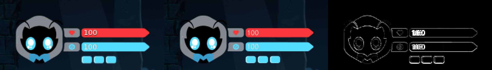
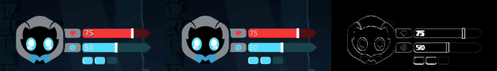
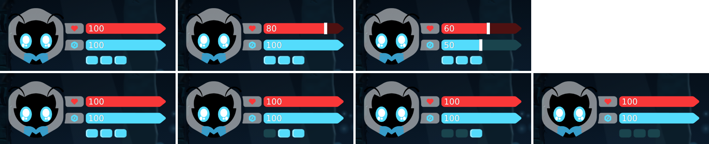

# Prompt 17 — El HUD superior izquierdo: el retrato, las barras y las botellas del artista reemplazan al HUD hecho con código, conectados a los valores reales del juego

> **Lo que pasó.** El usuario entregó **dos PNG del HUD** (2560 × 1440: el HUD con todo al máximo —100 de vida, 100 de magia, tres botellas— y el mismo HUD desgastado —75 de vida, 50 de magia, la tercera botella gastada, con un rectángulo blanco donde se juntan lo claro y lo oscuro de cada barra—) y **una captura del HUD puesto en el juego** (844 × 390), y pidió **reemplazar el HUD de arriba a la izquierda** por esos PNG: el retrato del protagonista, la barra roja de **vida**, la barra cian de **magia** y tres rectángulos que son **botellas de curación**; **sin redibujarlos, reconstruirlos con código, simplificarlos ni sustituirlos**; con el número dentro de cada barra, el rectángulo blanco del desgaste que se mueve con el valor real y cada botella oscureciéndose por su cuenta; **conservando la conexión con los sistemas reales** (combate, poderes, botellas, zonas, pausa, guardado).
> **Diagnóstico** ([§1](#1--diagnóstico-lo-que-había-lo-que-se-entregó-y-qué-datos-reales-hay)): el HUD que había estaba **dibujado con código** (placas con esquinas cortadas por `clip-path`, segmentos de vida, una barra de magia con degradado, estela y marca del coste, frascos hechos de polígonos y una tarjeta con el poder equipado y la tecla del dispositivo). Sus datos eran los buenos: `GameSession.status()` ya entrega **todo lo que el HUD nuevo necesita** (vida, magia, estado de cada botella, la que se está bebiendo) y es la **única puerta** entre la simulación y el HUD.
> **Qué se hizo:** los dos PNG entran **byte a byte** y de ellos salen **diez piezas**, cada una un rectángulo de uno de los lienzos copiado píxel a píxel (solo dos clases de pieza no son un recorte exacto, y las dos se prueban: [§2](#2--los-png-entran-sin-tocar-y-las-piezas-que-salen-de-ellos)); el HUD es **el lienzo del artista a 1:1**, con **una sola escala** para toda la pantalla, y mide y está **donde la captura del usuario lo tiene**, con un error de **menos de un píxel** ([§3](#3--tamaño-y-lugar-lo-medido-en-la-captura-del-usuario)); cada elemento **lee un valor real** ([§4](#4--de-dónde-sale-cada-valor-la-conexión-con-el-juego)) y el único texto que el código escribe son **los dos números** ([§5](#5--cómo-se-comporta)).
> **Lo que no se tocó:** **la simulación entera** —vida, magia, botellas, combate, poderes, guardado, zonas— y `PlayerStatus`: el cambio es de la **capa visual** (`src/ui/hud/`) y del cableado de `Game2D`. El combate **no se reescaló**: la vida del juego sigue siendo de 5 puntos y el número de la barra es su porcentaje ([§4](#4--de-dónde-sale-cada-valor-la-conexión-con-el-juego)).
> **Lo que no se puede afirmar:** que se vea y se sienta bien **en un dispositivo real** (todo se midió en Chromium sin cabeza con GL por software); que los **dígitos** sean idénticos a los que el artista tecleó en su PNG (el número es dinámico: lo escribe el navegador con la tipografía ligera del sistema, no una fuente incluida); y que la **interpretación** de «posición y longitud» del rectángulo blanco sea la que el usuario quiere ([§8](#8--límites-reales-y-lo-pendiente)).

---

## 1 · Diagnóstico: lo que había, lo que se entregó y qué datos reales hay

Leído en el repositorio **antes de tocar nada**:

| Sistema | Lo que había | Decisión |
|---|---|---|
| **La vista** (`HudView.ts`) | DOM dibujado con código: placas y segmentos con `clip-path`, una barra de magia con degradado, estela y marca del coste, frascos de polígonos con líquido, y **una tarjeta** (el poder equipado) con la tecla del dispositivo | **reescrita**: solo `` de los PNG del artista, movidos y recortados; lo único que el código escribe es el número |
| **El modelo** (`HudModel.ts`, puro) | segmentos de vida con fantasma, destello y ola de curación; vida crítica; línea de guardia; estela de la magia, coste del poder; «pop», brillo y segundos de cada botella; la tarjeta | **reescrito** (más corto): dos barras (dónde está la imagen y hasta dónde llegó lo perdido) y la oscuridad de cada botella |
| **La puerta de datos** (`PlayerStatus`, `GameSession.status()`) | ya entrega `life {current, max}`, `magic {current, max, regenerating}`, `bottles[i].state`, `drink.slot` | **intacta** |
| **El cableado** (`Game2D.ts`) | alimentaba el HUD con las teclas de cada dispositivo (glifos) y avisaba de cada botella bebida | **simplificado**: sin glifos, sin aviso de botella bebida (se ve en el estado de la botella); se conservan los avisos de lo **rechazado** (`skill:denied`, `bottle:denied`) |
| **El táctil** | el botón de dash, el de habilidad, el chip de la botella, los toques sobre las botellas | **intactos**; lo único que cambia es la **huella** del HUD que respetan (218.4 × 78.9 dp, margen 25.7: `src/ui/touch/layout.ts`) |
| **La pausa, el guardado, las zonas** | el HUD se detiene con el mundo (`worldDt = 0`); el guardado no guarda vida, magia ni el estado de las botellas | **sin cambios** ([§5.5](#55-pausa-zonas-guardar-y-cargar)) |

**Lo entregado** (los archivos están en `src/ui/hud/png/original/`; la captura, en [`img/prompt17/`](img/prompt17/referencia-en-el-juego-844x390.png)):

- `hud-complete.png` y `hud-worn.png`, ambos de **2560 × 1440** con alfa; lo dibujado ocupa un bloque de **2524 × 912 px** del lienzo (desde el punto (10, 258)): el **hexágono con el retrato** a la izquierda (890 × 912), **dos placas** (un corazón y un rayo dentro de un hexágono) con sus barras a la derecha, y **tres botellas** debajo. La barra de vida es de color plano (249, 55, 56) con la parte perdida en (78, 17, 17); la de magia, (84, 220, 252) con (26, 68, 77). Los números «100» y «75»/«50» están **tecleados dentro de la imagen**, en blanco y con una sombra dura de 3 px.
- En el HUD desgastado, **el rectángulo blanco** (50 × 186 px, 7 px más alto que la barra por arriba y por abajo) está donde termina lo claro (a 904 y a 609 px del extremo izquierdo de la barra de vida y de la de magia), y la botella gastada es la tercera.
- La captura de 844 × 390 da el **tamaño** y el **lugar** del HUD en el juego.

**Los valores reales** que el HUD tiene que mostrar (leídos del código del juego, no supuestos):

| | Valor real | Regla |
|---|---|---|
| **Vida** | **5 puntos** (`maxHealth` 5) | cada golpe quita 1; una botella cura 2; descansar en un altar o una derrota la restauran |
| **Magia** | **100** unidades | se recupera sola a 6 por segundo tras 1 s sin gastar; el Spirit Bolt cuesta 30; no se regenera mientras se lanza |
| **Botellas** | **3** de inicio, **4** con la recompensa de la sala R2 | cada una recarga en **60 s**, de **una en una** (la primera vacía desde la izquierda); la tecla o el chip beben **la primera lista desde la izquierda**; un toque sobre una botella bebe **esa** |

## 2 · Los PNG entran sin tocar, y las piezas que salen de ellos

- **Los originales**, byte a byte: `src/ui/hud/png/original/hud-complete.png` (134 858 B, SHA-256 `6cd823f2…de2be`) y `hud-worn.png` (130 695 B, SHA-256 `a717b306…d037`). Las huellas están en `tools/hud/originals.ts`, en el README de la carpeta, y las comprueban `npm run hud:check` (también parte de `npm run build`) y `tests/unit/ui/hudArt.test.ts`. La captura del usuario está guardada tal cual en `docs/img/prompt17/` (SHA-256 `7930d045…3ba`).
- **Las piezas** (`src/ui/hud/png/*.png`, diez; las escribe `npm run hud:cut` desde los originales): el HUD **no puede mostrar un lienzo** —las barras se mueven, el número lo escribe el juego, cada botella cambia por su cuenta—, así que **cada cosa** del lienzo es un archivo propio, un rectángulo de uno de los originales **copiado píxel a píxel** (sin escalar, recolorear, filtrar ni suavizar).

| Pieza | De dónde sale | Qué se le hizo además de cortarla |
|---|---|---|
| `portrait` (890 × 912) | `hud-complete` | nada |
| `plate-life`, `plate-magic` (310 × 172) | `hud-complete` | nada |
| `bar-life`, `bar-magic` (1281 × 172/173) | `hud-complete` | **se les quitó el «100» tecleado** (lo escribe el juego): las filas de la caja de los dígitos toman el color plano de la barra |
| `bar-life-lost`, `bar-magic-lost` | `hud-worn` | **se continúan hacia la izquierda**: la parte perdida solo existe en el original desde el rectángulo blanco hasta la punta, y a su izquierda se copian columnas planas oscuras (cada columna de la pieza es una columna del original) |
| `marker` (50 × 186) | `hud-worn` | nada: el rectángulo blanco |
| `bottle`, `bottle-used` (195 × 135) | `hud-complete` / `hud-worn` | nada: la disponible y la gastada |

- **Las dos únicas excepciones al «recorte exacto»** (las barras sin dígitos y las partes perdidas continuadas) **se pueden hacer sin inventar nada** porque una barra es de **un solo color plano** de punta a punta (una prueba lo mide): lo que había bajo los dígitos y lo que hay a la izquierda de lo oscuro **es** ese color. Las pruebas lo exigen: fuera de la caja de los dígitos la pieza es el original; los colores de las piezas son los del artista; la continuación casa con el contorno de la barra clara; y **reponer las piezas con la misma función que usa el juego reproduce las dos imágenes del artista** (menos los dígitos, el borde suave del marcador de la magia y la franja de antialias).
- **Cómo se muestran**: sin canvas, sin SVG, sin filtros, sin máscaras: cada pieza es un `` a su tamaño del lienzo; la barra clara se recorta hasta donde llega la vida (`clip-path: inset`) y la oscura desde ahí; el rectángulo blanco es la pieza `marker`, movida y —solo cuando se acaba de perder algo— estirada de ancho. Una prueba de la página lee los bytes que el navegador recibe y los compara con el archivo, y lee los píxeles que hay en pantalla.

## 3 · Tamaño y lugar: lo medido en la captura del usuario

La captura (844 × 390, `uiScale` 819/844) es la autoridad del tamaño y del lugar, como los tres botones táctiles lo fueron en el Prompt 15. Se puso el PNG del artista sobre ella y se **ajustó** hasta que coincidieron:

- **0.08395 px de pantalla por píxel del lienzo** (el hexágono mide 74.7 × 76.6 px) y la esquina del lienzo en (24.2, 3.15): con eso las dos imágenes difieren **2.5 niveles de media sobre 5 719 píxeles sólidos**. En unidades del juego: **0.0865 dp por píxel**, el bloque mide **218.3 × 78.9 dp** y su margen a la zona segura es de **25.7 dp** (`src/ui/hud/artGeometry.ts`, `layout.ts`).
- **El recorrido del rectángulo blanco**: el artista lo puso a 904 px (75 de vida) y a 609 px (50 de magia); 904 ÷ 0.75 y 609 ÷ 0.5 son 1205 y 1218, y **1210** deja las dos dentro de 4 px del lienzo (un tercio de píxel de pantalla).
- **El número**: a 40 px del extremo de la barra, dígitos de 95 px de alto, blancos, con una sombra dura de 3 px del color oscuro de **esa** barra. Es lo que el artista tecleó en el PNG, no un adorno añadido.
- **Una sola escala para todo.** El DOM del HUD **es el lienzo del artista, a 1:1**, y todo el bloque se escala de una vez (`transform: scale(...)`). Antes de hacerlo así se midió que ponerlo todo en dp hacía que Chrome **redondeara el cuadro de cada imagen** y la corriera hasta **0.55 px**; con una sola escala, ninguna pieza se coloca ni se estira en una unidad que el navegador redondee. El E2E mide los cuadros reales de la página contra los de la captura: cada pieza, a menos de **0.8 px**.
- **En cada pantalla**: arriba a la izquierda, dentro de la zona segura (una muesca empuja el HUD), a `uiScale` por la preferencia de tamaño del jugador (0.85 – 1.35), y lejos de los botones táctiles (E2E en 1024 × 768, 1280 × 720, 844 × 390, 1260 × 540 y 667 × 375).

### 3.1 En el juego, frente al dibujo del artista

Se puso el PNG del artista sobre una captura del juego **sin** HUD, con la transformación medida, y se comparó con una captura **con** HUD (844 × 390 a 1×; un recuadro de 260 × 112 px). Cada imagen es, de izquierda a derecha, **el juego · el dibujo del artista · la diferencia**, ampliadas ×3:

| Región | Diferencia media por píxel, HUD completo | HUD desgastado |
|---|---|---|
| todo el recuadro | 5.2 | 4.3 |
| retrato | 6.4 | 6.4 |
| placas | 7.0 | 7.0 |
| barra de vida (sin dígitos) | 8.8 | 6.4 |
| barra de magia (sin dígitos) | 9.3 | 5.5 |
| botellas | 25.2 | 17.4 |

(La suma de la diferencia de los tres canales, de 0 a 765.) En la imagen de la derecha **solo se ven los contornos** —el antialias de un dibujo reducido unas 12 veces por dos filtros distintos, el del navegador y el del guion que compone el dibujo del artista— y **los dígitos** (la tipografía del navegador, no la que el artista tecleó: el «100» del juego empieza a 1 px del suyo y es 2 px más ancho). Las botellas son lo que más difiere porque son lo más pequeño y lo de más contraste (16 × 11 px, con un brillo interior de 1 – 2 px): una fracción de píxel en sus bordes pesa mucho. **No hay desplazamientos ni diferencias de tamaño** a la vista.

Y el HUD en el juego, con la imagen de cada estado a 2× (un teléfono de 844 × 390 con una pantalla de densidad 2): arriba, una partida nueva (100 y 100), un punto de vida perdido (80: el rectángulo blanco donde termina la barra, del tamaño del artista) y 60 de vida con 50 de magia; abajo, las botellas una a una —tres disponibles, una gastada, dos, tres—:

## 4 · De dónde sale cada valor: la conexión con el juego

Todo entra por **una puerta**: `GameSession.status()` → `PlayerStatus` → `HudModel` (puro) → `HudView` (DOM). El HUD no conoce al jugador, a los recursos ni a ninguna entidad, y **no hay un segundo sistema** de vida, de magia ni de botellas.

| En pantalla | Valor real | Dónde se lee | Cómo se muestra |
|---|---|---|---|
| **Número de la barra roja** | `player.health.current` de `max` (5 puntos) | `status.life.current/max` | el **porcentaje entero** de la vida: 5/5 → **100**, 4 → 80, 3 → 60, 2 → 40, 1 → 20, 0 → 0 (100 solo si está llena; 0 solo si está vacía; nunca 0 si queda algo) |
| **Barra roja** | la misma fracción | `current ÷ max`, entre 0 y 1 | la imagen clara hasta ahí y la oscura desde ahí, con el rectángulo blanco entre las dos |
| **Número de la barra cian** | `magic.current` de `magic.max` (100) | `status.magic.current/max` | con el máximo en 100 el porcentaje **es** la unidad del juego: 100 → 70 al gastar 30; vuelve de uno en uno a 6 por segundo |
| **Barra cian** | la misma fracción | ídem | ídem |
| **Cada botella** | `bottles.slots[i].state`: `ready`, `recharging` o `empty` | `status.bottles[i].state` | `ready` → la botella clara; cualquier otro estado → la oscura (se funden una en otra en 0.18 s) |
| **Cuántas botellas** | `bottles.slots.length` (3; 4 con la recompensa) | `status.bottles.length` | una botella más **en la fila del artista**, un paso (229 px del lienzo) a la derecha |
| **Magia insuficiente** | el evento `skill:denied` de la simulación | `HudModel.magicDenied()` | la barra de magia se sacude (0.28 s, ±4 dp); la regla de la simulación no cambia: no se lanza |
| **Beber sin poder** | el evento `bottle:denied` (sin botella lista, o vida llena) | `HudModel.bottlesDenied()` | la fila de botellas se sacude |
| **Pausa** | `menuOpen` | `dt = 0` para el modelo | los números siguen siendo los reales; las imágenes **esperan** con el juego |

- **El número no se anima nunca.** `current`, `max` y `percent` del modelo son los de la simulación **en ese fotograma**; lo que se anima es la **imagen** de la barra y el rectángulo blanco, y llegan al valor real en una fracción de segundo. El E2E y las pruebas de integración comparan el número con la simulación (`outOfSync`) tras cada cambio: vida, magia, botellas, cambio de zona, pausa, carga.
- **La vida es de 5 puntos y el número, su porcentaje.** El usuario pidió «100/100 en una partida nueva» **«respetando siempre los valores reales del sistema de combate»**: en vez de reescalar el combate (daño 20, curación 40, todas las pruebas de combate), el número es **la fracción de la barra como porcentaje de su máximo real**. Un golpe baja 20 puntos del número; una botella sube 40. Si el máximo de vida cambia algún día (un sexto punto), el número lo sigue (`percentOf`). La lectura accesible (`aria-valuenow`) conserva los **puntos reales** (4 de 5).
- **No se inventó ninguna mecánica**: la recarga de las botellas (60 s, de una en una) ya existía y el HUD solo la muestra (la botella vuelve a su imagen clara cuando la simulación la da por lista); no hay regeneración de vida ni reposición que el juego no tenga.

## 5 · Cómo se comporta

### 5.1 El número (`percentOf`)

El porcentaje entero de la barra: **100 solo si está llena, 0 solo si está vacía, nunca 0 si queda algo**, redondeado hacia abajo con una tolerancia de 1e-9 (29 de 100 es 29, no 28). Se prueba para los 99 valores de 1 a 99 de la magia y para los seis de la vida.

### 5.2 La barra y el rectángulo blanco

Una barra es **la imagen clara hasta `edge` y la oscura desde ahí**, con el rectángulo blanco donde se juntan (`barLayout.ts`, una función pura: `placeBar`). `edge` va hacia la fracción real con un paso de 0.05 s (llega a menos de un píxel en una fracción de segundo; no se queda atrás del número). El rectángulo blanco sigue el comportamiento de la **segunda imagen** del artista:

- **su posición** es el borde de lo claro (`edge × 1210` px del lienzo) y sigue a la vida real; al perderla, la imagen de la barra retrocede con suavidad y el rectángulo **la sigue con un paso más lento** (0.14 s): durante un instante es más largo que como lo dibujó el artista (el límite de su extremo lejano es dónde estaba la barra un momento antes: **«longitud»**), y enseguida vuelve a su tamaño. Empieza en nada y acaba en nada: sin saltos y sin retenciones;
- **al recuperar** vida o magia, la imagen avanza y el rectángulo **nunca queda detrás** (no hay nada perdido que marcar);
- **en una barra llena** el rectángulo se desvanece en el último 3 % del recorrido (en la imagen completa del artista no hay rectángulo), y en una **vacía** está en su extremo izquierdo;
- **con «menos destellos»** (el ajuste de accesibilidad) el rectángulo **no se estira**: queda del tamaño que el artista lo dibujó;
- **un fotograma largo** (un dispositivo lento, un tirón, una pestaña que estuvo oculta) avanza las transiciones **como mucho 0.1 s** (`MAX_STEP_SECONDS`): la imagen sigue pasando por los lugares intermedios en vez de llegar de golpe, y los siguientes fotogramas la terminan. **El número no depende de esto.**

### 5.3 La magia

La misma barra, con los valores reales de la magia: gastar 30 en un Spirit Bolt la baja de 100 a 70 **en el mismo fotograma** (el número) y la imagen la sigue; la regeneración (6 por segundo tras 1 s) la sube de a décimas y el número cuenta las unidades enteras. Si **no alcanza** la magia, la regla actual no cambia (el poder no se lanza) y la barra se sacude.

### 5.4 Las botellas

Tres rectángulos, **cada uno una botella** (una `
` con su imagen clara y su imagen oscura, y un área táctil del alto de un dedo). Beber **consume una unidad real del inventario** y esa botella se oscurece **sola**; **las demás no se tocan**: con 2 listas hay una oscura y dos claras; con 1, dos oscuras y una clara; sin ninguna, las tres oscuras. Cuando una botella vuelve (la recarga de 60 s del juego), vuelve a su imagen clara; la cuarta botella (la recompensa) aparece con el tamaño y la fila del artista. **Qué botella se gasta primero es la regla del juego**: la primera lista **desde la izquierda** para la tecla y el chip, y la que se toca para un toque (el artista dibujó la tercera gastada en su ejemplo: es un estado posible, no un orden).

### 5.5 Pausa, zonas, guardar y cargar

- **Pausa.** El modelo recibe `dt = 0` mientras el menú está abierto: **las imágenes esperan con el juego**, los números siguen siendo los reales y el HUD lo dice (`data-paused`). Al reanudar, las imágenes llegan a donde los números ya estaban (E2E `hud` y `pause`).
- **Cambio de zona.** El HUD es el mismo objeto antes y después: el héroe lleva su vida, su magia y sus botellas a la sala siguiente, y el HUD **no vuelve a empezar desde 100** (E2E `hud`: tras cruzar de R1 a R2 el número y la imagen de la vida siguen en 60 y la botella bebida sigue oscura).
- **Guardar y cargar.** El HUD **no guarda ni inicia nada**: lee el estado de la sesión. La primera lectura **coloca** la imagen donde está el valor (no la anima desde 100), así que una partida cargada enseña lo que la sesión restaurada tiene. **El guardado del juego no guarda la vida, la magia ni el estado de las botellas** (solo el altar, las banderas, las habilidades, la carta y **cuántas** botellas hay: 3 o 4); es una regla anterior que no se tocó, así que una partida cargada arranca con la vida y la magia llenas y todas las botellas listas, **y eso es lo que el HUD dice**. Si el guardado guardara esos valores algún día, el HUD los mostraría sin cambiar.
- **Derrota y descanso.** La derrota y el descanso en un altar restauran la vida y la magia por las reglas del juego (las botellas **no** se rellenan al morir); el HUD lo sigue (E2E `checkpoint`, `bottle4`).

### 5.6 Accesibilidad y entrada

- Cada barra es un `role="progressbar"` con `aria-valuenow` (los puntos reales), `aria-valuemax`, `aria-valuetext` («80%») y su nombre traducido; cada botella es un `role="button"` con su estado en palabras («Botella 1: lista»); el HUD no escribe palabras, solo los dos números.
- **Táctil**: un dedo sobre una botella es de la botella (queda por encima de la zona de movimiento); la fila ocupa lo mismo que el artista la dibujó, con un área táctil de al menos 44 px de alto en la pantalla más pequeña. **Escritorio**: el mismo HUD, sin la capa táctil.

## 6 · Lo que se retiró

- **La tarjeta del poder equipado** (el cuadro con el icono y la tecla): el HUD del artista **no tiene espacio para ella**. El poder se sigue pudiendo usar y el botón táctil «Habilidad» (que lee `status.card`) sigue apareciendo solo cuando hay carta; lo que ya no hay es el cuadro en el HUD superior (ni la tecla del dispositivo ni el coste ni la recarga del poder).
- **Los segundos de la recarga de cada botella**: no están en el diseño del artista.
- **El fantasma, el destello y la ola de curación de la vida, la vida crítica, la línea de guardia, la estela de la magia y la marca del coste**: efectos del HUD anterior que **el artista no dibujó** y que el usuario pidió no añadir («no agregues bordes, brillos, partículas, sombras, iconos ni adornos»).
- Del código: el alimentador de glifos y el aviso de botella bebida en `Game2D`; las dos frases `hud.card` y `hud.cardEmpty` de los catálogos de textos; la CSS de formas.

## 7 · Pruebas

| Archivo | Qué afirma |
|---|---|
| `hudArt.test.ts` (**nuevo**) | los originales son los entregados (huella); cada pieza **es un recorte** del original salvo las dos excepciones, que se prueban; los colores planos son los del artista; el contorno casa; componer las piezas con `placeBar` **reproduce las dos imágenes del artista**; ninguna API de dibujo en el código del HUD; la escala es la medida |
| `hudModel.test.ts` (reescrito) | el número es la regla `percentOf` en todo su rango; la imagen llega al valor real y **el número no la espera**; el rectángulo blanco nunca queda detrás de la imagen, no se pasa de los extremos, empieza y acaba en nada; nada se mueve con `dt = 0`; un fotograma largo avanza como mucho `MAX_STEP_SECONDS`; las botellas se oscurecen solas y las nuevas nacen en su estado |
| `hudView.test.ts` (reescrito) | el DOM: una imagen por pieza con el archivo y el tamaño del artista, el número que se escribe, los atributos accesibles, el recorte de cada barra, las botellas (una por casilla), los toques (un dedo sobre una botella lo recibe el origen táctil), el modo «menos destellos», solo se escribe lo que cambia |
| `hudLayout.test.ts` (reescrito) | el tamaño y el margen medidos de la captura, la zona segura, la preferencia de tamaño, todas las proporciones de pantalla |
| `hudStatus.test.ts` (reescrito) | **con la simulación de verdad**: un golpe, una botella, un hechizo, un descanso, una derrota, la cuarta botella, el poder rechazado: el HUD dice en cada caso lo que el juego tiene |
| `hudSoak.test.ts`, `mobileGeometry.test.ts`, `touchLayout.test.ts` | adaptados al HUD nuevo: el *soak* compara el DOM con la simulación en cada fotograma con los números nuevos; `touchLayout` cambia las cifras de la huella; en `mobileGeometry` **dos igualdades exactas** (la huella del HUD que respetan los botones = el bloque del HUD, de ancho y de alto) pasaron a «mayor o igual y a menos de 0.1 dp», porque la huella se repite redondeada hacia arriba: **se conserva lo que importa** —nunca se reserva menos de lo que el HUD ocupa— y es **un poco menos estricto** |
| E2E `hud` (reescrita) | los bytes de cada pieza en la página son los del archivo; ningún filtro, mezcla, máscara ni fondo; ni canvas ni SVG en el HUD; **100/100 y tres botellas** en una partida nueva; cada pieza donde la captura del usuario la tiene; los colores en pantalla son los del artista; la vida (80, 20, 60, 100; el rectángulo se estira y vuelve; el rectángulo blanco donde el artista lo puso); la magia (50, la recuperación); cada botella una a una; la cuarta; el botón de habilidad; el chip; un dedo sobre una botella; **cambio de zona**; **pausa y reanudar**; cinco proporciones de pantalla; la muesca; los dos idiomas |
| E2E adaptadas | `magic`, `bolt`, `bottles`, `bottle4`, `accessibility` (el rectángulo no se estira con «menos destellos», nada del HUD parpadea ni tiene animaciones CSS; y espera la condición en vez de un tiempo), `vertical`, `progression`, `save` (una partida cargada escribe lo que el juego tiene), `finale`, `interaction`, y `arrival` (solo su instrumento: el búfer de recursos) |

**Lo que pasó con las pruebas del HUD anterior.** El HUD cambió de arriba abajo, así que sus pruebas se **reescribieron**: no se pueden «adaptar» pruebas de lo que ya no existe. Se retiraron las de **lo que el HUD ya no tiene** —los segmentos de vida con su fantasma, su destello y su ola de curación, la vida crítica, la línea de guardia, la estela y el coste de la magia, la tarjeta del poder, los glifos de las teclas, el «pop» y el brillo de las botellas y sus segundos de recarga— y se escribieron las del HUD nuevo: `hudModel` pasa de 42 a 31 pruebas, `hudView` de 42 a 25, `hudLayout` de 9 a 10, `hudStatus` (con la simulación de verdad) de 8 a 23 y entra `hudArt` con 35; en total **3164 → 3187 pruebas (195 → 196 archivos)**. `hudSoak`, `mobileGeometry` y `touchLayout` conservan sus 2, 23 y 35 pruebas; solo cambiaron las cifras de la geometría.

**Comprobaciones de que las pruebas fallan cuando deben** (mutaciones: un guion cambia **una** cosa, exige que falle alguna prueba y restaura el archivo comprobando su huella): **23 cambios, todos muertos**.

| Dónde | Qué se rompió | Quién lo mató |
|---|---|---|
| el modelo (9) | sin límite al largo de un fotograma · el número redondeado en vez de truncado · el rectángulo blanco que puede quedar detrás de la imagen · que no vuelve nunca a su tamaño · una botella que recarga con aspecto de disponible · la primera lectura animada desde cero · el número que sigue a la imagen y no al juego · una botella que cambia de golpe · la imagen que nunca llega a su valor | `hudModel`, `hudStatus`, `hudView` (de 1 a 24 pruebas cada uno) |
| la vista (5) | el número es la imagen de la barra · el lector de pantalla recibe el porcentaje y no los puntos · «menos destellos» que no se activa nunca · la imagen clara recortada por el lado equivocado · la oscura de la botella que no se muestra nunca | `hudView` |
| la geometría (5) | el rectángulo recorre toda la barra · no se desvanece nunca · no se estira nunca · el HUD un 4 % más grande · el margen distinto del medido | `hudArt`, `hudView`, `hudLayout` |
| el arte (3) | un píxel (un nivel de un canal) cambiado en `bar-life.png` y otro en `portrait.png` · un byte de más en `hud-worn.png` | `hudArt` (4, 4 y 1 pruebas) y `npm run hud:check` (salida 1) |
| el cableado (1) | el HUD que sigue moviéndose con el menú abierto (`Game2D`) | la sección de la pausa de la escena E2E `hud` |

De los 18 primeros cambios **dos sobrevivieron y no era un fallo de las pruebas** sino **mutantes equivalentes**: la condición `bar.wear < bar.edge || bar.wear - bar.edge < REST` tenía la primera mitad **de más** (la segunda ya la cubre) y se simplificó el código; y «menos destellos» está hecho **por duplicado** (la vista le pasa a la barra el borde como desgaste y `placeBar` además recibe `calm`), de modo que quitar uno de los dos no cambia lo que se ve: se sustituyó por un cambio que apaga el modo del todo, que sí murió.

**Defectos que la propia verificación encontró y que se corrigieron:**

| Defecto | Dónde se vio | Arreglo |
|---|---|---|
| Chrome redondeaba el cuadro de cada imagen y movía las piezas hasta **0.55 px** | la comparación del HUD con la captura del usuario | el DOM es el lienzo del artista a 1:1 con **una sola escala** ([§3](#3--tamaño-y-lugar-lo-medido-en-la-captura-del-usuario)) |
| El primer rectángulo blanco (se estiraba de golpe y se quedaba) parecía un destello y no el del artista | mirando el juego | la estela suave (`WEAR_SECONDS`): empieza en nada y acaba en nada |
| Con un fotograma largo (0.5 s en este contenedor) la imagen de la barra y el rectángulo **llegaban de golpe**: el estiramiento no llegaba a verse | E2E `accessibility` (el rectángulo no pasaba de 1.12 veces su ancho) | `MAX_STEP_SECONDS` = 0.1 s por fotograma en el modelo, con dos pruebas |
| La escena `arrival` **fallaba siempre en desarrollo**: no encontraba los archivos del paquete de R3 en `performance.getEntriesByType('resource')` | E2E completo: el navegador guarda como mucho **250** entradas de recursos y el servidor de desarrollo manda más de 200 módulos —el HUD añadió 18 peticiones: sus diez piezas y los módulos que las importan—, así que el búfer estaba **lleno antes de la primera sala** | el instrumento de la escena sube el búfer (`setResourceTimingBufferSize(5000)`) antes de cargar la página; **la aserción no cambió** (en producción no ocurre: son 41 *scripts*) |
| `accessibility` esperaba 150 ms fijos a que la página notara un desplazamiento (el aviso de «hay más abajo» se actualiza en el siguiente fotograma, que aquí dura más) | E2E completo, dos veces seguidas | espera la condición («hay más» = 0) en vez de un tiempo; **la aserción no cambió** |
| `HUD_FOOTPRINT` (la huella que respetan el resto de elementos) no coincidía con el bloque por un redondeo | la prueba de geometría | 218.4 × 78.9 (hacia arriba) y las pruebas exigen «mayor o igual» |
| Dos frases huérfanas (`hud.card`, `hud.cardEmpty`) en los catálogos | la prueba de catálogos | retiradas |

**Visto una vez y no reproducido:** `bottle4` falló en la primera pasada con «Execution context was destroyed, most likely because of a navigation» y **pasó** sola y en las dos pasadas completas siguientes. Lo más probable es que fuera una recarga del servidor de desarrollo por un archivo de `src/` que se estaba editando en ese momento (el contexto de la página se destruye), pero **no se comprobó**.

## 8 · Límites reales y lo pendiente

1. **Nada visto en un dispositivo real.** Todo se midió en Chromium sin cabeza con GL por software; la nitidez del HUD a 2 – 3×, y cómo se leen los dígitos sobre las barras, necesitan ojos en un teléfono.
2. **Los dígitos no son los del PNG.** El artista tecleó «100» dentro de su imagen; el juego tiene que escribir **el valor real**, así que se quitaron de la barra y los escribe el navegador, con la tipografía ligera del sistema (`Segoe UI Light`, `Helvetica Neue`, `Roboto`…), blanca, a la misma altura y a la misma distancia, con la misma sombra dura. **No se incluyó una fuente**: la forma exacta de los dígitos cambia de un sistema a otro.
3. **La vida es de 5 puntos y el número es su porcentaje.** No se reescaló el combate. Si el usuario prefiere **100 puntos reales** (el golpe quitaría 20, la botella curaría 40), es un cambio de las reglas del juego —y de sus pruebas— que no se hizo por su cuenta.
4. **«Posición y longitud» del rectángulo blanco es una interpretación.** La imagen del artista solo tiene el rectángulo en reposo (50 px de ancho). Su **posición** sigue la vida; su **longitud** es la que se estira un instante tras una pérdida. Si el usuario quería otra cosa (por ejemplo, un rectángulo de ancho fijo), es un ajuste de `barLayout.ts`.
5. **Se gasta primero la botella de la izquierda** (la regla del juego); el ejemplo del artista tiene gastada la tercera. Cambiar el orden es una decisión de reglas (y de las pruebas de botellas), no de imagen.
6. **El poder equipado ya no tiene cuadro en el HUD** ([§6](#6--lo-que-se-retiró)); queda el botón táctil. **No se muestran los segundos de recarga.**
7. **El guardado no guarda la vida, la magia ni el estado de las botellas** (anterior a este encargo): una partida cargada arranca llena ([§5.5](#55-pausa-zonas-guardar-y-cargar)).
8. **Dos piezas no son recortes exactos** ([§2](#2--los-png-entran-sin-tocar-y-las-piezas-que-salen-de-ellos)): las dos barras sin el número tecleado y las dos partes perdidas continuadas hacia la izquierda. Se probó que son el color plano del propio artista, pero **no son un recorte** y se dice.

## 9 · Resultados

Medido sobre el código que se entrega. **La simulación no cambió**: de `src/` solo se tocaron `ui/hud/` (la vista, el modelo, la disposición y los archivos nuevos), `ui/touch/layout.ts` (la huella del HUD), `app/Game2D.ts` (14 líneas de cableado), los cuatro catálogos de textos (dos frases retiradas y una palabra) y un comentario de `save/SettingsData.ts`; `gameplay/`, `abilities/`, `combat/`, `player/`, `world/` y `save/ProgressData` están intactos.

| Comprobación | Resultado |
|---|---|
| `npx tsc --noEmit` | sin errores |
| `npx vitest run` | **196 archivos, 3187 pruebas, todas pasan** (al cerrar el Prompt 16 eran 195 y 3164: +1 archivo, +23 pruebas; las del HUD anterior que describían lo que ya no existe se reescribieron: [§7](#7--pruebas)) |
| `npm run assets:check` | `art: OK` |
| `npm run hud:check` | las diez piezas son, píxel a píxel, lo que los dos originales dan (y es parte de `npm run build`) |
| `npm run build` (= `tsc` + `assets:check` + `hud:check` + `vite build`) | ✓ |
| `npm run bench:bundle` | arranque en frío de R1: **41 *scripts*, 199.4 KB gz** (el cierre del Prompt 16: 200.0 KB; presupuesto 200); la vista del HUD va en el *chunk* diferido `overlays` (8.6 KB gz) y las diez piezas pesan **105 KB** en total, que se piden cuando se construye el HUD |
| Mutaciones | **23 de 23 muertas** ([§7](#7--pruebas)) |
| E2E, producción (`npm run test:e2e -- --prod`) | **56 de 56 escenas en una pasada completa** (27.9 min), sobre la compilación del mismo código |
| E2E, desarrollo (`npm run test:e2e`) | **55 de 56 escenas en la pasada completa sobre el código final**; la que falló, `death` («the camera cut to the entrance»: una espera real de 200 ms), **ya había fallado así en el cierre del Prompt 16** por la lentitud de este contenedor y **pasa sola dos veces** (11.2 s y 10.8 s); no es del HUD y **no se tocó**. La pasada anterior, hecha antes de arreglar `arrival` y `accessibility`, dio 54 de 56 con esas dos ([§7](#7--pruebas)) |

**El contenedor en que se verificó es lento** (4 vCPU y GL por software: ≈ 100 ms por fotograma a 844 × 390): las esperas reales cortas de algunas escenas se quedan cortas de vez en cuando. En esta ocasión lo vimos en tres: `arrival` y `accessibility` ([§7](#7--pruebas)) tenían una causa concreta que se corrigió en el **instrumento** de la escena, sin tocar lo que afirman, y `death` es la de siempre y no se tocó.

**Lo que sigue sin verificarse**: todo lo que depende de un dispositivo real (la nitidez de unos PNG de 2560 px reducidos unas 12 veces en una pantalla de 2 – 3×, cómo se leen los dígitos del sistema sobre las barras, el peso de las piezas en un teléfono de gama baja), y lo que depende de **una decisión del usuario** ([§8](#8--límites-reales-y-lo-pendiente)): una vida de 100 puntos reales, el orden en que se gastan las botellas, un cuadro para el poder equipado y qué significa «longitud» del rectángulo blanco.
