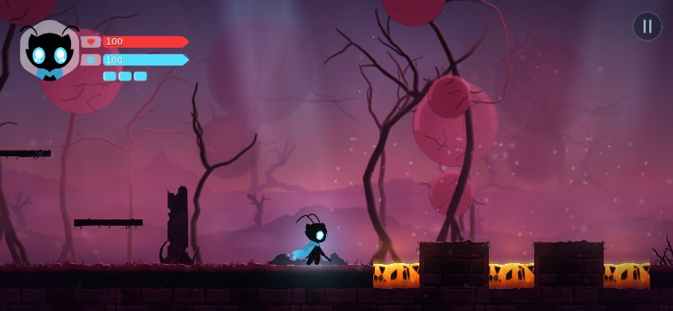
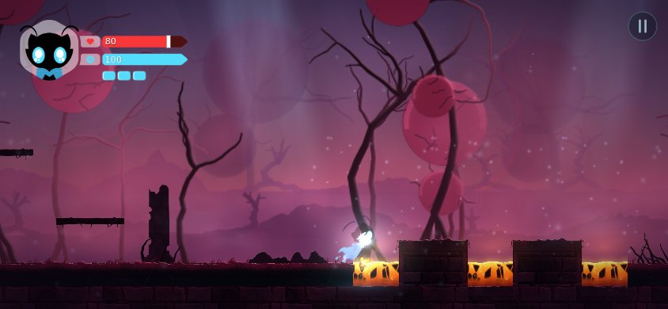
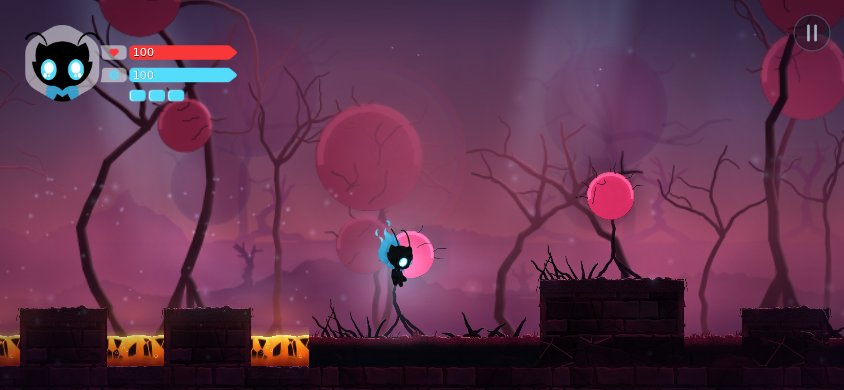

# Prompt 23 — Las dos estéticas del metroidvania

> Documento del encargo «Planificación y desarrollo de las dos estéticas»: la campaña tendrá **dos mitades** —la primera (0 % – 50 % de la duración), con **la estética actual**, completada y consolidada; la segunda (50 % – 100 %), con **una estética nueva definida por una imagen de referencia** (árboles retorcidos y oscuros con grandes esferas de energía roja, cielo nocturno rojizo, magenta y violeta) y con **lava como peligro jugable**— **en este orden: primero la primera mitad, después la segunda**. Reglas del encargo que gobiernan todo lo que sigue: no se vuelve a hacer la auditoría (se usa la que hay y se comprueba solo lo que cambió); no se sustituye ni se redibuja ningún PNG aprobado; no se inventa una dirección artística para la primera mitad; no se presenta como arte final lo que es una silueta provisional o una pieza repetida; no se afirma una duración sin pruebas; no se oculta un problema técnico con un arreglo visual; y **ninguna fase se da por terminada porque compile o pase una prueba: se mira el juego**. Este archivo se escribe **a medida que se trabaja**.

---

## 1 · Lo que la auditoría ya dice (y no se repite)

La auditoría de este encargo son las bitácoras de los Prompts 21 y 22 y las mediciones que ya existen (`docs/PROMPT21-LOG.md` §3, §9, §11 y §12; `docs/PROMPT22-LOG.md` §5, §8, §10 y §16). Lo que de ellas se usa, con su fuente:

| Dato | Valor | Fuente |
|---|---|---|
| El mundo | **7 zonas, 64 salas** (56 en el camino principal, 8 opcionales), 7 guardianes, 6 habilidades, 14 arquetipos de enemigo, 15 santuarios, 16 mejoras | Prompt 21 §3 |
| Duración medida (jugador de guion, de la partida nueva a la salida) | **26,2 · 27,5 · 37,7 min** (tres semillas); la travesía pura de las 55 salas del camino, **8,9 min**; el combate, 6–11 min; los siete guardianes, ≈ 6,5 min | Prompt 22 §5 y §8 (repetido hoy: 27,5 min la semilla 1) |
| Duración **humana** | **desconocida**; estimada en **1 – 2,5 h** para una primera partida del camino principal; el objetivo del encargo del Prompt 21 era de **3 – 5 h** (5 – 7 h con lo opcional) y **no se alcanza ni se ha medido** | Prompt 21 §11.1; Prompt 22 §8 |
| Lo que el propio Prompt 21 dijo que acercaría la duración | *«más tramos de vuelta con una razón para volver, más combates distintos por zona, más jefes opcionales»*, no copiar salas ni subir vidas | Prompt 21 §11.1 |
| El arte del escenario | **pintado por código** (`tools/art`), `provisional`; **un solo conjunto de fondo** (tres tiras) para las 64 salas; las 60 salas posteriores al Santuario **vestidas por un compositor** con una «mano» por zona; **la piedra partida y la palanca no tienen pieza**; las tiras de fondo **son más cortas que lo que la cámara necesita en 43 de las 64 salas** | Prompt 21 §9.4 y §12; Prompt 22 §10 |
| Criaturas y guardianes | solo el Ink Slime y el Custodio tienen arte pintado; los otros **13 arquetipos y 6 guardianes** se dibujan con siluetas procedurales | Prompt 22 §10.1 |
| El presupuesto del arranque en frío | **204 640 B de 204 800 B gz** (quedan **160 B**): nada que viaje con el primer fotograma puede crecer | Prompt 22 §14 |
| El protagonista y el HUD | de la persona propietaria, **intactos** (`art/player/source/character-sheet.png`, `src/ui/hud/png/original/`): no se tocan | Prompt 16, 17 |

**Lo que se comprobó de nuevo** (solo lo que hacía falta): el repaso visual de las salas, el reparto de tiempo por zona de la partida de guion (seed 1: Ruinas 1,0 · Santuario 0,7 · Raíces 4,4 · Ciénaga 2,9 · Minas 6,3 · Aguja 3,7 · Fundición 6,4 · Corazón 2,0 min) y la medida de los colores de la imagen de referencia (§3).

---

## 2 · El alcance de las dos mitades

### 2.1 · Qué es «el 50 %»: se mide en tiempo, no en salas

El encargo pide dividir **por duración real estimada**, no por número de salas. Lo que se puede medir hoy es el tiempo de un jugador de guion; lo que se quiere es el de una persona. El modelo que se usa (y se repite al final, §9) separa lo que está medido de lo que es una hipótesis:

| Magnitud | Cómo se obtiene | Hoy (mundo actual) |
|---|---|---|
| **Recorrido puro** | los metros del camino ÷ la velocidad de carrera (8,5 m/s), y la travesía que hace el piloto con saltos y trepadas | 3 190 m ≈ 6 min; con saltos, **8,9 min** (medido) |
| **Tiempo de guion** (cota inferior) | la partida completa del jugador de guion, con un héroe mortal | **26,2 – 37,7 min** (medido, tres semillas; 27,5 min la semilla 1) |
| **Duración humana del camino principal** | tiempo de guion × *m*, con *m* ∈ [3, 5] (**hipótesis**: orientarse, aprender cada jefe, morir, leer el mapa) | **1,4 – 2,3 h** (con 27,5 min) |
| **Con lo opcional** | + del 50 al 100 % de lo anterior (hipótesis: lugares escondidos, atajos, recompensas) | 2,1 – 4,6 h |

Con *m* entre 3 y 5, el objetivo de **3 – 5 h** del camino principal pide un tiempo de guion **total de ≈ 36 – 100 min**, con centro en **≈ 55 – 60 min** (m ≈ 4). La mitad es **≈ 28 – 30 min de guion por mitad**: la primera mitad actual (27,5 min) ya está en ese orden; **lo que falta es la otra mitad**. Es una hipótesis con su barra de error, y se dice así: el *m* no se ha medido nunca con una persona (`npm run session:report` existe para eso).

El reparto del tiempo de guion por zona (semilla 1, minutos) y lo que se gana en cada una:

| Zona | Salas | Tiempo de guion | Acumulado | Se gana |
|---|---|---|---|---|
| Ruinas (R1 – R3, Nave) | 8 | 1,0 | 3,6 % | el Dash, el Rayo |
| Santuario (R4) | — | 0,7 | 6,2 % | el Custodio de Tinta · el Impulso aéreo |
| Raíces Hundidas | 9 | 4,4 | 22,2 % | el Tirano de Raíces · el Salto doble |
| Ciénaga Luminosa | 10 | 2,9 | 32,7 % | la Matriarca · el Salto de pared |
| Minas de Cristal | 10 | 6,3 | 55,6 % | el Coloso · el Golpe al suelo (**las seis habilidades**) |
| Aguja de las Campanas | 10 | 3,7 | 69,1 % | el Custodio de la Campana |
| Fundición de Tinta | 10 | 6,4 | 92,4 % | el Motor de la Fundición |
| Corazón de Tinta | 7 | 2,0 | 100 % | el Soberano · la salida del mundo |

### 2.2 · La decisión: la primera mitad son las siete zonas actuales

**Primera mitad = las 7 zonas y las 64 salas que existen** (el camino de 56 salas y las 8 opcionales), consolidadas y moderadamente ampliadas (§5). **Segunda mitad = zonas nuevas**, en la estética de la imagen de referencia, que continúan **después** del Soberano. Tres razones, con los datos de arriba:

1. **Duración.** Con *m* = 3 – 5 el mundo actual vale 1,4 – 2,3 h: **es ya, con un margen pequeño, la mitad de un objetivo de 3 – 5 h**. Ampliarlo un 10 – 15 % (≈ 31 min de guion) lo centra en 1,5 – 2,6 h; una segunda mitad de duración parecida completa la campaña.
2. **Progresión.** Las seis habilidades llegan al final de las Minas, y la Aguja, la Fundición y el Corazón son su **aplicación**; los siete guardianes cierran un arco. Una segunda mitad tiene que ser una **continuación** (otro arco con las seis habilidades en la mano, más exigente), no un reciclado del primero.
3. **Lo que prohíbe el encargo.** *«No como un conjunto de habitaciones que solo cambian de color.»* Cortar en medio del mundo actual (donde el tiempo llega al 50 %, dentro de las Minas) obligaría a teñir de rojo **27 salas ya hechas**; y dejaría la primera mitad en 0,8 – 1,3 h, que no sostiene su duración.

**Lo que se evaluó y se descartó:** cortar al final de las Minas (el 56 % del tiempo de guion): primera mitad de 37 salas y 15,4 min de guion (0,8 – 1,3 h humanas, la mitad de lo que necesita), segunda mitad con la Aguja, la Fundición y el Corazón recoloreados más lo que hubiera que añadir; rompe el arco del Soberano, que es el clímax de la primera historia, y cambia de estética zonas que tienen pruebas, mapa, sonido y arte construidos sobre su identidad.

**Qué cambia en la estructura y qué no.** El Soberano de la Tinta deja de cerrar el juego: pasa a cerrar la primera mitad. La salida de `ih_end` —hoy *«la salida del mundo»*— lleva a la primera sala de la segunda mitad, y el final del mundo (la pantalla de cierre y los créditos, que **no cambian**) se muda a la última sala de la segunda. **No se escribe ninguna historia nueva ni se toca ningún texto narrativo aprobado.**

### 2.3 · Los objetivos que se miden al final

| | Primera mitad | Segunda mitad |
|---|---|---|
| Tiempo de guion | 28 – 34 min (hoy 27,5) | 28 – 34 min |
| Salas del camino | 56 + las nuevas | ≈ 40 – 44 (más grandes y más exigentes que la media actual) |
| Estética | la actual, un fondo propio por zona | la de la imagen de referencia |
| Peligros | pinchos | pinchos y **lava** |
| Proporción de cada una (por tiempo de guion) | 45 – 55 % | 45 – 55 % |

Lo que se afirma al final es **lo que se midió** (tiempo de guion de cada mitad), con la hipótesis de *m* **dicha como hipótesis**. No se afirma ninguna duración humana.

### 2.4 · Reglas de arquitectura que se fijan antes de empezar

- **La estética es un dato de la sala**, no un `if` del motor: `RoomDefinition.art.backdrop` elige el conjunto de fondo; los paquetes de arte dicen para qué salas valen (`zones`). Cambiar de qué estética es una zona es cambiar una lista.
- **La lava es un tipo de peligro** (`HazardKind`) que usa el sistema que ya hay —combate, daño, golpe, *i-frames*, eventos—, con lo que cambia en **datos** (empuje, rescate) y no en código nuevo; el código que cuesta bytes del primer fotograma se vigila contra los **160 B** de margen del arranque en frío.
- **La segunda mitad viaja aparte**: su contenido (salas, criaturas, jefes) es un *chunk* diferido como lo es `beyond` desde el Prompt 21, y sus ids no entran en la lista del primer fotograma.
- **Los PNG de la primera mitad no cambian**: lo que se pinte es *nuevo*. Los del propietario (la hoja del protagonista, el HUD) los fijan por hash las pruebas que ya existían; los pintados por código de las Ruinas se comprueban al reconstruir (los PNG tienen que salir idénticos: `git status art/` limpio de modificaciones) y así se hizo, y se dice así: **no hay una prueba nueva que fije cada PNG pintado**, porque ese arte es provisional y está hecho para sustituirse.
- **Nada se presenta como arte final**: lo pintado por código lleva el estado `provisional` y se cuenta como tal en el informe.

---

## 3 · La imagen de referencia: qué se mide y qué se toma de ella

Medida con el Chromium del proyecto (1023 × 436 px; `scratchpad`, no se guarda en el repositorio): **no es una imagen clara**, es de **luminancia baja** —percentiles 5 / 25 / 50 / 75 / 95 de 38 / 61 / 71 / 88 / 96 sobre 255—, con lo que **cabe en el tono oscuro del juego** sin romperlo.

| Elemento | Medida | Qué se toma |
|---|---|---|
| Cielo | `#43375d` arriba → `#523f65` (25 %) → `#684b70` (40 %) → `#904d67` (55 %) → `#b6455f` (65 %, la franja más viva) | un gradiente violeta-índigo a carmesí, que baja a un velo de bruma al horizonte |
| Suelo del fondo | `#7b2d45` → `#a54460` | un plano rosado oscuro bajo la bruma (el suelo que se *camina* sigue siendo la arquitectura oscura de las ruinas) |
| Esferas de energía | núcleo `#ed2e5f` / `#eb3276`; borde `#af3c68`; media `#d92866`; **reborde claro `#ff9ab8`**; las del fondo, apagadas (`#562c57`) | esferas con degradado radial, un reborde claro y **grietas oscuras** (venas), cada vez más apagadas con la distancia |
| Árboles | cerca `#3c1d2f` (casi negros), a media distancia `#422e55` – `#543958`, lejos `#60315a` | siluetas **retorcidas y delgadas**, ramas en punta, raíces como patas; **perspectiva atmosférica**: cuanto más lejos, más violeta, más transparentes |
| Motas | pequeños puntos blancos-rosados | las motas de luz que el juego ya tiene (`motes_a`), teñidas |
| Composición | espacio abierto y amplio; **un árbol con varias esferas** (la izquierda: tres de tamaños distintos), **uno con una sola esfera grande y patas** (la derecha), árboles lejanos desvaídos | los tres planos del fondo (lejos / medio / cerca) con esos tipos |

**Cómo se evita que el fondo compita con el juego** (lo que el encargo exige): el héroe es una silueta negra con luz cian —el color **opuesto** al de la escena, que lo hace más legible, no menos—; las esferas del fondo son **magenta**, y **la lava será anaranjada y amarilla** con una superficie animada y un reborde caliente, **un color y un movimiento que ninguna esfera tiene**; los árboles cercanos se atenúan por distancia (capa del fondo cercano) para no ser tan oscuros como el héroe y los enemigos; y la arquitectura transitable conserva su luz de borde, ahora rosada, para que los suelos se lean sobre el cielo.

---

## 4 · Plan por fases y puertas de calidad

| Fase | Qué | Puerta para pasar a la siguiente |
|---|---|---|
| **1** — la primera mitad | relevamiento visual; un fondo propio por zona; las piezas que faltan (piedra partida, palanca); más variedad del compositor; integración de criaturas y efectos; ampliar el contenido con lo que la auditoría recomienda | capturas de **cada zona** que se distingan a simple vista; métricas de repetición mejores que las de partida; los PNG existentes **idénticos**; todas las pruebas y las escenas de mundo en verde; el tiempo de guion dentro del objetivo |
| **2** — la segunda mitad | la estética de la imagen (pintor y paquetes); **la lava** (datos, sistema, daño, vista, sonido, solucionador y piloto); el mundo nuevo; la conexión | la lava hiere **una vez** por contacto, devuelve al héroe a un sitio seguro y se ve como lo que es; cada sala nueva auditada por el solucionador y jugada por el piloto |
| **3** — la integración | arranque en frío, carga diferida, rendimiento, mapa, guardado, audio, HUD, transiciones | `npm run bench:bundle` dentro del techo; la partida completa extendida de la nueva a los créditos |
| **4** — la verificación | duración, proporciones, repetición, E2E y pruebas | informe con lo medido y lo que no |

---

## 5 · Fase 1 (primera mitad), bloque 1: cada zona tiene su escenario

### 5.1 · El punto de partida, medido

El repaso visual de las 64 salas dio el hallazgo que ordena todo lo demás: **todas las salas compartían un único fondo** (tres tiras pintadas para las cuatro salas del corte vertical). Una captura de las Minas de Cristal y otra de la Fundición eran la misma imagen —el mismo bosque azulado, las mismas «vainas» colgando— con otro suelo en un sitio. Las medidas, con `scratchpad/p23/metrics.mts` leyendo los paquetes confirmados y los datos de las salas:

| | Antes | Después |
|---|---|---|
| Conjuntos de fondo distintos en el mundo | **1** | **7** (Ruinas + 6 zonas) |
| Capas de fondo más cortas que lo que la cámara necesita (de 192; sobre ellas se ve el cielo) | **82** (14 lejanas, 25 medias y 43 cercanas) | **3** (las tres en las Ruinas, cuyas tiras no se tocan; la altura de cada tira de las demás zonas sale de la cámara más alta de la zona: `planStrip`) |
| Piezas de decorado por detrás del paso (en las 64 salas) | 109, de **3 – 5 tipos por zona** | **186**, de **5 – 13 tipos por zona** |
| Cuota de la pieza más repetida de una zona | 25 – **71 %** | 17 – 44 % |
| Pares de piezas vecinas dentro de una sala que son la misma | 15 – 50 % | 0 – 20 % |
| Primer plano (lo que cuelga delante de la cámara) | 3 imágenes en 3 zonas; **ninguna en 4** (y en ellas se veían las «vainas» provisionales del borrador de formas) | de 2 a 5 imágenes en **todas** |
| Materiales del suelo por zona | 3 (piedra, tierra, madera) | 4 – 5 (el suelo de la Fundición es hierro y escoria; el del Corazón, tinta y hueso) |

### 5.2 · Qué se hizo

- **Un fondo por zona** (`tools/art/painter/zones.ts`, `motifs.ts`): las tres tiras —lejos, medio, cerca— de las Raíces (verde-negro, troncos y raíces en arco), la Ciénaga (verde-azulado, hongos que brillan bajo el sombrero, farolas, juncos), las Minas (azul frío, techo con dientes, cristales, vigas), la Aguja (bronce de un ocaso con viento, torres, campanas, contrafuertes), la Fundición (rojo-negro de un horno enfriado, chimeneas, depósitos, tuberías, engranajes) y el Corazón (violeta-negro, costillas, venas que brillan, quistes). **Mismo lenguaje que el de las Ruinas, otro tono**: siluetas oscuras iluminadas desde arriba, bruma delante del suelo para que el héroe se lea, lo lejano más pálido; el tono de cada zona es el que ya nombraba su ambiente (`content/atmosphere.ts`). Las tres tiras de las Ruinas **no se tocaron**: el paquete se reconstruyó y los PNG salieron idénticos byte a byte.
- **El suelo que cada zona pisa**: nuevos materiales de dato (`materials` de `mapRoom`: piedra `rock`/`masonry`/`iron`/`ink`, tierra `mud`/`gravel`/`flagstone`/`slag`/`inksoil`, plataforma `timber`/`beam`/`grate`/`bone`: 13 en total) y las pieles correspondientes en el pintor (`painter/skins.ts`: la rampa de la piedra, la de lo que crece, la luz de las grietas y la luz con que se ilumina). Las pieles son parámetros de los mismos generadores de siempre, con la piel de las Ruinas por defecto: **los PNG de las Ruinas salieron idénticos**.
- **El decorado de cada zona** (`painter/zoneProps.ts`, `scenes/zones.ts`): de 3 a 6 clases de pieza que se levantan detrás del paso (las Raíces reutilizan además los pilares y las raíces rastreras del paquete de la Galería de Raíces, que ya eran suyas) (un cristal tan alto como una casa, un depósito sobre sus patas, una campana en su marco, una farola sobre un poste, una costilla que sale del suelo…), 2 que yacen, 1 – 2 que cuelgan delante de la cámara, las puntas de los fosos en el material de la zona (cristal, hierro, tinta; las Raíces y la Ciénaga conservan las zarzas) y la luz en el color de la zona. **El compositor** ya no esparce seis piezas donde caiga la semilla: recorre el suelo abierto de la sala como lo haría quien la diseñó (una pieza cada tantos metros, distinta de las dos anteriores; un par que enmarca el santuario; las dos puertas de la arena marcadas), y solo lee los datos de la sala, así que reconstruir no cambia nada.
- **Las dos piezas que el contrato pedía y nadie pintaba** desde el Prompt 21: la **piedra partida** (`door:stone`: un muro de polígonos con grietas que dan luz, más pálido que la piedra que lo rodea, para que se lea como lo que se va a romper en cualquier zona) y la **palanca** (`interactive:activate`: dos cuadros, en reposo y encendida mientras se puede tirar de ella). `STILL_THE_BLOCKOUT` queda **vacío**.
- **Los tamaños de las tiras vienen de los datos**, no de una cifra a ojo: la sala más alta del mundo muestra 52 m de cámara (la Aguja), y la tira que la cubre mide 43 m. El límite del manifiesto para la altura de una pieza (40 m) pasó a 64 m con esa razón escrita.

### 5.3 · Lo que no cambió (y la prueba)

Colisiones, salidas, puertas, jefes, enemigos y habilidades **no se tocaron**: el único cambio en los datos de sala es el nombre del fondo y de los materiales (`art.backdrop`, `materials`), que son piel. Las pruebas que fijaban *«las dieciséis piezas sin las cuales las 64 salas no están vestidas»* ahora fijan las **cuarenta y siete** (las 16 de las Ruinas, las 18 tiras de los fondos de las zonas y los 13 materiales del suelo), con la lista escrita pieza a pieza. Presupuesto del arranque en frío tras este bloque: **204 682 B de 204 800** (quedan 118 B; el bloque cuesta 42 B: seis alias de fondo en el borrador de `render/backdrops`).

### 5.4 · Lo que sigue siendo provisional (dicho, no escondido)

Todo lo pintado por `tools/art` lleva el estado `provisional` y se cuenta como tal: los seis fondos, los 13 materiales nuevos, las 42 clases de pieza de decorado (84 imágenes: dos variantes de cada una), la palanca, la piedra partida y las puntas. Son **arte generado por código, coherente con el de las Ruinas y suficiente para jugar y juzgar el conjunto, no arte final**: un ilustrador podría sustituir cualquiera de ellos por una pieza pintada a mano sin tocar una línea del juego (el contrato lo permite pieza a pieza). Siguen sin arte propio **13 criaturas y 6 guardianes** (siluetas por código). Las tiras cercanas de las zonas nuevas se pintan a 28 px/m (las de las Ruinas, a 38,4): la sala más alta del mundo pide 43 m de tira, y a la densidad de las Ruinas serían 10 MB de memoria solo para esa capa.

### 5.5 · Lo que cuesta cada zona en memoria (y lo que se recortó para que cupiera)

El presupuesto de una zona es de 40 MiB de páginas de arte ya decodificadas (`MEMORY_BUDGET_MIB.zone`). La primera versión del bloque lo rompía: el juego sostiene en una sala **todos los paquetes cuyas zonas la nombran más los que viajan con el juego** (el héroe y la luz de los efectos), y cada sala posterior a las Ruinas pedía además tres paquetes grandes de las salas del corte vertical solo por una pieza pequeña cada uno —el santuario (en el de la Galería de Raíces, 5,8 MiB), la runa (en el del Santuario, 6,1 MiB) y el sigilo de un sello (en el de la Cámara del Sello, 4,2 MiB)—. Medido en el juego (`scratchpad` `mem.mts`: el mismo gancho de pruebas que lee la biblioteca de arte), antes de recortar: **40,8 MiB en la Fragua Vieja** (estático) y 39,8 MiB en la cima de la Aguja. Lo que se hizo, sin tocar un píxel de lo ya aprobado:

- **Las piezas compartidas viven en un paquete pequeño** (`ruins-parts`: el santuario, el frasco, la runa y el sigilo —los mismos dibujos: la misma pieza y la misma semilla—, más la piedra partida y la palanca) y los paquetes de R2, R3 y R4 vuelven a ser solo de esas salas.
- **La luz de cada zona se guarda a la mitad de densidad** (`scale: 0.5`: una luz no necesita más de lo suave que es) y **la tira cercana de las zonas más altas se pinta a menos px/m** (el tope es de ~900 px de alto: 20 px/m en la Aguja, donde la cámara de 52 m pide 43 m de tira).
- **El pack de luz de las Ruinas es solo de las Ruinas**; cada zona trae su haz de salida.

Resultado medido: el peor cuarto del mundo guarda **34,8 MiB** (la Pasarela de la Ciénaga), y todos están por debajo de 40. `tests/unit/tools/zoneMemory.test.ts` lo fija para las 64 salas (suma de las páginas de lo que se guarda en cada una) y que una sala guarde **el conjunto de su zona y de ninguna otra**.

### 5.6 · Contenido de la primera mitad: tres salas del camino

El reparto del tiempo de guion (§2.1) decía dónde estaba delgada la primera mitad: la Ciénaga (2,9 min), el Corazón (2,0 min: el clímax de la mitad, con el Soberano dentro) y la Aguja (3,7 min). Se añadieron **tres salas obligatorias**, una en cada una, escritas con la misma gramática que las 64 anteriores (`RoomCanvas` + `mapRoom`) y puestas donde cuentan algo que la sala vecina ya prometía:

| Sala | Zona | Entre | Qué es |
|---|---|---|---|
| `mr_mangrove` · *Manglar* | Ciénaga | Farolillos → **Manglar** → Foso de los Sapos | 56 × 34 m. Siete tablones de raíz, cada uno 3 m más arriba y 3 m más allá, sobre agua negra: una subida de 20 m hasta la cornisa a la que el Foso de los Sapos siempre entraba (su entrada oeste está a 22 m y la sala anterior no subía: **la sala que faltaba entre las dos**). Un sapo guarda el tablón ancho, dos fuegos fatuos cuelgan en los huecos y una espora cierra la subida. |
| `sp_roofs` · *Tejados* | Aguja | Campanario → **Tejados** → Pasarela del Viento | 96 × 30 m. Tres hastiales de piedra escalonados (cumbres a 6, 9 y 8 m) con la gotera del suelo entre ellos, una tira de clavos en la primera, un tañedor en la gotera y otro en la cumbre del segundo hastial, un fuego fatuo y dos murciélagos bajo el alero. Termina en la cornisa a 8 m desde la que empieza la Pasarela (que ya estaba a esa altura y a la que se llegaba desde el suelo). |
| `ih_atrium` · *Atrio* | Corazón | Pulso → **Atrio** → Ascenso | 80 × 26 m. Un tejedor en medio del salón es el guardián de la puerta de piedra del este: la puerta se abre cuando cae (el mismo patrón que la puerta del sapo de los Farolillos), con una Sombra de Velo a cada lado. Un tablón a 3 m sobre el centro y dos tocones de un salto para quien quiera algo bajo los pies. |

**Qué se comprobó, y lo que enseñó.** Las tres pasan la auditoría del solucionador (solo el dash alcanza todo lo que no declara una necesidad; ninguna entrada está a la vista de una criatura; ninguna entrada cae dentro de la zona de una salida) y los 72 pasos entre salas (`transitions`). El primer diseño del Atrio **no era superable por el jugador de guion**: el tejedor guardián estaba sobre una tarima de 2 m y, con dos sombras y una sanguijuela en la misma sala, el héroe murió 300 veces en 600 000 ticks sin abrir la puerta. Se bajó el guardián al suelo y se quitó la sanguijuela (la sala del Antecámara tiene la misma compañía —dos sombras y un tejedor— y la pasa). Es la utilidad del jugador de guion como *cota*: no dice que una persona lo logre, dice que un diseño que ni él logra no se entrega.

**Un instrumento viejo que mentía poco, y se corrigió en su causa.** Al añadir salas, la semilla 3 de la partida completa dejó de pasar por una diferencia de **94 ticks** entre el reloj de la página y el del corredor de pruebas, de signo contrario en dos zonas vecinas. No era del juego: tras morir en `fd_gate` el héroe vuelve al santuario de `sp_approach`, y esa carga emite `room:loaded` pero no `room:entered`, que era el único evento que el corredor oía para cambiar de sala. Ahora el corredor cambia de sala con `room:loaded` (la página ya lo hacía) y cuenta la visita con `room:entered`; la tolerancia (40 ticks) **no se tocó**.

**El arranque en frío ganó margen.** La lista de las 64 (ahora 67) salas viajaba en el arranque aunque R1 solo necesita las cuatro del primer capítulo: `content/world.ts` guarda esas cuatro y `content/worldRooms.ts` —la lista del resto, por zonas, en el orden en que se encuentran— la añade `content/beyond.ts` cuando llega. Quien importa `@/content` (el menú, las pruebas, las herramientas) ve el mundo entero y en el mismo orden; solo `app/Game2D.ts` importa el núcleo. **Arranque en frío: 204 498 B de 204 800 (quedan 302 B; eran 118)**, con las tres salas ya contadas.

**El tiempo, medido (jugador de guion, tres semillas: la cota inferior, no una duración humana).** Antes: 26,2 – 37,7 min (27,5 la semilla 1). **Ahora: 25,7 · 28,5 · 31,2 min** (semillas 2, 1 y 3); la semilla 1 por zona: Ruinas 1,8 · Raíces 4,4 · Ciénaga 2,9 · Minas 6,2 · Aguja 4,2 · Fundición 6,4 · Corazón 2,5 (28,5 en total; 3 muertes). La subida es de ~1 min (3,6 %): **la primera mitad queda en el borde bajo del objetivo (28 – 34 min)**, y se dice así; no se infla con salas de relleno. Lo que se mide en el informe final es esto, con la hipótesis de *m* dicha como hipótesis.

Pruebas: 264 archivos / 5 007 pruebas en verde (las cifras fijadas —67 salas, 59 del camino, 144 puertas, once salas de la Ciénaga y de la Aguja, ocho del Corazón— se actualizaron una a una).

---

## 6 · Fase 2, bloque 1: la lava como peligro jugable

### 6.1 · Qué es y cómo se decidió

La lava es **un tipo de peligro** (`HazardKind = 'spikes' | 'lava'`), no un sistema nuevo: una zona que *hiere por el sistema de combate* —el mismo golpe de cualquier peligro: 1 punto de vida, aturdimiento de 14 ticks, parada de impacto de 6, empuje hacia arriba y hacia afuera, los *i-frames* de siempre y los mismos eventos—, de modo que la repetición está gobernada por lo que ya la gobierna (un segundo contacto durante los *i-frames* no hace nada; el dash protege con los suyos; el modo dios no la siente). Se descartaron dos diseños:

| Diseño | Por qué no |
|---|---|
| **Hundirse hasta el vacío y que lo rescate el `killY`** (la lava como un foso con una capa que hiere) | El héroe atravesaría la lava a la vista, caería a un vacío sin fondo dibujado y reaparecería después de ~1 s; además la lava no tendría dibujo posible más allá de una franja. |
| **Peligro periódico (géiser que se enciende y se apaga)** | Pide el reloj en el sistema de peligros (bytes del arranque en frío) y que el solucionador y el piloto sepan de fases: un peligro que el solucionador trata como pared fija haría inalcanzables las salas que dependen de cruzarlo en su fase. **El tiempo lo ponen las criaturas rítmicas que ya existen** (el tañedor, el pistón, el escupidor) sobre plataformas entre pozas; se dice así, no se finge. |

**Quema una vez y suelta.** Tras el golpe, y pasada la parada de impacto, a los **9 ticks** (`LAVA_LET_GO`: lo que dura que el golpe y el destello se vean) el héroe es devuelto al **último suelo sólido seguro** —la misma regla que ya rescata al que cae fuera del mundo (`rescuePlayer`)—, con la sala y el guardado intactos. Un fallo cuesta **un punto de vida y un paseo corto**, nunca un bucle de quemaduras ni un lugar del que no se sale. Un héroe que **muere** de la quemadura no es trasladado: es la derrota (`DeathFlow`) la que lo devuelve al santuario. Un tablón de una sola dirección no es suelo al que volver (la regla de siempre: solo suelo sólido); las piedras de paso, sí, por lo que **las salas de lava se dibujan con piedras, no con tablones, donde un fallo no debe costar el camino entero**.

### 6.2 · Dónde está, y lo que cuesta

| Pieza | Dónde | Coste en el arranque en frío |
|---|---|---|
| El tipo `lava` | `world/RoomDefinition.ts` (un tipo: 0 B) | 0 |
| «Quema y suelta» | `gameplay/GameSession.ts` (el *callback* del peligro) y `gameplay/HazardSystem.ts` (`LAVA_LET_GO`) | **54 B** (204 498 → 204 552 de 204 800; quedan 248) |
| La lava en el dibujo de salas | `world/roomMap.ts` (`=`, `RoomCanvas.lava(x0, x1, y, depth)`; cada poza —o cada caída, una columna— es **un** rectángulo; una caída se apoya en la poza que alimenta) | 0 (viaja en el *chunk* diferido) |
| El efecto del quemón | paleta `ember` (naranja con corazón amarillo: el color que ni el cian del héroe, ni el violeta de los enemigos, ni el acento rojo tienen), disparador `lavaBurn` (brasas que suben, gotas que caen pesadas, un destello cálido), dentro del contrato de efectos | 0 (carga diferida con los efectos) |
| El sonido | `hazard.lava` (3 variantes: un siseo que cae, un peso caliente, el crepitar de lo que prendió), construido con la biblioteca de `tools/audio` | 0 |

### 6.3 · Pruebas

`tests/integration/lava.test.ts` (10, en una sala de laboratorio dibujada en letras: una repisa a cada lado, 16 m de lava de un metro sobre una cubeta de piedra con tres piedras de paso y un tablón): un contacto cuesta un punto y lo anuncia (sala, peligro, tipo, daño, dónde); el golpe es el habitual y el héroe es soltado tras la parada de impacto y el lanzamiento; **se quema una vez** por muy largo que fuera a quedarse; vuelve a la **piedra** donde estuvo y no a la repisa de la que salió; nunca queda dentro de una poza; un tablón no es suelo al que volver; la derrota no es trasladada; el modo dios ni quema ni traslada; los pinchos siguen sin trasladar. Comprobado que **cinco fallan** si se quita la regla de «suelta». `roomMap` (3 pruebas nuevas: el dibujo en letras, la caída sobre la poza, el error que nombra la sala si la lava no se apoya en nada sólido) y el contrato de efectos (el disparador, su evento y su techo de 40 partículas por disparo).

## 7 · Fase 2, bloque 2: la segunda estética y el mundo de la segunda mitad

### 7.1 · La imagen, convertida en piezas (qué se pintó y qué se decidió)

La segunda mitad son **cuatro zonas** —Linde del Ocaso, Arboleda de las Esferas, Cráter de Brasas, Trono de Ceniza— pintadas por código con el mismo método que las seis de la primera (`tools/art`: siluetas iluminadas en bruma, lo más lejano más pálido, lo que se camina más claro que lo que tiene detrás para que el héroe se lea), en el idioma de la imagen de referencia:

| Zona | Cielo y luz | Lo que la distingue |
|---|---|---|
| **Linde del Ocaso** (`dusk`) | el gradiente de la imagen, de violeta `#2a2146` a carmesí `#c9607a`; bruma rosada | la imagen misma: árboles delgados y retorcidos sobre sus propias raíces con una esfera en la horquilla, ralos y abiertos |
| **Arboleda de las Esferas** (`grove`) | más hondo (`#1f1838` → `#c24c66`) | los mismos árboles, más juntos y con esferas en racimos; gotas de luz que cuelgan del techo |
| **Cráter de Brasas** (`crater`) | naranja sobre el borde (`#e07a2c`), cielo de ceniza | las esferas se apagan (`DYING`), el basalto se agrieta con fuego, la luz viene de abajo; fumarolas y piedras de brasa |
| **Trono de Ceniza** (`throne`) | carmesí negro (`#0b0612` → `#8f1a38`) | arcos y torres rotos, jaulas de espino con una esfera apagada dentro, cadenas, y **una esfera inmensa** y tenue baja en el cielo |

**Cómo se construyó.** Un árbol con esferas es **una forma, no una imagen** (`painter/orbs.ts`): patas, tronco, ramas y las garras que sujetan cada esfera; la esfera es un disco que brilla con venas recortadas y un reborde claro (`orbLight`, `orbRim`). El reparto en dos capas (`back` y `front`) deja la esfera entre el tronco y las garras que la abrazan. Los tres planos de cada zona (`painter/ember.ts`) usan esas formas con tamaños, densidades y opacidades distintas; lo que se comparte con la primera mitad (cielo, bandas, bruma, haces) salió de `zones.ts` a `painter/themeKit.ts` **sin cambiar un solo píxel de las seis zonas ya aprobadas**: se reconstruyeron los seis paquetes y `git status art/` quedó limpio.

**Decisiones de arte, con su razón.**
- **Los objetos interactivos siguen siendo cian y violeta** (santuarios, vasijas, palancas): son la lengua del juego y lo que el jugador aprendió a buscar; teñirlos de rojo los habría confundido con las esferas y con la lava. El color cálido es de la luz de las cosas del *mundo* (esferas, lava), nunca de lo que se *usa*.
- **Las esferas de los planos cercanos están atenuadas** (`intensity` 0,40–0,46 frente a 0,6 en el plano medio): una esfera cercana tan viva como la de fondo competiría con el héroe y con las criaturas, que son siluetas oscuras con luz de borde.
- **Los materiales del suelo son piel** (`cinder`/`ash`/`charwood` en el Ocaso y la Arboleda; `basalt`/`scorch`/`obsidian` en el Cráter y el Trono): la arquitectura transitable conserva su luz de borde, ahora rosada o naranja, y los colliders se leen igual que en la primera mitad.
- **La lava es lo más vivo de cualquier escena** (naranja y amarillo con una cresta casi blanca): ni el cian del héroe ni el violeta de los enemigos ni el rojo de la herida ni las esferas (magenta) tienen ese color ni ese movimiento. La poza es **una tira periódica de cuatro metros** (superficie, remolino y placas de corteza se encuentran consigo mismos en los extremos) que el arte reparte fotograma a fotograma en orden, de modo que **una poza de cualquier ancho no tiene costura**; la caída es una columna pintada una vez y estirada por la escena a la altura de la caída; sobre cada una, un brillo que pulsa y brasas que suben.
- **Dos materiales de púas nuevas**: zarzas de madera roja con la punta rosa (Ocaso y Arboleda) y cristal negro con la punta al rojo (Cráter y Trono).

### 7.2 · Las cuatro zonas: 41 salas, y qué pide cada una

La segunda mitad **continúa** después del Soberano: la salida de `ih_end` —que era la salida del mundo— lleva a la primera sala de la zona nueva, y la salida del mundo se muda a la última sala de la segunda (`ct_end`). El héroe llega con **las seis habilidades**; lo que cambia es lo que se le pide con ellas y **lo que hay debajo de cada salto**. Ninguna sala es una sala de la primera mitad con otro color: cada zona tiene su gramática.

| Zona | Salas | Qué aprende o qué se le pide | Salas firmantes |
|---|---|---|---|
| **Linde del Ocaso** | 10 | la lava, de uno en uno: una poza con dos piedras, terrazas con una poza ante cada escalón, un río de ocho piedras con un campanero en medio y pistones encima, un lago con una escalera de diez tablones (el Salto doble en cada peldaño), una sala con suelo agrietable | `dv_ford`, `dv_lake`, `dv_ruins` (+ `dv_cellar`, opcional) |
| **Arboleda de las Esferas** | 11 | lo mismo con la lava *debajo* de lo que se hace: un puente al que le faltan tablones (se pelea sobre él), una bajada de cuatro tablones sobre un río (la vuelta son cuatro Saltos dobles), una chimenea de madera (el Salto de pared), un claro con una puerta que guarda un tejedor, una grieta de diez piedras con dos campaneros, un manantial que cae de una piedra en el aire | `og_edge`, `og_roots`, `og_gap`, `og_spring` (+ `og_vault`, opcional) |
| **Cráter de Brasas** | 10 | la lava deja de ser una poza en un suelo y **es el suelo**: diez terrazas con 4 m de lava ante cada una, una escalera de doce tablones con pistones, un río de 106 m en saltos de 6 y 7 m (carrera y *dash* en cada uno), una forja con dos palancas que piden el Salto doble y el de pared, una sala con un río encima y un túnel debajo, una montaña en medio de la lava | `ec_rim`, `ec_slope`, `ec_river`, `ec_forge`, `ec_tunnel` (+ `ec_cache`, opcional) |
| **Trono de Ceniza** | 10 | lo más difícil de cada cosa y **la última lava**: una calzada de tres piedras con un guardián en cada una, un salón sin lava lleno de criaturas, una galería con dos caminos, una escalera de siete pisos con una poza en cada uno, un foso de cadenas con dos cimas de 13 m, un pasillo de 130 m de piedras de tres metros a seis de distancia | `ct_gate`, `ct_stair`, `ct_chains`, `ct_gauntlet`, `ct_arena` |

**Las tres bóvedas opcionales** (`dv_cellar`, `og_vault`, `ec_cache`) están bajo una piedra agrietada que solo rompe el golpe al suelo, y guardan una vasija cada una **tras un desafío de lava distinto**: tres piedras de paso entre dos orillas con sapos (Ocaso), un foso de 14 m con dos piedras, un sapo y dos guardianes (Arboleda), cuatro piedras pequeñas con dos pistones encima (Cráter).

**Las pruebas de cada sala** son las mismas que las de las 67 primeras (`tests/helpers/audit.ts`): sin errores del validador; desde cada entrada se llega a cada salida y a cada cosa que tomar **con lo que la sala dice pedir y con nada más**; cada reclamación (`needs`) está ajustada (sin esa habilidad, alguna entrada no llega); ninguna entrada está a la vista de una criatura; ninguna entrada cae en la zona de una salida; y no hay **lugares de los que no se pueda salir** (la lava no cuenta como suelo: una isla rodeada de lava es un lugar al que se llega y del que se sale por las mismas piedras). La primera versión de cada zona tuvo defectos que estas pruebas encontraron y se corrigieron (entradas dentro del alcance de una criatura, una columna de piedra de 7 m que cerraba un salón, una chimenea de 44 m que el solucionador no sube —el límite es el tiempo del guion de saltos de pared, 560 ticks—, una escalera que no tenía por dónde volver).

### 7.3 · Criaturas y guardianes nuevos (qué son y qué no son)

**Diez criaturas de brasa**, cada una **una definición, no un cerebro** (`content/creaturesEmber.ts`): los mismos arquetipos de la primera mitad con los números movidos —más alcance, menos preparación, un poco más de vida—, de modo que todo lo que el jugador aprendió de las trece sigue siendo verdad: el Reptador de ceniza (la carga en línea, más larga), el Sapo de magma (salta una poza de 8 m y su onda es más ancha), el Guardián de basalto (el escudo, más piedra), el Fuego fatuo de brasa (viene más rápido y estalla más grande), el Murciélago de ceniza (se lanza tres veces), el Escupidor de escoria (se mantiene más lejos y lanza más rápido), el Campanero de ceniza (su ritmo es más corto), el Pistón de magma (fija antes y cae más rápido), el Tejedor de ceniza (teje reptadores) y la Sombra del ocaso (está menos tiempo ausente).

**Cuatro guardianes por tabla**, cada uno con **una condición distinta bajo la que puede ser herido** (`content/bossesEmber.ts`): el **Pastor del Ocaso** guarda su esfera en el pecho y solo la saca para lanzarla (abierta solo durante cada salva); el **Jardinero de la Arboleda** llama dos fuegos fatuos a dos tercios de su vida y tres a un tercio, y su flor se ve tras un salto y tras un anillo; el **Behemot del Cráter** abre la costra de su espalda cuando cae (un pisotón, o una carga que acaba contra un muro: la apertura más larga del mundo) y lanza lava en arco y la rueda por el suelo; el **Soberano de Ceniza** corta por detrás, llueve fuego del suelo bajo el héroe y donde tendrá que estar, lanza esferas y un anillo, carga a lo largo del suelo, y llama una sombra y un tejedor. Cuatro conjuntos de patrones distintos entre sí y distintos de los seis anteriores.

**Lo que NO es arte final** (dicho aquí y repetido en el informe): las diez criaturas y los cuatro guardianes son **siluetas procedurales** (`content/proceduralEmber.ts`), igual que las trece criaturas y seis guardianes de la primera mitad; todo lo pintado por código en esta fase lleva el estado `provisional`; y los fondos, las piezas y la lava son **arte generado por código coherente con la imagen de referencia, no una ilustración hecha a mano**.

### 7.4 · La conexión del mundo

**El camino.** El Soberano de la Tinta deja de cerrar el juego. La puerta este de `ih_end` (el Descanso) sigue funcionando solo cuando él ha caído (`defeated:ih_boss`), pero ya no termina la aventura: lleva a `dv_gate` (Puerta del Ocaso), cuya puerta oeste devuelve a la entrada este del Descanso, de cara a la sala. Cada zona entrega a la siguiente por la puerta este de su arena —que funciona cuando su guardián ha caído— y la última sala, `ct_end` (Cielo de Ceniza), tiene en la pared este **la única salida del mundo** (`end`, que exige `defeated:ct_boss`). El cierre y los créditos **no cambian**: se mudan allí (`worldEnds(WORLD, ROOMS)` devuelve `ct_end/end`; lo que antes preguntaba cuál era la última sala lo lee de ahí: `tests/helpers/road.ts`, `LAST_ROOM`). Una partida que ya estaba terminada en la versión anterior conserva su marca de terminada (`completed:adventure` es un indicador del mundo como cualquier otro) y, al cargarla, el héroe está en el Descanso con la puerta este ya abierta hacia la zona nueva.

**Los atajos de vuelta.** Cada zona repite lo que enseñaron las Raíces y las Minas: una puerta de piedra en una galería del extremo oeste de su primera sala, que se abre con una palanca de la antesala del guardián (`lever:dv_lift`, `lever:og_lift`, `lever:ec_lift`, `lever:ct_lift`) y lleva a la antesala. Quien vuelve de un santuario no repite la zona entera; quien llega a la palanca por primera vez ve la puerta del atajo cerrada y sabe que hay algo que abrir.

| | Primera mitad | Segunda mitad | Total |
|---|---|---|---|
| Zonas | 7 | 4 | **11** |
| Salas | 67 | 41 | **108** |
| Salas del camino principal | 59 | 38 | **97** |
| Salas opcionales (vasijas, cámaras, el Archivo…) | 8 | 3 | 11 |
| Santuarios | 15 | 9 | 24 |
| Guardianes | 7 | 4 | 11 |
| Salas con pinchos / con lava | 15 / 0 | 0 / 28 | 15 / 28 |
| Metros del camino (recta de la entrada a la salida de cada sala, sin contar saltos) | 3 205 | 2 730 | 5 935 |
| Vasijas de vida / de magia | 5 / 3 | 4 / 2 | 9 / 5 (vida máxima 14, magia máxima 200) |

**Lo que se tocó para conectarlo, y nada más.** El mapa conoce las cuatro regiones nuevas (`MapView.REGION_KEYS`: el nombre de cada una) y el perfil del menú de pausa cuenta ahora **108 salas y 11 guardianes**; `content/atmosphere.ts` da a cada zona su ánimo (luz, niebla y color: el ocaso, la espesura, el cráter, el trono); `audio/zoneAudio.ts` las suena **con lo que hay** —la pieza de las ruinas sobre ceniza, la humedad de las raíces con el pulso de las esferas, la cámara con su aire largo, la quietud vasta del Santuario— y el quemón tiene un sonido propio (`hazard.lava`): **las zonas nuevas no tienen música propia**, y se dice así (el crepitar de una brasa y el burbujeo de una poza quedan para la canalización de audio, con la música de cada zona); `content/upgrades.ts` enumera las seis vasijas nuevas (la prueba del mundo mantiene la lista y los recogibles de las salas iguales en los dos sentidos); `content/world.ts` y `content/worldRooms.ts` enumeran las 41 salas.

**Carga diferida.** Las 41 salas, las diez criaturas, los cuatro guardianes, sus miradas y **sus palabras** (`i18n/beyondCatalogs.ts`: los nombres de las salas y de lo que vive en ellas, en los dos idiomas) viajan en el trozo que el juego pide cuando ya ha dibujado el primer fotograma (`content/beyond.ts`; `app/beyond.ts` guarda las palabras y `Game2D.speakBeyond` las añade al traductor cuando llegan, y también al iniciar una partida que ya empieza más allá del Santuario). El arranque en frío no carga nada de la segunda mitad; cuánto cuesta lo que sí cambió en el núcleo se mide aquí: **204 723 B de 204 800 (quedan 77 B)**; la lava costó 54 B (§6.2) y conectar el mundo —el lector de las palabras que llegan con el *chunk* (`speakBeyond`, `app/beyond.ts`) y las seis vasijas de `content/upgrades.ts`, que el primer fotograma sí necesita— otros 171 B.

**Memoria.** Lo que el juego guarda en una sala de la segunda mitad (las páginas del paquete de su zona más lo que viaja con el juego), medido sobre los paquetes empaquetados: el peor cuarto de cada zona nueva —el Linde 29,6 MiB, la Arboleda 34,3, el Cráter 29,1, el Trono 32,5— y el peor del mundo, `mr_stilts` en la Ciénaga con 35,4 MiB, quedan **por debajo de los 40 MiB** de presupuesto; `tests/unit/tools/zoneMemory.test.ts` lo fija para las 108 salas y exige que una sala guarde el conjunto de su zona y de ninguna otra. En el navegador, la partida completa mantuvo el montón entre 9 y 42 MB, el DOM en 281 nodos como máximo y 33 llamadas de dibujo como peor momento (presupuesto: 60) a lo largo de 58 minutos y 108 salas (`fullrun`, §9.7).

### 7.5 · Lo que encontró el jugador de guion en la segunda mitad (y de quién era cada defecto)

El jugador de guion de los Prompts 22 y 23 (`Runner`: un héroe **mortal** que juega la partida completa con acciones reales —carrera, saltos del solucionador, golpes, magia, botellas, palancas, vasijas, santuarios, guardado y recarga—) se extendió a la segunda mitad y encontró cosas. Se separa lo que era **del instrumento** (el jugador de pruebas no sabía hacer algo que una persona sí) de lo que era **del contenido** (el juego pedía algo injusto), porque los dos se arreglan de modo distinto y solo el segundo cambia lo que juega la gente:

| Hallazgo | De quién era | Arreglo |
|---|---|---|
| El combatiente seguía a un escupidor al fondo de una poza (5 quemones en el Huerto de Cenizas) | instrumento | `Brawler.lavaAhead`: la prueba del suelo dice «hay dónde pisar» en el fondo de una cubeta con lava; ahora mira también la lava delante de los pies y por debajo (un tablón dos metros sobre un río) y se aplica en todos los estados salvo el *dash* y el aturdimiento. `tests/integration/brawlerLava.test.ts` (falla con 5 quemones sin la guarda, en las dos salas de laboratorio) |
| Un salto «estable» despegaba del final de una cornisa y caía en lava (la Cresta) | instrumento | `RoomPhysics.pastTheEnd`: la estabilidad del despegue no vale si el cuerpo pasa del extremo de la superficie; el piloto elige el despegue más cercano al extremo hacia el que corre |
| Una carrerilla de 20 m atravesaba a un guardián y a un tañedor sin reaccionar (la Caldera) | instrumento | el piloto comprueba su reflejo mientras toma carrerilla, no solo después |
| El jugador no sabía vencer a las criaturas de brasa con sus tácticas de las de tinta | instrumento | `KIN`: cada criatura de brasa se juega con la táctica de su arquetipo; el pistón solo es amenaza cuando está fijado (`lock`/`drop`/`stuck`) y cerca; el escupidor lanza a través de los huecos |
| El Motor de la Fundición no se terminaba en 30 000 ticks: las cargas del guardián acababan 0,7 m antes del muro oeste y el luchador no lo atraía | instrumento | cebo contra el muro **solo cuando se estanca** (`STALL = 1500` ticks sin bajarle la vida): una memoria incondicional rompía el combate del Soberano de Ceniza (dos semillas perdidas) |
| La partida completa grabada en Node **divergía en el navegador** a los 35 000 ticks (en la Ciénaga, sin decir dónde): el luchador soltaba la tecla de salto y volvía a pulsarla **dentro del mismo tick**, y una grabación de teclas sostenidas (el navegador deriva las pulsaciones de los cambios) no puede decir eso: la segunda pulsación se perdía y el héroe del navegador no saltaba | instrumento (lo mostró la escena `fullrun` de las escenas E2E, no las pruebas de Node) | `Brawler.pressPulses`: un salto no se pulsa en el tick en que la tecla acaba de subir (espera uno, como un dedo); y **`sayableFrames`** (`tools/e2e/replay.ts`): lo que una grabación no puede decir —una tecla que sube y baja en un tick, un frasco o *Interact* en dos ticks seguidos, una tecla sostenida que nadie pulsó, la tecla de caer— se rechaza **en el tick en que ocurre** al grabar, y `fullRun.test.ts` lo exige en las tres semillas (`replay.test.ts`: cuatro pruebas nuevas). Antes el fallo aparecía treinta mil ticks después |
| `rest:` daba por hecha una tarea de descansar que no se había hecho (Campamento de las Minas) | instrumento | el corredor cuenta los santuarios por evento (`checkpoint:set`), no por la tarea, y deja de insistir (900 ticks) con una criatura a la que tres veces seguidas no ha podido quitar vida |
| Pistones del Cráter y del Trono que mataban al héroe sobre piedras pequeñas: tres pistones que adelantan al héroe un metro por segundo acaban los tres sobre la última piedra | **contenido** | parámetro `leash` del pistón (hasta dónde de su puesto sigue al héroe; sin él, comportamiento de siempre): el Pistón de magma sigue a 13 m. `creatures.test.ts` lo fija (falla con un cabestro de 1000 m) |
| Un guardián de basalto sobre un banco de 3 m (el Borde), un escupidor y un pistón en tablones (el Río de Fuego), densidad en el Túnel, la Caldera, la Antesala del Behemot y el Foso de Cadenas | **contenido** | menos criaturas y mejor puestas: el Borde del Cráter guarda su noveno banco con un reptador y no con un guardián; el Río de Fuego tiene dos pistones; el Túnel, un guardián, un escupidor y un tañedor en el suelo del túnel; la Caldera, ningún pistón; la Antesala del Behemot, un guardián, un sapo y un pistón; el Foso de Cadenas, dos tañedores, dos pistones, un fuego fatuo y un murciélago; la Antesala del Pastor, dos reptadores y un pistón |
| Dos salas con la misma huella de criaturas (`ct_gauntlet` = `ct_chains`) tras quitar un escupidor | **contenido** | se añadió un murciélago de ceniza al Foso de Cadenas (con su techo a menos de 0,6 m: la regla de los murciélagos) |
| Entradas a la vista de una criatura, una columna de 7 m que cerraba un salón, una chimenea de 44 m que el solucionador no sube (el límite es el tiempo del guion de saltos de pared, 560 ticks), una escalera sin vuelta | **contenido** | corregidos al construir cada zona, antes del jugador de guion; los encontró la auditoría de cada sala |

Lo que el jugador de guion **no** dice: que una persona lo logre. Dice que un diseño que ni siquiera el jugador de guion supera (con sus reflejos exactos, sin cansancio ni miedo) no se entrega.

### 7.6 · El tiempo medido (jugador de guion, tres semillas: la cota inferior, no una duración humana)

`tests/integration/fullRun.test.ts` (la partida completa, de la partida nueva a la salida del mundo, en la sesión real con un héroe mortal; informe con `FULLRUN_REPORT=…`):

| | Semilla 1 | Semilla 2 | Semilla 3 | Media |
|---|---|---|---|---|
| **Tiempo total** | 56,1 min | 55,3 min | 53,3 min | **54,9 min** |
| Primera mitad (7 zonas) | 30,0 | 28,8 | 27,6 | 28,8 |
| Segunda mitad (4 zonas) | 26,1 | 26,5 | 25,7 | 26,1 |
| **Proporción de la segunda mitad** | 46,5 % | 47,9 % | 48,2 % | **47,5 %** |
| Muertes | 3 | 3 | 3 | 3 |
| Combate / guardianes | 14,3 / 11,0 | 13,9 / 10,8 | 13,3 / 11,3 | 13,8 / 11,0 |

Por zona, en minutos (semillas 1 · 2 · 3): Ruinas y Santuario 1,9 · 1,9 · 2,1; Raíces 4,8 · 4,6 · 4,4; Ciénaga 5,3 · 4,0 · 3,7; Minas 4,4 · 4,5 · 4,5; Aguja 4,3 · 4,3 · 4,1; Fundición 4,9 · 5,1 · 4,5; Corazón 4,4 · 4,4 · 4,3; **Linde del Ocaso 4,5 · 6,1 · 4,9; Arboleda 4,6 · 4,3 · 5,0; Cráter 9,0 · 9,2 · 8,3; Trono 8,0 · 7,0 · 7,5**. La partida con recargas (cerrar y abrir el juego en seis santuarios) dura 57,7 min con 8 muertes y conserva todo lo ganado (`fullRun.test.ts`, «the game closed and opened again…»).

Qué dice esto, sin adornos:
- **La segunda mitad pesa casi lo que la primera** (47,5 %, objetivo 45 – 55 %), pero **queda por debajo de los 28 – 34 min** que se había fijado: 26,1 min de media, ≈ 2 min (7 %) menos. La primera mitad (28,8 min) está dentro del objetivo, en su borde bajo. No se inflaron las zonas para llegar a la cifra.
- **El Cráter y el Trono son las zonas más largas del mundo** (8 – 9 min cada una contra 4 – 6 de las demás): es donde está la lava y donde se pierde vida; la Arboleda y el Linde se parecen a las zonas medias de la primera mitad.
- Es **una cota inferior**, no un tiempo de persona: el jugador de guion no se orienta, no lee, no duda, no aprende el patrón de un guardián y no se detiene a mirar. Cuánto más tarda una persona es el *m* de §8, que **no se ha medido**.

---

## 8 · Duración y proporciones: la estimación honesta

El encargo pide dividir **por duración real estimada**, y prohíbe afirmar una duración sin pruebas. Lo que hay, separado en lo medido, lo calculado y lo supuesto:

**Medido** (§7.6; tres semillas, jugador de guion con héroe mortal, de la partida nueva a la salida del mundo): **53,3 · 55,3 · 56,1 min (media 54,9)**; primera mitad 27,6 – 30,0 min, segunda 25,7 – 26,5 min. Los metros del camino principal, en recta de la entrada a la salida de cada sala y sin contar saltos, son 3 205 la primera mitad y 2 730 la segunda (5 935 en total: 11,6 min corriendo a 8,5 m/s si no hubiera nada en el camino).

**Calculado** (las dos formas de partir el mundo, que no coinciden):

| Reparto de la campaña | Primera mitad | Segunda mitad |
|---|---|---|
| Por **salas** (108) | 67 (62 %) | 41 (38 %) |
| Por salas del **camino** (97) | 59 (61 %) | 38 (39 %) |
| Por **metros** del camino | 3 205 (54 %) | 2 730 (46 %) |
| Por **tiempo de guion** (lo que pide el encargo) | **28,8 min (52,5 %)** | **26,1 min (47,5 %)** |

Partir por salas daría 62 / 38; por tiempo, 52,5 / 47,5. La segunda mitad tiene **menos salas pero más grandes y más exigentes** (lava, guardianes más largos): el Cráter y el Trono pesan 8 – 9 min cada uno, el doble de una zona media de la primera mitad. Lo que se afirma es el reparto **por tiempo**, y se dice cuánto vale: 52,5 / 47,5 en el tiempo del jugador de guion (objetivo del §2.3: 45 – 55 % cada una: **cumplido**).

**Supuesto** (el único eslabón que ninguna prueba cubre): la duración de una persona es el tiempo de guion × *m*, con *m* ∈ [3, 5] (orientarse, leer el mapa, aprender el patrón de cada guardián, morir más de las 3 veces del guion, parar a mirar). Con 54,9 min:

| *m* | Duración del camino principal |
|---|---|
| 3 | 2,7 h |
| 4 (centro) | 3,7 h |
| 5 | 4,6 h |

El objetivo del encargo de los Prompts 21 – 22 era de **3 – 5 h**: con *m* ≥ 3,3 se alcanza y con *m* ≤ 5,5 no se pasa; con *m* = 3 se queda en 2,7 h. **Es una hipótesis con su barra de error, no una medición**: nadie ha jugado este mundo (`npm run session:report` existe para medirlo con una persona y su informe no se ha producido). Lo opcional (once salas, el 10 % del mundo) no está en el tiempo de guion y sumaría a lo anterior en proporción desconocida. **El *m* de la segunda mitad probablemente es mayor que el de la primera** (cuatro guardianes que aprender, lava que se mide con el cuerpo y una dificultad por encima de la media): por eso la proporción en tiempo humano podría estar por encima del 47,5 %, y se dice como riesgo, no como dato.

**Contra los objetivos que se fijaron antes de empezar (§2.3):**

| Objetivo | Resultado | |
|---|---|---|
| Primera mitad, tiempo de guion 28 – 34 min | 27,6 – 30,0 (media 28,8) | **dentro**, en el borde bajo |
| Segunda mitad, tiempo de guion 28 – 34 min | 25,7 – 26,5 (media 26,1) | **por debajo**, ≈ 2 min (7 %): no se infló con salas de relleno |
| Proporción de cada mitad 45 – 55 % | 52,5 / 47,5 | **cumplido** |
| Salas del camino de la segunda mitad ≈ 40 – 44 | 38 (más 3 opcionales: 41 salas) | **dos por debajo** del plan, con salas más grandes que las de la primera mitad |
| Lava como peligro jugable, una quemadura por contacto, con retorno justo | `lava.test.ts`, 10 pruebas; E2E `lava`; 28 salas, 151 piezas de lava | cumplido (§6) |
| Segunda estética de la imagen de referencia, sin teñir de rojo la primera mitad | cuatro zonas con su fondo, esferas, lava y suelos; ninguna zona anterior se tiñó de rojo y ningún PNG que ya existía cambió | cumplido, con arte **provisional** (§9) |

---

## 9 · Informe final

Lo que pide el encargo, en el orden en que lo pide.

### 9.1 · Trabajo completado de la primera mitad

La primera mitad —las siete zonas y las 67 salas que ya había— se **consolidó antes** de empezar la segunda, sin cambiar su estética ni los PNG aprobados (§5):

- **Un escenario propio por zona.** Antes todas las salas compartían un único fondo; ahora hay **siete conjuntos** de tres tiras (Ruinas, que no se tocó, y seis nuevos) en el mismo lenguaje que las Ruinas y con otro tono (§5.2). Las tiras de fondo que quedaban más cortas que la cámara pasaron de **82 a 3** (las tres de las Ruinas, que no se tocaron).
- **El suelo que cada zona pisa** (13 materiales) y **el decorado de cada zona** (de 5 a 13 tipos de pieza por zona, antes 3 – 5; la pieza más repetida pasó de un 25 – 71 % a un 17 – 44 % de la zona).
- **Las dos piezas que el contrato pedía y nadie pintaba:** la piedra partida y la palanca.
- **Tres salas del camino** donde la primera mitad era delgada (Manglar, Tejados, Atrio): 67 salas en total; el tiempo de guion de la primera mitad pasó de 26,2 – 37,7 a **27,6 – 30,0 min** (§5.6).
- **La memoria de cada zona** dentro del presupuesto (el peor cuarto del mundo guarda 35,4 MiB de 40, ya con la segunda mitad: §7.4) y **un arranque en frío con margen** al repartir la lista de salas (§5.5, §5.6).

### 9.2 · Contenido ampliado o mejorado

- **Primera mitad:** +3 salas del camino (Manglar, Tejados, Atrio), el Atrio con su puerta de piedra que guarda un tejedor; las 67 salas con un escenario distinto por zona (§5).
- **Segunda mitad (nueva):** **4 zonas y 41 salas** (38 del camino y 3 opcionales), **10 criaturas de brasa**, **4 guardianes** con una condición de herida distinta cada uno, **9 santuarios**, **4 atajos de vuelta**, **6 vasijas** (4 de vida y 2 de magia: vida máxima 14, magia máxima 200), **28 salas con lava** (151 piezas de lava) y la **salida del mundo** en `ct_end` (§7).
- **Instrumentos de prueba:** el jugador de guion juega ahora las **11 zonas** de la partida nueva a la salida con un héroe mortal; el luchador no sigue a una criatura a la lava; las grabaciones del jugador de guion **se rechazan en el tick en que un teclado no podría repetirlas** (§7.5).

### 9.3 · Qué recursos visuales siguen siendo provisionales (y la lista exacta de lo que haría falta)

**Nada de lo pintado en este encargo es arte final.** Todo lo que pinta `tools/art` lleva el estado `provisional` en su manifiesto y el juego lo cuenta así (`npm run assets:missing`). No se ha inventado, sustituido ni redibujado ningún PNG del propietario: el protagonista y el HUD no se tocaron, y **el control de versiones no muestra ningún PNG modificado**. La imagen de referencia se usó como referencia visual oficial (medida en §3); no se copió. Lo que hace falta de **una persona con herramientas de ilustración**, con el sitio donde se integra:

| Recurso | Estado hoy | Qué hace falta | Dónde se integra |
|---|---|---|---|
| **Las 14 apariencias nuevas** de la segunda mitad: `cinder_crawler` 1,2 × 0,75 m · `ash_bat` 1 × 0,6 · `ember_wisp` 0,8 × 0,8 · `slag_spitter` 1 × 1,25 · `basalt_guard` 1,5 × 1,55 · `magma_toad` 1,3 × 0,95 · `ash_toller` 1,3 × 1,85 · `magma_piston` 1,3 × 1,05 · `cinder_weaver` 1,05 × 1,65 · `dusk_shade` 0,95 × 1,75 · guardianes `boss_shepherd` 2,8 × 4,4 · `boss_gardener` 2,8 × 3,2 · `boss_behemoth` 3,8 × 3,6 · `boss_cinder_sovereign` 2,4 × 3,4 | **siluetas procedurales** (`content/proceduralEmber.ts`), no arte | las seis partes de una criatura o de un guardián del motor, con el tamaño dicho | `art/<paquete>/` y `npm run assets:pack`; guía `docs/guides/deliver-environment-art.md` §8 y §9; `npm run assets:missing` dice nombre, tamaño y salas de cada una |
| Las otras **20** apariencias de la primera mitad (14 criaturas y 6 guardianes del motor) | siluetas procedurales (sin cambio desde el Prompt 22) | igual | igual |
| **Los cuatro fondos nuevos** (`dusk`, `grove`, `crater`, `throne`: tres tiras cada uno), **las piezas de decorado, los 6 materiales de suelo, las púas de zarza y de cristal, la tira de lava de 4 m, los árboles con esferas y la luz** — 174 imágenes en cuatro paquetes (`zone-dusk` 43, `zone-grove` 41, `zone-crater` 45, `zone-throne` 45) | pintados por código, `provisional` | si se quiere arte de mano, sustituir pieza a pieza (el contrato lo permite): mismas medidas y anclas que dice el manifiesto de cada paquete | `art/zone-*/` + `npm run assets:pack` (el estado `provisional` se quita pieza a pieza) |
| Los seis fondos y los 13 materiales de la primera mitad | pintados por código, `provisional` (§5.4) | igual | igual |
| **Música propia** de las cuatro zonas nuevas y de sus cuatro guardianes; **burbujeo de la poza y crepitar de la brasa** | no existen: las zonas usan las piezas y los lechos que ya había (`audio/zoneAudio.ts`); solo el quemón tiene sonido propio (`hazard.lava`, sintetizado) | piezas de música y dos bucles de ambiente | `tools/audio/music/` y `npm run audio:build` (genera `public/audio`); `src/audio/zoneAudio.ts` (`ZONES` y `BOSS_MUSIC`) dice qué pieza suena en cada zona y con cada guardián |
| El protagonista | **10 de 15 clips con dibujo propio** (`assets:missing`): faltan `attack2`, `attackAir`, `crouch`, `attackCrouch` y `drink` | no es de este encargo (no se tocó); sigue pendiente | `art/player/requests/`, guía `docs/guides/deliver-protagonist-art.md` |

### 9.4 · Cómo se implementó la segunda estética

**Es un dato de la sala** (`art.backdrop`, `materials`), no un `if` del motor: cuatro conjuntos de fondo y seis materiales de suelo nuevos; el motor, las colisiones y la arquitectura transitable no saben de estética (§2.4, §7.1). Un árbol con esferas es **una forma** (`painter/orbs.ts`) con tres planos por zona (los árboles cercanos atenuados para no competir con el héroe); la imagen se midió (§3) y de ella se tomó el gradiente violeta-carmesí, el reborde claro de las esferas, las venas oscuras, los árboles delgados con raíces como patas y la perspectiva atmosférica. **Los objetos interactivos siguen siendo cian y violeta** (lo que el jugador aprendió a buscar), el color cálido es de la luz del mundo. Las zonas **no son salas de la primera mitad recoloreadas**: cada una tiene su gramática (§7.2). `ARCHITECTURE-2D §19`.

*Mirado a ojo, no solo contado:* las once zonas **se distinguen a simple vista** por paleta y por silueta (las ruinas azul-verdosas, el bosque negro-verde, la Ciénaga con sus hongos que brillan, las Minas azules con cristales, la Aguja de bronce con torres, la Fundición rojo-negra con tuberías, el Corazón violeta con costillas; y, ya en la otra estética, el Linde rosa con árboles delgados y esferas, la Arboleda más densa con lava a los pies, el Cráter naranja y el Trono carmesí con arcos y torres rotos). **Defectos que se ven y no se tapan:** el Borde del Cráter es la captura **más pobre** de las once (cielo naranja casi plano, pocas piezas a la vista en ese tramo del encuadre); las criaturas son siluetas (la Sombra de la derecha del Trono, el fuego fatuo del Linde) y se leen como lo que son: marcadores, no arte; y el decorado se repite más de lo que haría una escena pintada a mano (la medida está en §5.1: la pieza más repetida de una zona es el 17 – 44 % de sus piezas).

### 9.5 · Cómo funciona la lava

Un tipo de peligro (`HazardKind = 'lava'`) que hiere **por el sistema de combate** (un punto de vida, aturdimiento, parada de impacto, empuje, *i-frames*, los mismos eventos) y **quema una vez y suelta**: a los 9 ticks de la quemadura el héroe es devuelto al último suelo **sólido** seguro; el que muere no es trasladado (lo trae el santuario) y el modo dios no la siente. Un tablón no es suelo al que volver, por eso las salas de lava se dibujan con piedras. Se ve (naranja y amarillo con una cresta casi blanca: el color que ni el héroe ni las criaturas ni la herida ni las esferas tienen), se oye (`hazard.lava`) y tiene efecto propio (`lavaBurn`). **Pruebas:** `lava.test.ts` (10: una quemadura por contacto, vuelve a la piedra donde estuvo, nunca queda dentro de una poza, la derrota no es trasladada, el modo dios no la siente; 5 fallan sin la regla de «suelta»), cuatro pruebas de zona con quemón real y el piloto cruzando sin quemarse, y la escena E2E `lava` en el navegador (§6, §7.2).

### 9.6 · Zonas y salas por mitad

| | Zona | Salas (camino + opcionales) | Guardián | Tiempo de guion (media de tres semillas) |
|---|---|---|---|---|
| **Primera mitad** | Ruinas (con el Santuario) | 8 (5 + 3 opcionales) | Custodio de Tinta | 2,0 min |
| | Raíces Hundidas | 9 (8 + 1) | Tirano de Raíces | 4,6 |
| | Ciénaga Luminosa | 11 (10 + 1) | Matriarca | 4,3 |
| | Minas de Cristal | 10 (9 + 1) | Coloso | 4,5 |
| | Aguja de las Campanas | 11 (10 + 1) | Custodio de la Campana | 4,2 |
| | Fundición de Tinta | 10 (9 + 1) | Motor de la Fundición | 4,8 |
| | Corazón de Tinta | 8 (8 + 0) | Soberano de la Tinta | 4,4 |
| **Segunda mitad** | Linde del Ocaso | 10 (9 + 1) | Pastor del Ocaso | 5,2 |
| | Arboleda de las Esferas | 11 (10 + 1) | Jardinero de la Arboleda | 4,6 |
| | Cráter de Brasas | 10 (9 + 1) | Behemot del Cráter | 8,8 |
| | Trono de Ceniza | 10 (10 + 0) | Soberano de Ceniza | 7,5 |
| **Total** | **11 zonas** | **108 salas (97 + 11)** | **11** | **54,9 min** (primera mitad 28,8 · segunda 26,1) |

### 9.7 · Pruebas: las que se ejecutaron y las que no

**Se ejecutaron** (en este entorno, al cerrar):
- `tsc --noEmit` limpio (código, pruebas y herramientas).
- `npx vitest run`: **269 archivos y 5 713 pruebas, todas verdes** (al cerrar la primera mitad, §5.6: 264 y 5 007; las pruebas de *scratch* de trabajo, que no están en el repositorio, no se cuentan). Nuevas en este tramo: `world/{dusk,grove,crater,throne}.test.ts` (72), `bossesEmber` (25), `encountersEmber`, `brawlerLava` (2; fallan sin la guarda de lava), piston `leash` (1; falla con un cabestro de 1 000 m), `replay` (4) y las aserciones nuevas de `fullRun`/`pauseMenuWiring`/`world`/…
- La **partida completa de guion**, tres semillas y una con cierres y reaperturas: **53,3 – 56,1 min**, 3 muertes cada una, la segunda mitad entre el 46,5 y el 48,2 % del tiempo; `engineIndependence` (la misma aventura con un motor cuyas funciones trascendentes se desvían una unidad) en verde.
- `npm run build` (incluye `assets:check`, `hud:check`, `licenses:check`) y `npm run bench:bundle`: **arranque en frío 204 723 B de 204 800 (quedan 77 B)**.
- **E2E en Chromium contra el *build* de producción: las 68 escenas del conjunto pasan** (67 a la primera: la que fallaba, `player-art`, tenía una lista de paquetes de arte desactualizada —no conocía las diez zonas— y pasó al corregirla), en 43 min en esta máquina; `fullrun` repite en el navegador **208 675 ticks (58,0 min de fotogramas) con los 4 174 resúmenes iguales a los de la simulación** (399 – 411 s). **En desarrollo (`npm run test:e2e` sin `--prod`): las 68 escenas pasan** (46 min; `fullrun` 437 s). **CI (ejecución nº 140, la del código y las pruebas de este encargo): verde en sus seis trabajos** —`check` (tipos, 5 713 pruebas y el *build*), `engines` en Firefox y en WebKit, y `e2e` en `play` (19 min), `stability` (7 min) y `journey` (`fullrun`: **11 min 22 s** en el *runner* frente a 6 min 50 s aquí, dentro del límite de 60)—. Lo que enseñaron las escenas, en §9.7.1.

**No se ejecutaron** (y no se dan por hechas):
- **Nada en un dispositivo real** (iPhone, Android, mando físico): ni el rendimiento de las zonas nuevas con sus pozas animadas, ni los gestos, ni el sonido.
- **`test:engines` (Firefox y WebKit) en local**: solo corrieron en la CI (verdes); las escenas largas de Chromium son las que se repitieron aquí.
- **Ninguna persona ha jugado el mundo**: ninguna prueba dice que la dificultad sea justa ni que sea divertido, solo que se puede y que el jugador de guion lo logra.
- **La CI del último *commit* de documentación**: el código y las pruebas de este encargo pasaron en la ejecución nº 140; lo que cambió después es documentación, la lista de paquetes de `player-art` (una escena que la CI no ejecuta) y un comentario de `ci.yml`.

#### 9.7.1 · Lo que enseñaron las escenas E2E

- `rooms` falló al principio: sus zonas eran una lista de siete prefijos; ahora conoce las once y fija una captura por zona.
- `ending` y `fullrun` esperaban la salida del mundo en el Corazón y siete guardianes: ahora esperan `ct_end` y once.
- `player-art` esperaba una lista de once paquetes de arte (la de las Ruinas) y el índice tiene ya 22: no se había visto porque no está entre las escenas de la CI; ahora lista los 22.
- **`fullrun` divergió en el navegador a los 35 000 ticks** (§7.5): lo que parecía un problema del motor era del jugador de pruebas (una tecla que subía y bajaba en un tick). Se arregló en su causa y se añadió una comprobación que lo habría dicho al grabar; después de eso el navegador y Node coinciden **en los 208 675 ticks**.
- Escena nueva `lava`: la poza de la Puerta del Ocaso en el navegador (1 279 píxeles de color de lava a la vista frente a 0 fuera de ella; una quemadura; el héroe devuelto a la orilla; tres saltos que la cruzan; el último punto de vida que mata y el santuario que devuelve).

### 9.8 · Duración estimada con su evidencia

§8: **54,9 min de guion** (cota inferior medida, tres semillas) y, con *m* ∈ [3, 5] (hipótesis, **no medida**), **2,7 – 4,6 h** del camino principal (centro 3,7 h); el reparto por tiempo es **52,5 % / 47,5 %** (por salas sería 62 / 38). La primera mitad cumple el objetivo de 28 – 34 min en su borde bajo; **la segunda se queda ≈ 2 min por debajo**.

### 9.9 · Problemas pendientes

1. **La duración humana no se ha medido** (`npm run session:report` existe para hacerlo con una persona).
2. **Arte provisional**: 34 de las 36 apariencias de criaturas y guardianes son siluetas; todo el escenario es arte generado por código; las cuatro zonas nuevas no tienen música propia (§9.3).
3. **La segunda mitad queda ≈ 2 min (7 %) por debajo de su objetivo de tiempo** y dos salas del camino por debajo del plan; no se inflaron.
4. **El margen del arranque en frío es de 77 B**: lo siguiente que crezca en el código de la primera pantalla tiene que ir a un *chunk* diferido.
5. **`fullrun` en la CI** pasó de ≈ 100 000 a 208 675 ticks: tarda 11 min 22 s en el *runner* (6 min 50 s aquí; límite del trabajo: 60 min). Cabe, con margen; si la segunda mitad crece, el trabajo `journey` es el primero que lo notará.
6. **Lo que el propietario debe aportar** sigue en [PROMPT22-LOG §16](PROMPT22-LOG.md#16--estado-final-por-área-y-lo-que-queda) más las 14 apariencias de §9.3 y la música de las zonas nuevas.

